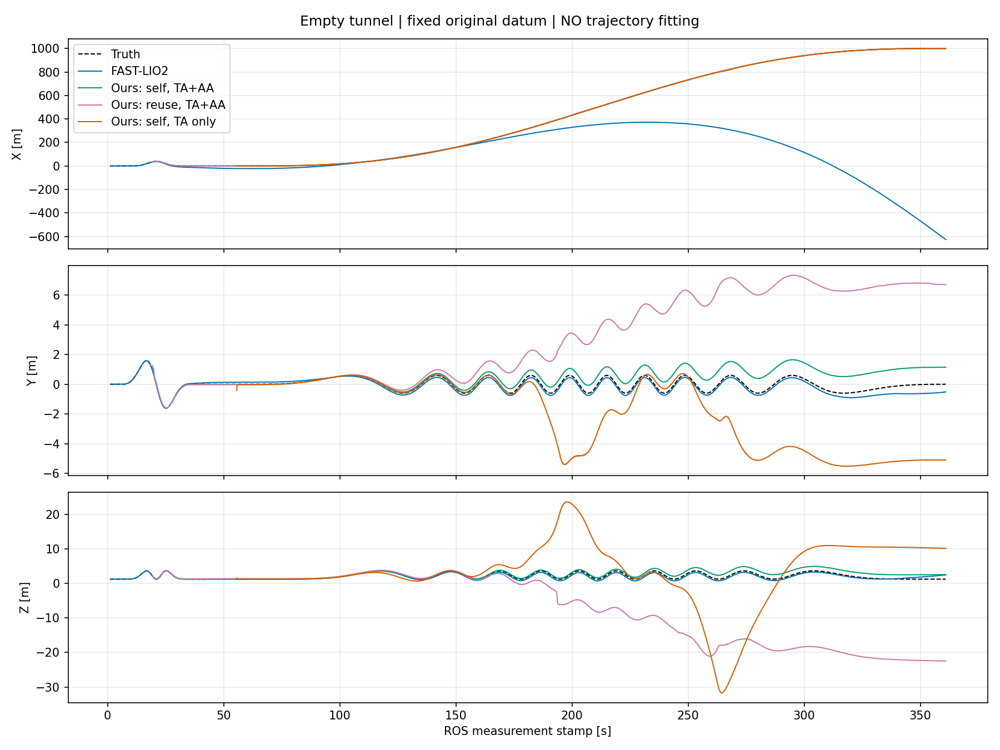
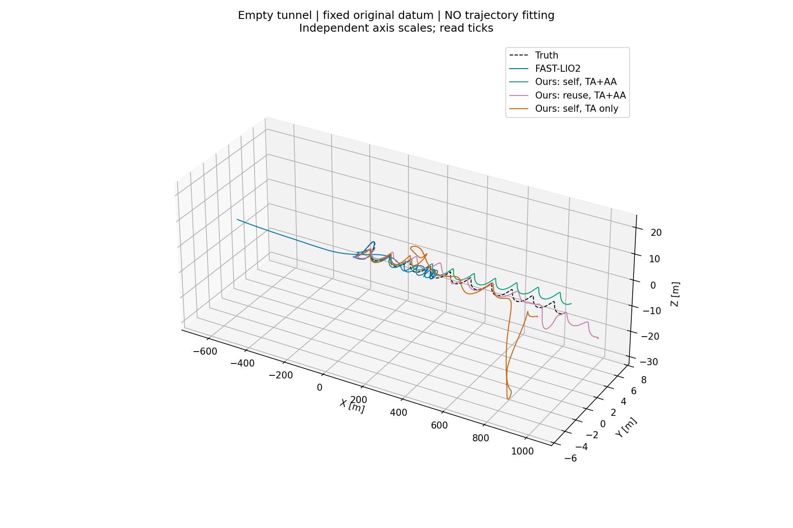
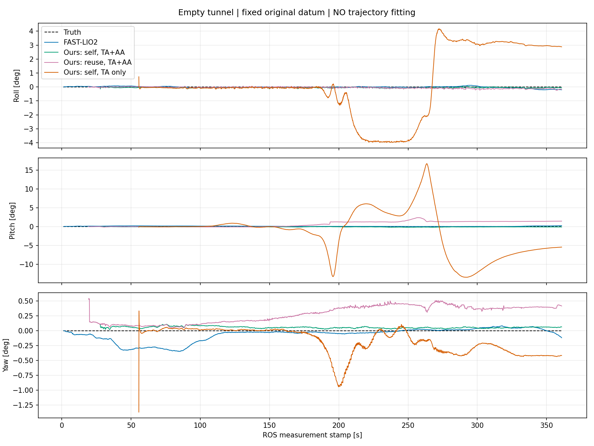
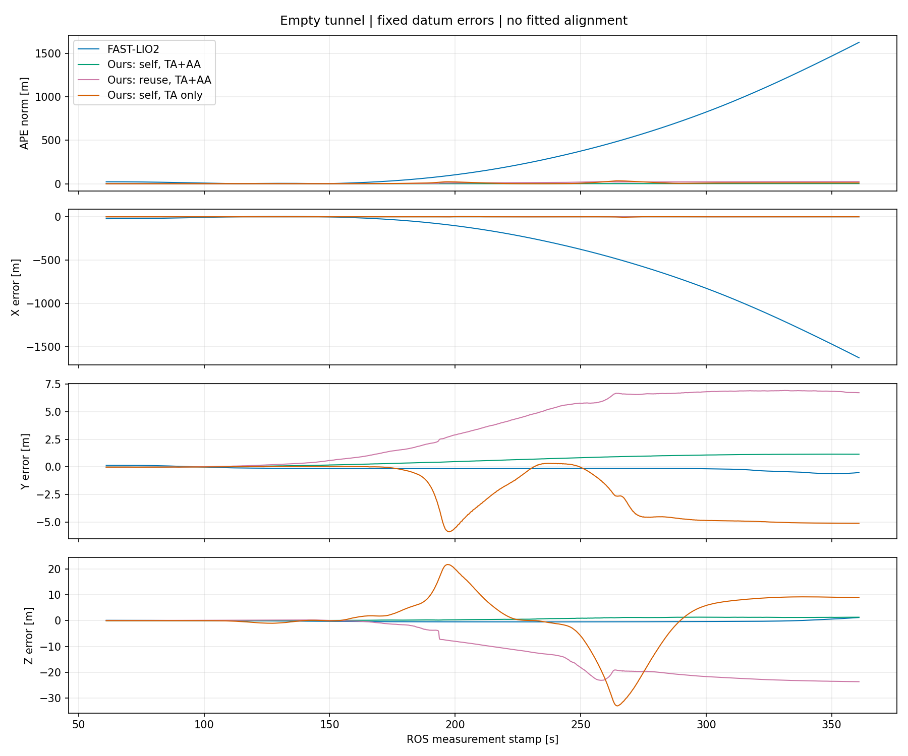

# TA 为基础、AA 可选：默认关闭及空隧道配对验证

已将 `uwb.use_aa` 改为**默认 false**，允许显式 true 启用 AA。TA、LiDAR、IMU 紧耦合保持不变。本轮复用旧 FAST-LIO 和两组 TA+AA 成绩，没有重新运行其他方法。

**结果：开关已生效，但这份输入下 TA-only 没有改善定位。** 无图 TA-only 的 APE RMSE 为 **10.030 m**，3,054 帧输出全部为 LOST；有图 TA-only 在 20 s 初始化预算内未能确认分支，零轨迹，APE 不可计算。没有调参重试算法或放宽验收门槛。

## 配置语义

在现有完整配置的 `uwb` 对象中设置：

```json
"use_aa": false
```

- 缺省字段也按 false 处理；只接受 JSON 布尔值，`"false"` 字符串会拒绝。所有项目主配置显式关闭。
- 设为 true 时保留原有 AA 因子、跨帧统计摘要及初始化/扩图用途。该开关不关闭 TA，也不改变噪声、外参、优化参数或点云路径。
- 本开关控制**新 AA 观测是否进入估计器**，不是射频调度开关。仿真仍发布/记录原始 AA，因此新旧方法可读取完全相同的原始包，通信时隙也未重分配。AA 关闭时，有效 AA 经过字段/会话/去重校验后记录 `AA_ABLATION_DISABLED`，不进入初始化缓存、扩图、摘要或图，也不因端点尚未初始化而影响定位健康判定。
- 关闭当前 AA 无法移除历史地图先验已经吸收的信息。新地图记录 `uwb_information.use_aa` 和 `accepted_aa_measurements`；旧地图缺少字段时视为来源未知，不能声称 TA-only。本轮有图使用独立 TA-only 首次地图，**没有继承旧 TA+AA 地图**。
- 旧版省略 `use_aa` 时默认开启；用新版复现旧实验必须显式 true。历史运行快照及报告未改写。

## 输入、地图及评估口径

评测输入仍为 [20261023T034937Z_071](../log/20261023T034937Z_071)：seed 1，空矩形隧道、入口启动、原 360 s 三维运动。原始 MCAP SHA-256：`40cdd3f6bd2391d93ea89636137bbb9df1f47f804914ef986c4bb10f788210f1`。新旧所有评测 run 记录中的源文件哈希相同；有图 TA-only 初始化失败，只消费了前缀，不声称其处理了完整路线。

TA-only 首次地图来自独立 seed 0 [20261023T061415Z_161](../log/20261023T061415Z_161)，同一空隧道、起点 `(0,0,1.2,0)` 和 360 s 路线。旧 seed 0 没有完整 MCAP，因此按相同参数生成一次并录包；核对 IMU/点云语义哈希一致，26,114 条 UWB 的 sequence、stamp、端点、真实距离、测量距离和方差逐条一致，仅会话身份不同，见 [首次输入核对](../log/aa-optional-calibration-input-check.json)。不声称两份包字节哈希相同。

新地图仅初始化 3 站，接受 AA 数为 0，仍为 provisional；首次运行位置 RMSE 约 3.839 m，主要是高度误差，并非可靠地图。地图 SHA-256：`1d3cb987a4038d693c973bdbd3dbc71c7aba6bc88d439d25ba9e95b4a77ccad6`。本轮有图对照同时关闭了首次建图和复用阶段 AA，不能据此单独量化两个阶段各自的作用。

配置与原实验比较，除 `use_aa` 和录包选项外逐项一致；新二进制增加了默认值、过滤/日志和不变量检查，因此不声称同二进制配对。已有实验也显示初始化存在可重复性问题，本轮单次结果不代表普遍收益或统计显著性。

APE 使用固定原始启动 datum，不拟合整条轨迹、不按首输出姿态校正、不缩放。主窗口 ROS stamp 61–360.9 s，0.1 s 网格，时间容差 0.051 s。四个有完整输出的方法共同有效样本 **3000/3000**；失败组明确 N/A，不把缺失当零误差，不删除 LOST 点。XYZ 指隧道轴向、横向、高度。

| 方法 | APE RMSE (m) | X RMSE (m) | Y RMSE (m) | Z RMSE (m) | APE P95 (m) | 最大 APE (m) |
|---|---:|---:|---:|---:|---:|---:|
| FAST-LIO（旧结果） | 613.528 | 613.528 | 0.230 | 0.386 | 1409.829 | 1626.275 |
| 本方法无图 TA+AA（旧结果） | 1.074 | 0.015 | 0.712 | 0.804 | 1.718 | 1.755 |
| 本方法有图 TA+AA（旧结果） | 14.956 | 0.134 | 4.510 | 14.259 | 24.445 | 24.624 |
| 本方法无图 TA-only（新增） | 10.030 | 0.785 | 3.019 | 9.532 | 22.502 | 33.288 |
| 本方法有图 TA-only（新增） | N/A：初始化失败 | — | — | — | — | — |

| 方法 | 输出帧数 | 首输出 stamp (s) | 主窗口覆盖率 | 输出状态计数 |
|---|---:|---:|---:|---|
| FAST-LIO（旧结果） | 3596 | 1.4 | 100.0% | {'not_published': 3596} |
| 本方法无图 TA+AA（旧结果） | 3332 | 27.8 | 100.0% | {'LOST': 29, 'DEGRADED': 3303} |
| 本方法有图 TA+AA（旧结果） | 3416 | 19.4 | 100.0% | {'DEGRADED': 3271, 'LOST': 145} |
| 本方法无图 TA-only（新增） | 3054 | 55.6 | 100.0% | {'LOST': 3054} |
| 本方法有图 TA-only（新增） | 0 | — | 0.0% | 无轨迹，初始化超时后 LOST |

FAST-LIO 的 `not_published` 表示没有发布同类健康状态，不是 TRACKING。生命周期 completed 或基础运行检查 PASS 均不等于定位有效。

## 图形对比

图中有 FAST-LIO、旧 TA+AA 无图/有图、新 TA-only 无图及真值。**TA-only 有图零输出，没有虚构它的轨迹。** 原始波浪运动仍是预设路线，不是新增算法振荡；新 TA-only 的大幅偏离和跳变则属于估计失效。





三维图坐标轴采用独立显示比例，需结合刻度，不是等比例空间形状。



RPY 为 body 到固定评估坐标的姿态，`R=Rz(yaw)Ry(pitch)Rx(roll)`，单位度，角度换支展开，无平滑。



## AA 关闭的实际检查

| 检查 | 无图 TA-only | 有图 TA-only |
|---|---:|---:|
| 接受 AA 数 | 0 | 0 |
| 记录为关闭的 AA 数 | 2160 | 120 |
| 接受/构造 TA 测量数 | 18874 | 1155（初始化候选阶段） |
| 运行期图记录数 | 3054 | 0（未初始化成功） |
| AA 因子/摘要/累计数最大值 | 0 / 0 / 0 | 无运行期图，不能仅凭空记录宣称验证 |
| 继承地图中的 AA | 无输入地图 | 明确 use_aa=false，accepted_aa=0 |

独立首次 TA-only 地图已核对全部 3064 条图记录，AA 因子、摘要和累计数均为零，接受 AA 数为零；见[地图审计](aa_optional_map_audit.json)。默认 false、显式 true/false 及错误类型拒绝已通过配置测试；AA 因子与地图相关测试保留通过。不以这些检查代替精度或初始化验收。

## 保留的失败与限制

- 无图 TA-only 全程输出 LOST，主要横向/高度漂移；不能因为比已经轴向发散的 FAST-LIO 数字小就说有效。其 61–360.9 s RMSE 10.030 m 与全输出时段 9.941 m 窗口不同，不混用。
- 有图第一次尝试 [20261023T062657Z_302](../log/20261023T062657Z_302/runtime/simulation_console.log) 在首条 `/clock` 发布超过 250 ms，尚无 IMU/点云/UWB/里程计。保留此基础设施失败，原配置、输入、地图和门槛完全不变，仅重试一次。
- 第二次 [20261023T062815Z_413](../log/20261023T062815Z_413/runtime/odometry_console.log) 正常进入初始化，但 20 s 预算内未认证位置分支，报 `INITIALIZATION_AMBIGUOUS_TIMEOUT` 并退出。未增加预算、替换地图或强行选择分支，也没有再次重跑。
- 此次数据支持“AA 关闭开关正确生效”，不支持“关闭 AA 会提高精度”。TA-only 的初始化和运行稳定性仍有限；AA 作为可选能力保留，本轮没有为得到好结果修改其余参数。

## 复现和产物

- FAST-LIO（旧结果）：[run](../log/20261023T040819Z_553)、[轨迹](../log/20261023T040819Z_553/export/odometry/trajectory.csv)。
- 本方法无图 TA+AA（旧结果）：[run](../log/20261023T035548Z_992)、[轨迹](../log/20261023T035548Z_992/export/odometry/trajectory.csv)。
- 本方法有图 TA+AA（旧结果）：[run](../log/20261023T040208Z_950)、[轨迹](../log/20261023T040208Z_950/export/odometry/trajectory.csv)。
- 本方法无图 TA-only（新增）：[run](../log/20261023T062039Z_641)、[轨迹](../log/20261023T062039Z_641/export/odometry/trajectory.csv)。
- 本方法有图 TA-only（新增）：[run](../log/20261023T062815Z_413)、[轨迹](../log/20261023T062815Z_413/export/odometry/trajectory.csv)。

- [指标与开关审计 JSON](aa_optional_results.json)、[冻结协议及重试记录](aa_optional_comparison_protocol.md)。
- [构建](../log/aa-optional-build-final.txt)、[21 项 UWB/配置 + 2 项地图测试](../log/aa-optional-tests.txt)。
- [首次地图](../log/20261023T061415Z_161/export/map/calibrated_map.json)、[上一轮对比报告](empty_tunnel_comparison.md)。

```bash
cd /home/dev/code/ws_tunnel/src/liuo_tunnel
export LIUO_RUN_ROOT="$PWD/log"
# 当前两个正式配置均为 use_aa=false
./tools/run.sh --replay log/20261023T034937Z_071 \
  --config packages/liuo_tunnel/config/phase3_self_calibrate.json \
  --installation packages/liuo_tunnel/config/installation/straight_simulated.json --formal --wall-timeout 600
./tools/run.sh --replay log/20261023T034937Z_071 \
  --config packages/liuo_tunnel/config/phase3_reuse_map.json \
  --map log/20261023T061415Z_161/export/map/calibrated_map.json --formal --wall-timeout 600
# 只重新评估和画图，不重跑任何定位方法
python3 tools/baselines/evaluate_empty.py --runs tools/baselines/aa_optional_runs.json --prefix aa_optional
```

实现提交 `73d5f31`，开关审计提交 `a699598`，失败/有限重试记录 `cb25fb3`。实际源码及二进制身份以各 run manifest 为准。所有定位进程已由各自运行器收尾，原有结果未覆盖，未将任何阶段标记为完成。
