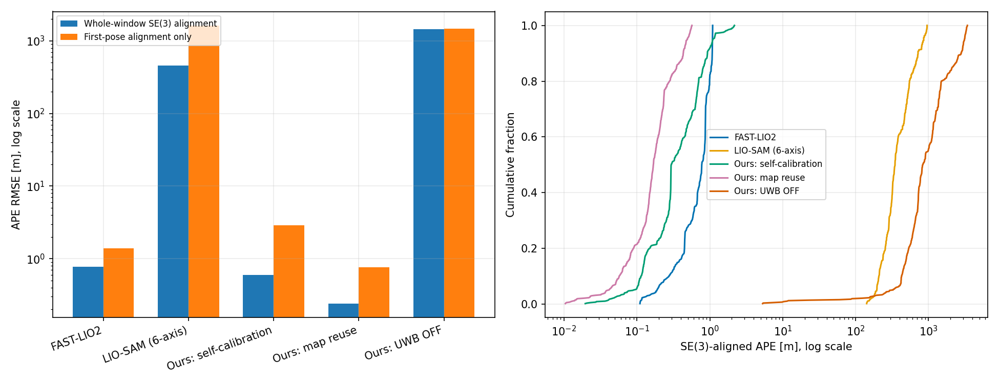
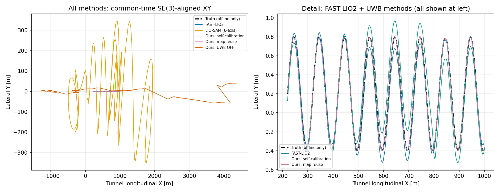
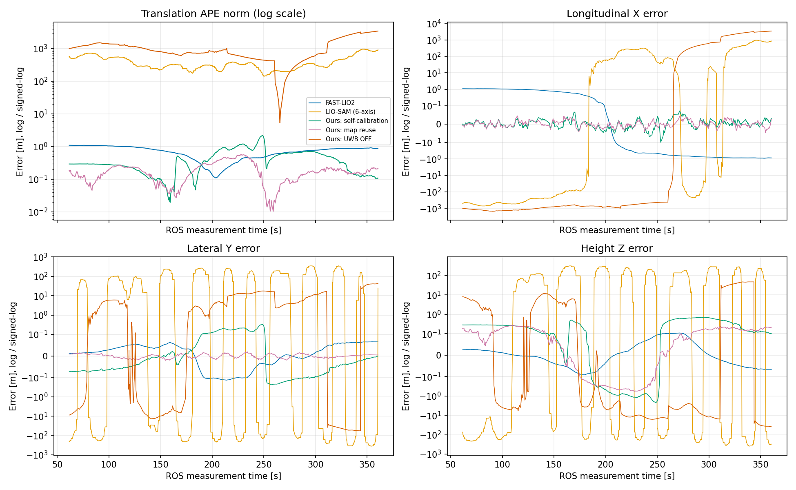
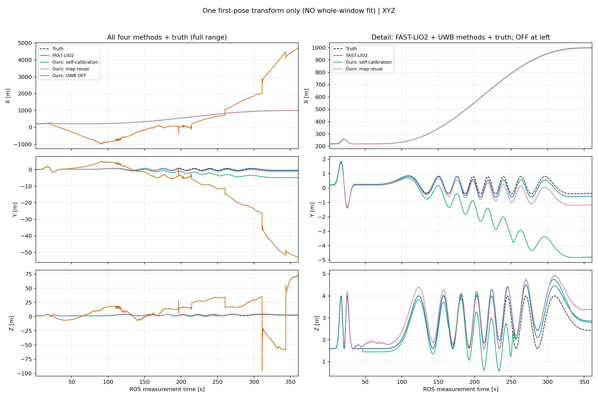
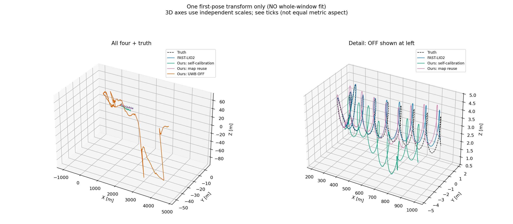
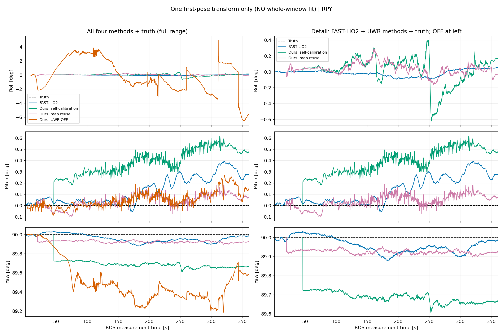
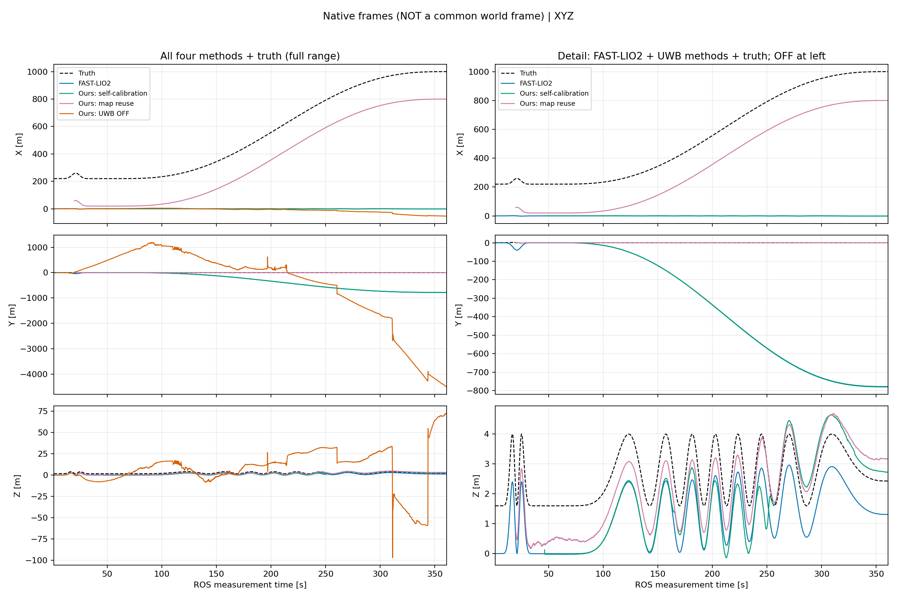
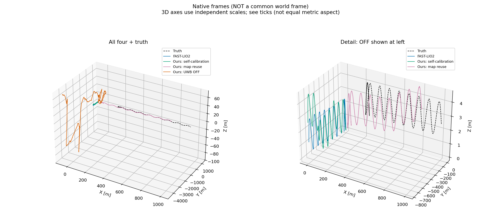
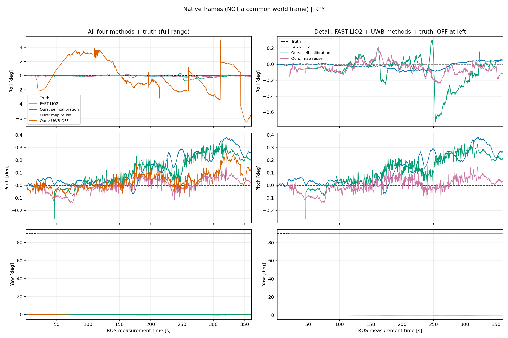

# 轨道隧道仿真：五种配置的 APE 实测对比

本报告比较 FAST-LIO2、LIO-SAM、本方法无图联合自标定、本方法有图复用和本方法关闭 UWB。这是**单个固定种子、snapshot 仿真、指定适配配置**的结果，不是算法普遍排名或部署认证。外部算法不使用 UWB；本方法无图/有图两组使用原始 UWB 紧耦合，OFF 组只用 LiDAR+IMU。

在以下共同样本和 SE(3) 对齐口径下，最低平移 APE RMSE 为 **本方法 · 有图/UWB 复用：0.241 m**。请同时看固定首姿态对齐、分轴误差及输出覆盖，不能只看单个最优数字。

## 1. 输入与公平性边界

- 评测原始输入：`log/20261022T161447Z_132`，seed 1，360 s，真实运行起点 (220,0.2,1.6) m / yaw π/2，仅供仿真与离线评估说明，不进入估计器。40 线 × 512 水平射线、40 m LiDAR 量程、10 Hz 点云、200 Hz 六轴 IMU；点云为 snapshot，无滚动扫描验证。
- 有图组地图来自独立 seed 0 首次标定 `log/20261022T160635Z_994`，没有用 seed 1 的评测输入先建地图。这里的“有图”是 UWB 基站/安装参考的相关后验，**不是稠密点云地图重定位**。
- 外部两组发布的 LiDAR/IMU 数量相等；冻结原始文件、实际执行的转换器代码一致，分别重建的**规范化消息 SHA-256 相等**。原始 CDR 字节哈希曾不一致，已复现原因是未定义的对齐填充字节，原差异保留；不能把字节哈希不一致直接当作相同。此处是发布侧确定性重建核对，不是接收侧录包证明；算法内部丢帧/节流体现为输出覆盖率。未发布真值、UWB 或 GPS。完整审计、原始哈希与对齐矩阵见 [机器可读结果](ape_five_method_results.json)。
- FAST-LIO2 保留 CPU 原生后端；本方法使用 GPU 原始因子路径；LIO-SAM 使用 CPU、关闭 GPS/回环。本文不以不同后端的耗时作速度排名。
- LIO-SAM 原接口要求姿态，本次明确是**六轴适配版**：静止段比力初始化 roll/pitch、局部 yaw=0、随后陀螺积分，原始 gyro/acc 不改；不使用真值姿态。关闭独立航向初始化及持续 RPY 融合权重。不能把该结果当作带九轴姿态传感器的原版成绩。
- FAST-LIO2 对全零点时间默认会重建扫描时间，本次显式 snapshot 补丁关闭这种行为及等时点云去畸变；绝不伪造滚动扫描。ring 来自已知雷达射线角度，与隧道几何先验无关。详见 [冻结协议、补丁和来源](../tools/baselines/README.md)。

## 2. APE 定义

所有输出先转换到同一物理 **IMU/body 原点**。预声明主窗口为 ROS stamp 61–360.9 s，避开启动阶段但启动耗时仍单列。按 0.1 s 网格找最近输出，最大时间差 0.051 s；不跨断档插值，不删除大误差点。五组中有可评估轨迹的组采用共同有效时刻，共 **571/3000 个网格点（19.0%）**。真值在各自测量时间插值；只用于此离线步骤。

主结果采用每组一次全窗口 SE(3) 刚体最小二乘对齐，**不拟合尺度**：`APE_i = ||R p_est,i + t - p_gt,i||`，`RMSE = sqrt(mean(APE_i²))`。该对齐可以消除坐标规范差异，也会吸收部分整体姿态/位置漂移，因此同时报告仅用首个输出姿态建立坐标关联的 APE。分轴指仿真世界的隧道轴向 X、横向 Y、高度 Z。姿态 RMSE 是同一 SE(3) 对齐后的 SO(3) 角误差，不是位置 APE。

## 3. APE 精度表

单位：m；所有主表数字基于相同的共同时间集合。

| 配置 | APE RMSE | 均值 | 中位数 | P95 | 最大值 | 仅首姿态对齐 RMSE |
|---|---:|---:|---:|---:|---:|---:|
| FAST-LIO2 · snapshot 适配 | 0.771 | 0.716 | 0.775 | 1.086 | 1.093 | 1.399 |
| LIO-SAM · 六轴适配 | 460.709 | 415.241 | 346.513 | 857.477 | 953.821 | 1630.861 |
| 本方法 · 无图/UWB 自标定 | 0.599 | 0.466 | 0.296 | 1.098 | 2.174 | 2.906 |
| 本方法 · 有图/UWB 复用 | 0.241 | 0.201 | 0.168 | 0.492 | 0.568 | 0.761 |
| 本方法 · LiDAR+IMU / UWB OFF | 1438.571 | 1170.870 | 838.262 | 3109.819 | 3408.098 | 1470.321 |



全程 SE(3) 对齐后的低误差不等于已知世界坐标下的绝对定位精度；尤其不能据此宣称 UWB 地图高度已可靠。固定首姿态对齐也不是给估计器增加先验，它仅是离线选择坐标规范。

| 配置 | 轴向 X RMSE (m) | 横向 Y RMSE (m) | 高度 Z RMSE (m) | 姿态 RMSE (deg) |
|---|---:|---:|---:|---:|
| FAST-LIO2 · snapshot 适配 | 0.766 | 0.062 | 0.052 | 0.635 |
| LIO-SAM · 六轴适配 | 394.985 | 164.986 | 170.350 | 111.961 |
| 本方法 · 无图/UWB 自标定 | 0.023 | 0.115 | 0.587 | 0.333 |
| 本方法 · 有图/UWB 复用 | 0.017 | 0.009 | 0.240 | 0.587 |
| 本方法 · LiDAR+IMU / UWB OFF | 1438.312 | 20.439 | 18.094 | 130.570 |

**本次结果的具体含义：**

- 三个纯 LIO 配置中，FAST-LIO2 是本次最可靠的精度基线；LIO-SAM 六轴适配版与本方法 OFF 均发生明显发散，表中的数百/上千米是失败轨迹误差，不是有效工作的名义精度。
- UWB 两组的轴向误差较 FAST-LIO2 小，但其高度误差更大：不能概括成“所有方向都更好”。无图组仅首姿态对齐 RMSE 也比 FAST-LIO2 大，不能只拿全窗口对齐后的较低数字宣称全面胜出。
- 无图组原始输出包含 **167 帧 LOST**、**2980 帧 DEGRADED**。它完成了回放，但这次新起点下不能宣称始终健康。
- 有图组的 0.241 m 是去掉整体坐标差异后的轨迹形状精度。其已有固定地图坐标评估记录的全输出位置 RMSE 为 1.036 m，高度 RMSE 为 1.034 m；详见 [原运行评估](../log/20261022T162059Z_880/export/analysis/report.json)。两者的对齐方式和采样范围不同，不能互换。

## 4. 轨迹与误差随时间变化



左图保留全部方法的尺度；右图只放大 FAST-LIO2 与本方法两个 UWB 组，以便查看细节，LIO-SAM 与 OFF 仍完整保留在左图及全部指标中。坐标为离线对齐后的世界坐标。



APE 范数采用对数纵轴，以同时保留小误差和大漂移；分轴曲线采用保留正负号的对称对数轴（±0.1 m 内为线性）。长直、重复纹理的隧道存在几何弱约束，单独的“比 OFF 好”并不能证明部署有效性。

## 4.1 新增：XYZ、三维轨迹与 RPY 对比

以下图仅包含 **FAST-LIO2、本方法无图/UWB 自标定、本方法有图/UWB 复用、本方法 UWB OFF，以及真值**，不包含 LIO-SAM。使用各组完整原始输出时刻，从启动到结束，不受前述五组共同采样集合限制；没有估计输出的启动区间留空，超过 0.25 s 的输出断档不连线。全部为 IMU/body 原点。

**坐标处理：新增主图不使用全程轨迹拟合。** 每组仅在其首个有效输出时刻用真值确定一个固定刚体变换，随后对所有位置和姿态应用同一个变换。该操作仅供离线可视化，消除各自局部坐标系的原点和朝向差异；它会消除首帧误差，因此不能用于判断地图的绝对定位偏差，也不能称作“未经对齐”。各组开始时刻不同，图中保留这一差别。[固定变换、输入哈希与起始时刻](pose_four_plot_provenance.json) 可追溯。后附未经变换的原始输出，不把不同局部坐标直接当作同一世界坐标。

APE 是对应时刻的绝对位姿误差；**是否先做坐标关联是评测口径，而不是 APE 定义要求必须全程拟合**。已在相同坐标系中的轨迹可以直接计算 APE。RPE 比较两个时刻之间的相对运动，同一个世界坐标刚体变换会在相对位姿中消去，也不要求全程拟合。前述历史 SE(3) 拟合结果保留，但只代表该对齐口径下的误差。

### 固定首姿态坐标关联：观察后续漂移







左列完整显示全部四种方法及真值；右列放大 FAST-LIO2 和两个 UWB 组，OFF 的失败轨迹仍保留在左列。XYZ 使用线性轴；三维图各轴独立缩放以显示细节，**不是等比例空间形状**，须结合刻度阅读。没有裁掉大误差来伪装稳定。

RPY 单位为度，采用 `R = Rz(yaw) Ry(pitch) Rx(roll)`（SciPy 外禀 `xyz`）分解，表示 body 到对应绘图坐标系的朝向。角度采用主值，跨 ±180° 换支处断线；欧拉角本身有奇异性，不能把换支当作真实姿态突变。这些是姿态曲线，不是姿态误差曲线；首姿态图中的姿态与位置采用同一固定旋转。

### 原始输出：不施加任何轨迹坐标变换

以下真值属于仿真世界坐标，各算法输出属于自身坐标系，**数值不重合不等于定位误差**；提供这些图用于检查原始输出，不用于跨坐标系计算 APE。







复现新增六张图（只读已有轨迹，不重跑估计器）：

```bash
python3 tools/baselines/plot_pose_comparison.py
```

## 5. 输出完整性与失败记录

| 配置 | 总输出数 | 首/末输出 stamp (s) | 主窗口自身覆盖率 | 最大相邻输出间隔 (s) | run 生命周期 |
|---|---:|---|---:|---:|---|
| FAST-LIO2 · snapshot 适配 | 3596 | 1.400 / 360.900 | 100.0% | 0.100 | completed |
| LIO-SAM · 六轴适配 | 707 | 1.500 / 360.500 | 19.0% | 4.000 | completed |
| 本方法 · 无图/UWB 自标定 | 3147 | 46.300 / 360.900 | 100.0% | 0.100 | completed |
| 本方法 · 有图/UWB 复用 | 3412 | 19.800 / 360.900 | 100.0% | 0.100 | completed |
| 本方法 · LiDAR+IMU / UWB OFF | 3579 | 3.100 / 360.900 | 100.0% | 0.100 | completed |

`completed` 只代表输入回放和进程收尾完成，不表示定位健康或精度合格。N/A 表示缺少足够轨迹，不能按零误差处理。各组自身窗口指标与共同采样指标均在 JSON 中保留；稀疏输出会缩小共同集合，必须结合覆盖率阅读排名。

LIO-SAM 日志记录 **167 次速度过大重置**、**0 次偏置过大重置**。这些失效迹象保留在评价中，未因重新输出轨迹而清除。本方法状态计数见 JSON；DEGRADED/LOST 不改写成 TRACKING。若轨迹没有覆盖到至少 stamp 360 s，不进入全程主表，也不让其早期前缀缩短其余方法的评测路线。

共同采样被 LIO-SAM 的稀疏输出限制在 19.0%。为检查采样影响，下表保持主表的同一对齐矩阵不变，纳入每组在整个预声明窗口内的所有有效网格点。这是补充诊断，样本数不同，不替代主表的同时间对照。

| 配置 | 自身窗口样本数 | 同一对齐矩阵下 APE RMSE (m) |
|---|---:|---:|
| FAST-LIO2 · snapshot 适配 | 3000 | 0.765 |
| LIO-SAM · 六轴适配 | 571 | 460.709 |
| 本方法 · 无图/UWB 自标定 | 3000 | 0.567 |
| 本方法 · 有图/UWB 复用 | 3000 | 0.225 |
| 本方法 · LiDAR+IMU / UWB OFF | 3000 | 1350.313 |

## 6. 可追溯运行与复现

| 配置 | 实际 run | 轨迹 SHA-256 |
|---|---|---|
| FAST-LIO2 · snapshot 适配 | [log/20261023T021753Z_515](../log/20261023T021753Z_515/export/odometry/trajectory.csv) | `c4a03b9b63854150b471a6845de972e8053d622e71fc957218d29029d3041d50` |
| LIO-SAM · 六轴适配 | [log/20261023T022435Z_656](../log/20261023T022435Z_656/export/odometry/trajectory.csv) | `ea1d3612c14586f960641b642f8344b76ce08c8c1af9da02ddaf6cec3118576c` |
| 本方法 · 无图/UWB 自标定 | [log/20261023T023211Z_731](../log/20261023T023211Z_731/export/odometry/trajectory.csv) | `d56626e22eb5ab9b76ba0824304f1d9d35dfbdb43f1d7b9ffcd65519d188c5c7` |
| 本方法 · 有图/UWB 复用 | [log/20261022T162059Z_880](../log/20261022T162059Z_880/export/odometry/trajectory.csv) | `43e25bf608be16b90aee0b17aeb795ede5e72f32d768bb17778fb7eb2d83fbba` |
| 本方法 · LiDAR+IMU / UWB OFF | [log/20261022T161447Z_132](../log/20261022T161447Z_132/export/odometry/trajectory.csv) | `d903f3e84b222d08020bd58a7312bf7a4ab4a1cea544802073b3cf32c130745e` |

运行命令、固定源码提交、配置和全部适配说明见 [对比工具说明](../tools/baselines/README.md)。运行目录中的 `metadata/manifests/` 保存输入/二进制身份，`runtime/` 保存控制台日志，`export/odometry/trajectory.csv` 为原始估计轨迹；所有失败尝试保留，未替换成成功结果。

运行平台为 ROS 2 Jazzy / GTSAM 4.3a0。FAST-LIO2、LIO-SAM 的固定参数分别见 [FAST-LIO 配置](../tools/baselines/config/fastlio.yaml)、[LIO-SAM 配置](../tools/baselines/config/liosam.yaml)。FAST-LIO 原生的编译期源码目录 debug 文本已额外归档到该 run 的 `runtime/fastlio_native_debug/`，不用于轨迹评分。

| 验证 | 结果与证据 |
|---|---|
| 干净 ROS underlay 下重建外部三包 | PASS，[构建日志](../log/baseline-clean-reproduction-build.txt) |
| 重建的五个外部可执行文件与实际运行的 SHA-256 一致 | PASS，[二进制复核](../log/baseline-clean-build-binary-check.json) |
| 适配不改变点坐标/强度/零时间与原始 IMU 数值 | PASS，[针对性测试](../log/baseline-adapter-tests-final.txt) |
| 刚体 APE 不拟合尺度，不跨输出断档插值 | PASS，[评估测试](../log/baseline-ape-tests-final.txt) |
| 外部两组规范化输入重建一致 | PASS（发布侧重建），[完整审计](../log/baseline-canonical-input-audit.txt) |
| 本方法 OFF 的 3,580 条图记录没有 UWB / 基站 / 地图因子 | PASS，[因子检查](../log/baseline-off-factor-check.json) |

```bash
python3 tools/baselines/evaluate_ape.py --runs tools/baselines/runs.json
```

## 7. 能说明什么、不能说明什么

本报告仅说明这份冻结仿真输入、这些参数与适配条件下的实测差异。无图自标定和地图复用使用额外的 UWB 信息，因此不是三种纯 LIO 算法之间的同信息比较；纯 LIO 应只比较 FAST-LIO2、LIO-SAM 六轴适配版和本方法 OFF。原有本方法 DEGRADED/LOST、地图 provisional、协方差过度自信及高度限制不会被 APE 对齐或本报告覆盖。

未覆盖多种子统计、真实 Mid-360、rolling/去畸变、磁航向 IMU、完整飞行运动、断流故障矩阵或部署认证。没有按这份真值反复搜索参数；两套外部算法的短程 smoke 仅用于接口与生命周期检查，不作为主精度表数据。
