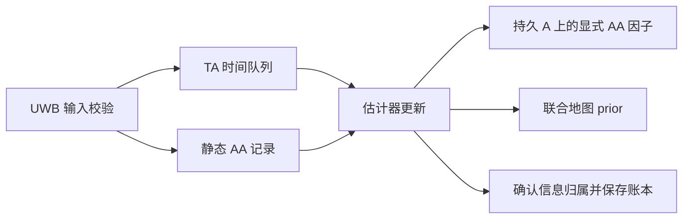

# 曲线隧道与静态 Anchor–Anchor 测距图设计

日期：2026-10-27。状态：**设计建议，尚未实施或验证**。

依据：用户关于曲线道路隧道、低频 AA、逐步获取静态地图和保持算法简洁的讨论，以及 `b86933c` 的代码审计。本文只记录设计；不修改算法，不启动 Goal，不运行 LIUO 或 FAST-LIO2。工作区已有的场景制作文件不在本次修改范围内。

关联：[场景制作需求](road_tunnel_7km_scene_requirements.md)、[部署与初始化合同](spec/deployment_initialization_contract.md)、[现有 UWB 接口](../../nlink_parser_uwb/docs/liuo_integration_contract.md)。

## 1. 设计结论

1. **算法的数学核心不是直线隧道专用，但当前完整自标定流程有直线假设。** LiDAR、IMU 和三维 TA/AA 距离因子可以保留；未知 Anchor 初始化、安装/墙面约束和地图格式需要适配。新场景的 rolling LiDAR 还需要独立的时序与去畸变适配。
2. **AA 适合成为逐步获取、长期缓存、按需更新的静态测距地图。** 这张地图记录带不确定度的边长观测，允许 Anchor 坐标未知；它不同于估计出的 Anchor 坐标地图。
3. **当前已经有“一条静态边一个累计因子”的基础。** 优先补齐静态输入与车辆时间窗的解耦、跨运行的物理观测身份、地图已吸收信息记录，不重写 AA 残差。
4. **首版最多保留 18 个、具备初始化条件后加入的持久 Anchor 变量，以及全部有效 AA 边记录。** 滑动窗口只淘汰旧车辆状态；暂不引入分布式优化、Anchor 子图裁剪或全局道路样条状态。
5. **不要求 AA 子图单独解决全部定位问题。** 先区分 AA 自身刚性和 LiDAR/IMU/TA/AA 联合可观性；真实布局做不到的几何信息，缓存和增加广播次数都不能补出来。
6. **已知宽度与贴墙偏距仍有意义，但不等于已知曲线。** 先解除对全局直线的强制依赖，必要时再加入有真实局部观测与正确关联支持的几何约束。

## 2. 当前代码究竟做了什么

以下是代码行为，不是本次运行测试的结果。行号对应审计版本。

| 部分 | 当前行为与限制 | 代码依据 |
|---|---|---|
| TA 与 AA 因子 | TA 连接车辆位姿及 Anchor；AA 仅连接两个三维 Anchor。二者均使用欧氏距离，无直线轴假设 | [range_factors.hpp](../packages/liuo_tunnel/include/liuo_tunnel/uwb/range_factors.hpp#L65)，65、153 行 |
| LiDAR/IMU | 使用 GPU VGICP 与 IMU 预积分；不要求共享直线轴 | [node.cpp](../packages/liuo_tunnel/apps/liuo_tunnel_node.cpp#L1279)，1279–1308 行 |
| 安装资料与因子 | 输入强制 `shared_straight_horizontal_axis`；所有相关 Anchor 使用同一个二维直线状态 `l(0)` | [installation_input.hpp](../packages/liuo_tunnel/include/liuo_tunnel/uwb/installation_input.hpp#L26)、[installation_factors.hpp](../packages/liuo_tunnel/include/liuo_tunnel/uwb/installation_factors.hpp#L28) |
| 未知 Anchor 启动 | 要求墙面观测、至少三个 Anchor；候选搜索依赖同一条直线，启动过程中加入直线安装因子 | [node.cpp](../packages/liuo_tunnel/apps/liuo_tunnel_node.cpp#L727)，727–804 行；[unknown_anchor_candidates.hpp](../packages/liuo_tunnel/include/liuo_tunnel/uwb/unknown_anchor_candidates.hpp#L34) |
| 墙面观测 | 拟合局部平行墙面，连续观测仍关联全局 `l(0)`；不能代表沿线变化的切向 | [body_wall_observation.hpp](../packages/liuo_tunnel/include/liuo_tunnel/uwb/body_wall_observation.hpp#L25)、[node.cpp](../packages/liuo_tunnel/apps/liuo_tunnel_node.cpp#L1319) |
| 标定地图 | 联合状态固定为 `A + L`，维数 `3N+2`，保留相关协方差 | [calibrated_map.hpp](../packages/liuo_tunnel/include/liuo_tunnel/uwb/calibrated_map.hpp#L12) |
| LiDAR 输入 | 当前只接受 snapshot，遇到非零逐点时间会拒绝 | [sensors.hpp](../packages/liuo_tunnel/include/liuo_tunnel/common/sensors.hpp#L13)、[node.cpp](../packages/liuo_tunnel/apps/liuo_tunnel_node.cpp#L1128) |
| UWB 接入 | 回调校验、去重、入队，估计器更新负责入图。每条无向 AA 边选本数据集首个可用 reporter，另一方向不再累计 | [observation_input.hpp](../packages/liuo_tunnel/include/liuo_tunnel/uwb/observation_input.hpp#L58)、[node.cpp](../packages/liuo_tunnel/apps/liuo_tunnel_node.cpp#L377) |
| AA 累计 | 每条边保存 `count/weight/mean/scatter`；新独立样本到来时移除旧摘要因子、加入新摘要因子，不无限增加因子数量 | [range_factors.hpp](../packages/liuo_tunnel/include/liuo_tunnel/uwb/range_factors.hpp#L131)、[node.cpp](../packages/liuo_tunnel/apps/liuo_tunnel_node.cpp#L1031)，1031–1074 行 |
| AA 跨窗口 | 全部已初始化 `A` 每次更新刷新时间戳，已加入的静态边不因车辆走远而丢失 | [node.cpp](../packages/liuo_tunnel/apps/liuo_tunnel_node.cpp#L1366)，1366–1370 行 |
| 迟到 AA | 普通 `append_ranges` 在区分 TA/AA 前统一执行车辆时间 bracket，旧 AA 可能被 `WINDOW_EXPIRED` 等拒绝；启动缓存对 AA 有豁免，入口行为不一致 | [node.cpp](../packages/liuo_tunnel/apps/liuo_tunnel_node.cpp#L980)，980–1026 行 |
| 重置与复用 | 重置清空 AA 摘要；导出联合后验与 AA 总数，复用不主动重放旧因子，但没有精确的已吸收物理观测集合 | [node.cpp](../packages/liuo_tunnel/apps/liuo_tunnel_node.cpp#L225)，225–274、670–719、1233 行 |

因此，“现在只能用在直线隧道”应准确理解为：**当前已实现和已验证的完整流程受直线模型与 snapshot 合同限制，而不是距离融合方法只能处理直线。** 仅关闭连续墙面约束并不能解除初始化中的直线依赖。

现有单数据集去重和独立高斯摘要机制有合理基础；本文指出的是新增长期缓存能力的缺口，不据此否定已有实验，也不宣称既有实验已发生重复计权。

## 3. 曲线隧道：保留什么，修改什么

### 3.1 已知宽度不等于已知道路地图

在用户确认的轴线重合、常规对称侧墙假设下，Anchor 的合法安装资料仍可给出有符号横向偏距 `d_i`。若局部轴线点为 `c(s_i)`、水平横向单位法向为 `n(s_i)`，关系可写成：

```text
n(s_i)ᵀ [A_i − c(s_i)] = d_i
```

这里表达的是约定断面中的横向投影，不能写成包含高度差的三维距离 `||A_i−c(s_i)||=|d_i|`。偏距应按实际侧墙安装带与天线相位中心定义；10.50 m 建筑限界宽度不能自动当作实际墙宽。

已知 `d_i` 没有给出 `c(s)`、`s_i`、局部切向、Anchor 高度或沿线顺序。即使宽度处处相同，仍有许多曲线满足要求。不能从模拟器读取半径、里程、控制点或编号顺序来补齐这些未知量。

“共享曲线轴”在几何上成立；**是否把它作为优化状态，是另一个问题**。先有可用观测与关联，再决定是否需要曲线模型，不能把名字中的 straight 改成 curve 就认为完成适配。

### 3.2 第一版建议：通用核心与初始化解耦

保留 `X/V/B/A`、GPU VGICP、IMU 和原始 TA/AA 距离似然。未知 Anchor 初始化改为利用当前估计轨迹和原始距离生成数值候选，再在联合图中估计；候选求解使用的轨迹仅是初始化依据，不能包装成独立、精确的外部位姿观测后重复入图。

允许暂缓初始化、保留镜像候选或报告高度弱约束。普通汽车运动近似平面，弯道增加方向变化，但不保证解决竖向退化；不能用固定高度、车道位置或模拟真值兜底。未知 Anchor 未准备好时，已具备条件的惯性/点云估计与静态边收集应能够继续，缓冲资源需要明确上限。

这是对现有启动流程的实质适配，**不是一个现成配置开关**。如果纯通用观测不足以支持某段自标定，应记录退化并继续积累合法信息，不能承诺关闭直线因子即可得到同等精度。

### 3.3 宽度/贴墙信息作为有条件的局部约束

后续若证据表明需要安装信息，优先使用已观测局部墙面或断面，并明确 Anchor 对应哪一段几何、有效范围与不确定度。数百米外 Anchor 不能套用车辆当前断面的切线；不能给每站放一条没有观测支持的自由轴，制造形式上为零的偏距残差。

局部直线近似也需有误差预算。例如半径 3000 m、从切点沿切向延伸约 40 m，曲线相对切线偏离约 `40²/(2×3000)=0.267 m`。这只是近似误差量级，不能直接套进当前厘米级墙面内点阈值。应按实际使用跨度限制近似、检查拟合残差；没有证据时不新增全局样条、固定曲率或强平滑先验。

保留墙面专用点与 VGICP 点的分离原则；点集分开只减少直接复用同一原始点，不证明共享位姿和地图误差完全独立。任何局部几何变量若参与估计，地图导出应保留其必要相关性。

### 3.4 高速与 rolling 是另一项必要适配

80 km/h、10 Hz 下，一帧内移动约 2.22 m。必须支持真实逐点时间、完整 IMU 覆盖、明确帧参考时刻及运动补偿，不能将点时间清零，也不能给算法输入真值去畸变点云。原 VGICP 的几何残差可以保留，但点云形成与使用流程需要适配。

TA 仍需正确测量时间及姿态/杆臂关联，并在新的速度、角速度下核查插值近似。AA 静态化不会解决 TA 或 LiDAR 的时间问题。FAST-LIO2 留作后续独立对照，不能用其运行成功替代 LIUO 的曲线或 AA 信息一致性验证。

## 4. 静态 AA 地图到底保存什么

必须区分以下对象：

| 对象 | 含义 | 是否带来新增信息 |
|---|---|---|
| 物理测距 | 某次真实 TWR/明确的独立测量块 | 在误差模型与独立性成立时可以 |
| 报文交付 | 同一测量被广播、重传、分包或转发 | 自身不增加 |
| 静态边记录 | 某安装时期内，某对 Anchor 的观测及摘要、来源、版本 | 用来保存和同步已有信息 |
| 坐标地图 | 联合优化得到的 Anchor 坐标后验 | 是已有信息的推断结果，不是新的测距 |

测量频率、广播频率、地图内容更新频率分别配置。AA 物理状态静止，支持少量有质量依据的测量后冻结记录，低频健康检查、发现时下载、缺失补发、版本变化时同步。TA 随车体运动，继续按高频传感器处理。

不能“只广播一次后永久不可获取”：首次进入区域的机器人仍需发现和获取机制。有请求能力时按缺失边/版本请求；否则低频公告及有界重复发送同一版本。重传多少次都不应增加观测权重。AA 测距链路与报告到车辆的链路分别验证，不向车辆直接注入全隧道真值图。

### 4.1 最少需要明确的身份

| 身份 | 作用 |
|---|---|
| `network + deployment_epoch` | 标识物理部署及“Anchor 未移动”的有效时期，不等同于 ROS 时钟或驱动启动编号 |
| 无向端点对 | 规范化一条边；ID 只作身份，不暗含位置或前后关系 |
| `measurement_id / block_id` | 标识原始物理样本或有确切覆盖定义的测量块，跨交付与驱动重启保持稳定 |
| `revision + covered_blocks` | 说明内容版本及其覆盖哪些物理信息；版本号增加不自动证明独立 |
| 原始来源与误差模型 | 测量方、采集时间/时间可信度、误差模型版本、独立性依据、有效状态 |

交付 ID 仍用于分包和重传审计，但不能取代物理测量身份。不同方向报告、不同机器人转发同一记录，均必须保留同一来源关系。当前“首个可用 reporter”策略可以保留为保守的单源选择；不能无依据地把反向报告再作为独立样本。按最小 ID 强制选源也可能造成报告不可达，不建议作为替代。

首版每条边可冻结一个有限测量块，避免维护无界原始样本列表。后续独立块需有可核验的覆盖关系；不能用距离值相等、内容 hash 相同或报文序号不同来判断是否同一次物理测量。

### 4.2 静态不等于精确，也不等于永远有效

当前 `GaussianRangeSummary` 对**同一不变预测量、独立高斯误差、已知方差**成立。令 `w_k=1/σ_k²`、`W=Σw_k`、`μ=Σw_k z_k/W`，则：

```text
Σ w_k [z_k − ||A_i−A_j||]²
  = W [μ − ||A_i−A_j||]² + Σ w_k [z_k−μ]²
```

因此可保留现有摘要与散布项，不必保存每条显式因子；这不适用于未经处理的相关样本、逐样本鲁棒核或变化的 Anchor 位置。

同一缓存值广播 1000 次仍是一次信息。静态链路的偏置、NLOS 和温漂也不会靠高频重复自动消失。仿真声明的独立噪声模型可以继续使用；现场需有校准支持的块级不确定度。只有明确存在固定误差项时才使用有依据的误差下限，不能一边声称独立高斯等价、一边任意截断方差。

不同块的样本集合不重叠，也不足以证明独立：共享天线标定、持续 NLOS 等可以使不同块甚至不同边相关。每边冻结一个块只限制反复累加，不能自动消除这些相关性。块应来自原始测距及其校准，不能从联合坐标后验反算一条“更准的距离”再作为新观测反馈入图。

第一版不新增每条边的偏置状态或复杂相关噪声模型。无法证明独立/有效的数据先留在诊断记录中；低频健康检查发现明显不一致时触发复核，不直接修改地图。Anchor 确实移动、替换或 ID 重用属于部署变化，必须开启新时期并处理受影响的 TA、AA、安装信息和坐标后验；单纯更新边长不能撤销旧地图里的位置与相关信息。

## 5. 邻接边选择与几何刚性

### 5.1 先确定需要哪一种保证

连通只表示存在路径，不保证形状确定。对于一般自由点构型，一阶刚性要求距离 Jacobian 的秩达到二维 `2n−3`、三维 `3n−6`；对应边数只是必要门槛。局部刚性不排除其他离散构型，几何接近退化时即使满秩也可能很不稳定。二维泛型全局刚性有三点连通与冗余刚性的刻画，不能直接当作三维充分条件。依据：[Aspnes 等，A theory of network localization，第 III 节](https://www.cs.yale.edu/homes/aspnes/papers/loc-tmc-final.pdf)。

这里的三维 AA 图有整体刚体变换自由度；联合惯性/点云问题的规范自由度与误差尺度另行处理，不能把两个问题的秩判据混用。已知横向偏距但轴线未知、安装高度未知，也不能直接把本任务宣布为已知平面上的二维定位。

### 5.2 对当前 18 站布局的推论

按约 400 m 间隔、800 m 上限粗略估计，若只可能连接相邻一跳和两跳，则最多：

```text
E_max = (18−1) + (18−2) = 33
自由三维一阶刚性所需边数至少 3×18−6 = 48
```

这说明该 AA 子图不能单独提供一般三维构型的一阶刚性。二维所需的 33 条也只是必要计数；一串三角形仍可能有翻折分支。800 m 是三维量程，坡度、安装位置和遮挡会让实际边集更小；上述 33 是条件性上界，不是已生成场景的实测结果。

弯道内首先可能遇到可见性问题。圆弧跨度约 400 m、半径 3000 m 时，弦与弧中部偏离量级为 `400²/(8×3000)≈6.7 m`，已与隧道半宽同量级。实际是否穿墙取决于内外壁端点与真实轮廓，必须逐边做三维 LOS 检查，不能因为量程允许便假设可测。

### 5.3 第一版不必复杂地“选最优几条边”

18 站最多只有 `18×17/2=153` 个无向端点对。每站保留所有合格的本地邻接记录，机器人逐步缓存实际收到的有效记录；先通过减少重复交付降负载，不为省几十条记录而裁掉有用几何。

若硬件确有限额，才基于可测性和几何贡献选择：保留跨侧、不同方向、跨越局部连接瓶颈及确有高度差的可靠边，避免只留最近同侧链。边数或每站度数本身不是保证；异常边不能为了凑刚性而保留。

若未来要求 **AA 单独恢复一般三维地图**，一种充分构造是从非共面的四点完整测距子图起步，每个新点连接到已确定子图中四个非共面的点；这只是理论充分构造，当前稀疏贴墙布置未必物理可达，也非最低边数方案。依据：[同一原始论文第 IV 节](https://www.cs.yale.edu/homes/aspnes/papers/loc-tmc-final.pdf)。不能把它简化成“每站随便连四站”。

本项目更合适的目标是评估**联合问题**：LiDAR/IMU 约束轨迹，TA 将轨迹与 Anchor 联系，AA 约束 Anchor 间相对形状，合法安装信息补充实际可观测方向。AA 子图不刚性不等于联合问题必然不可解；反过来也不能仅因有 LIO 就宣布全部 Anchor 可观。

后续诊断应分别报告 AA 图连通分量、刚性矩阵秩与非零奇异值，以及去除规范自由度、统一尺度后的联合问题弱方向/条件数和镜像分支。场景制作阶段可以离线用真值诊断部署，但结果不得成为定位器先验。本次不执行这些检查。

## 6. 滑动窗口如何保留旧边且不重复引入

### 6.1 因子依赖决定生命周期

```text
TA: r_ti = z_ti − ||p_tag(X(t)) − A_i||   → 依赖测量时刻的车辆状态
AA: r_ij = z_ij − ||A_i − A_j||          → 只依赖两个静态 Anchor
```

TA 必须关联合法车辆时间段；AA 在同一部署时期内不需要车辆位姿 bracket。晚收到的 AA 不能仅因测量时刻早于车辆窗口而失效，也不能把时间改成 now 伪装新样本。

当前接入同时校验时间可信度、噪声模型与 freshness。未来静态通道应把“是否需要同步车辆时钟”与“物理样本/部署有效性”分开：前者对 AA 可放宽，后者仍需证据。不能直接绕过当前校验，放行所有 unknown time 或 freshness=false 的数据。

### 6.2 已不可见的 Anchor 不必立即移出图

首版继续保留全部已初始化 `A`。这 18 个点只有 54 个位置自由度，先测资源再决定是否需要裁剪；固定车辆窗口并不意味着整张图的规模与地图大小无关。

消去旧 `X/V/B` 时，相关 TA/IMU/点云信息通过联合边缘先验保留；仅连接持久 `A` 的 AA 仍是显式非线性因子。车辆每次前进只更新必要的图状态，不重新插入缓存的旧边。

现有 [joint_marginalization.hpp](../packages/liuo_tunnel/include/liuo_tunnel/uwb/joint_marginalization.hpp#L13) 已区分触碰被消元变量的因子与未触碰的因子。未来保留这一规则。GTSAM 的更新与边缘化机制也将“新增/移除因子”和“消去变量”作为不同操作，参见 [官方 FixedLagSmoother 接口](https://gtsam.org/doxygen/4.0.0/a04343.html)。

### 6.3 一份物理信息只有一个计权位置

每个物理块的融合位置只允许是：待入图、显式因子、已吸收进联合地图之一。数据可以同时存在于日志和缓存，但不能同时在两个位置计权。

| 事件 | 正确动作 |
|---|---|
| 同一物理块重发、转发或驱动重启后再送达 | 幂等接收，不加权、不新增因子 |
| AA 端点尚未初始化 | 保存有界 pending 记录，待端点具备条件再加入 |
| 两端点存在，AA 早于车辆窗口 | 在部署与来源有效时接纳，不寻找旧车辆位姿 |
| 新块确实独立且覆盖不重叠 | 加入新信息；满足同一高斯模型时并入该边摘要 |
| 新累计版本包含旧版本，旧摘要仍显式存在 | 验证覆盖关系后原子替换旧因子；不能将两版本相加 |
| 旧信息已经吸收进导出的地图 prior | 同集合只作去重；新累计版本不能整体再次入图 |
| 已吸收旧块后收到“旧块＋新块” | 仅在有充分统计量、覆盖关系及独立性证据时提取新块；否则暂不融合该累计版本 |
| 来源冲突、同 ID 内容改变、未知覆盖关系 | 明确诊断并隔离，不用最后到达覆盖已融合内容 |
| Anchor 移动或部署改变 | 停用受影响旧时期的融合，按新部署重建或明确迁移；不悄悄修改旧 prior |

关键限制：**删掉一个显式 AA 因子，不能从已经吸收它的联合 prior 中减掉同一信息。** 已吸收信息需要更正时，必须有可重建证据重新生成后验，或启动新时期；首版不实现从稠密 prior 中“反向扣除”某条边。

加载地图后，“每边一个显式摘要”仅覆盖**尚未被 prior 吸收的独立增量**，不是该边全部历史。替换前实际检查旧因子仍存在及其来源归属；记录边缘化吸收了哪些信息，不能只凭因子名称推定安全。

在当前 A 持久、纯 AA 未被消去的结构下，替换显式 AA 摘要成立。由其他因子形成的边缘 prior 与 A 相关，并不等于旧 AA 似然被直接复制进其中；但边缘化仍是固定线性化近似。大幅更改旧观测可能令该近似失效，不能承诺任意版本修正与全历史重优化完全等价。

## 7. 最小实现方案与消息演进

### 7.1 一个小 Module 管好静态边

建议提取 `StaticAnchorEdges` Module，集中维护现有摘要、稳定身份、覆盖关系和融合位置。其 Interface 只需表达三种操作：接收记录并给出去重/拒绝决定；读取待应用的图变更；由估计器在成功更新后确认变更。



F 与 P 是同一物理信息在不同阶段的归属，不允许重复持有其权重。ROS 回调仍只校验/入队，不能修改优化图。运行时 factor index 只是图内句柄，不能作为持久身份；重启按同一检查点的记录重建，不能独立恢复一个与图不一致的“已融合”标志。

不新增 AA 边长优化变量，不另建一个先解 Anchor 再把点当精确观测的独立优化器。已有 Gaussian summary 与 AA 因子继续使用；第一版也不需要数据库、通用地图同步框架或 Anchor 间分布式优化。

### 7.2 保留原始 UWB msg，避免把缓存语义塞错字段

当前 `UwbObservationBatch` 仍适合交付原始 TA/AA 观测。第一步可以只调整算法内部 AA 生命周期并保存机器人已经收到的原始记录，不修改共享 msg。

但是当前 `driver_session_id/source_session_id/source_frame_seq` 是数据集与源帧身份，不能自动提供跨驱动重启的稳定物理块身份；也没有通用的摘要覆盖集合。真正让机器人首次取到旧缓存块时，应另行明确最小静态记录合同，承载第 4.1 节字段、距离统计与误差模型。实现可以是专用文件/消息适配，等实际设备能力确定再冻结线格式，不预设复杂协议。

不得把累计均值伪装成一次原始测距，不把 revision 填进源帧序号，不改写采集时间，不借新 session 将同一缓存值变成“新独立测量”。没有这些来源能力时，应明确只支持当前数据集内缓存，不能宣称跨运行的物理去重已完成。

### 7.3 坐标地图与边记录一起管理信息归属

新地图 schema 应允许只含实际估计的 Anchor 联合后验；不再强制附带一条全局直线。若加入局部几何，只导出确实估计且需要保留的变量与相关项。保留规范选择、线性化点、适用部署、近似说明和未初始化/未解决分支信息，不以独立单点先验替代联合协方差。

导出后验时，一并保存其已吸收的 AA 物理块/版本覆盖清单、误差模型与来源，原子发布成一致的检查点。加载后，旧块可用于查询、去重和审计，不能重新形成因子；真正新增且独立的信息才可增加权重。新运行仍独立初始化车辆，不继承旧车体位姿或 bias 作为起点先验。

现有 `liuo_joint_map_v1` 只有 AA 总数与文字 provenance，不能无损补出缺失的物理账本。迁移时保留其历史适用范围；没有可重建原始证据的旧地图不得声称支持任意缓存重播。保守做法是只接受能证明在其吸收集合之外的新独立块，证明不了则不再融合相应 AA。

时钟回退与物理部署变化分开：前者可以重建车辆时间窗，经过身份/部署核对的静态缓存仍可保留；后者需要新有效时期。ROS 重启不是 Anchor 移动证据，也不是旧测量获得新信息量的理由。

## 8. 后续实施顺序与验收问题

本节是未来任务划分，本次只交付文档，不执行以下测试。

| 顺序 | 最小工作 | 需要回答的验收问题 |
|---|---|---|
| 1 | 明确物理块身份与静态输入分流 | 迟到 AA 不依赖车辆窗口；TA 时间校验不变；同块重传/反向/转发不重复计权 |
| 2 | 复用现有摘要，增加归属账本与持久化 | 同块重复后 cost/梯度/信息不变；独立增量与显式高斯图等价；图更新失败不会先记“已融合” |
| 3 | 联合地图携带吸收清单 | 导出→重启→复用→重发旧块不增加信息；累计版本含已吸收前缀时不会重复计权 |
| 4 | 从直线启动解耦，允许通用 Anchor 初值与未初始化状态 | 不读取真值/ID 顺序；弱高度、镜像或无覆盖被如实报告；无虚假全局直线因子 |
| 5 | rolling 与高速时序适配 | 逐点时间/IMU 覆盖/参考时刻正确；不靠清零 time 或真值运动补偿通过 |
| 6 | 观察联合问题，决定是否需要局部安装约束 | AA 图与联合图弱方向分开报告；局部几何关联和近似误差有证据；不预先引入全局曲线 |

还需覆盖：不可见边跨多次窗口滑动仍有效；未知端点缓存上限；同 ID 内容冲突；时钟重置但部署不变；部署变化；一条边只保留一个显式累计因子；去重账本和地图检查点一致。边缘化等价性比较应固定相同线性化点，不将局部高斯近似宣称为全局后验精确等价。

通信验证分别统计物理交换次数、交付字节数、首次获取延迟、重传次数、唯一物理块数和实际入图信息，不能仅用 ROS topic Hz 表示通信负载或信息量。具体频率由设备能力和场景生成合同确定，不在设计文档中凭空设定现场可靠性阈值。

## 9. 与新场景数据如何衔接

现有场景需求中的 TA 20 Hz、AA 1 Hz、可选 5 Hz 完整报告轮次，是已声明的生成基线；其中重复快照本来就不得变成独立测距。本文提出的“冻结块＋按需同步”是下一种输入策略，不能悄悄改写旧数据语义，也不能据此推导场景生成或算法的验收状态。独立的场景制作提交及其产物不在本次审计范围内。

未来生成器可在同一几何与物理测量证据下，分别生成持续交付和静态缓存交付，用于检验交付方式改变是否保持相同物理信息。只把 AA 频率降低而丢掉独立样本，属于信息量改变，不能声称两者等价。由于 LOS 与可达链路受弯道影响，静态地图只包含实际可测、且确实送达或合法同步的记录。

本次结论不是增加更多先验，而是明确三件事：**曲线几何不能被全局直线替代；静态测距不应受车辆窗口淘汰；每份物理信息只计权一次。** 在这三点成立后，再根据真实退化与资源证据决定下一项改动。
