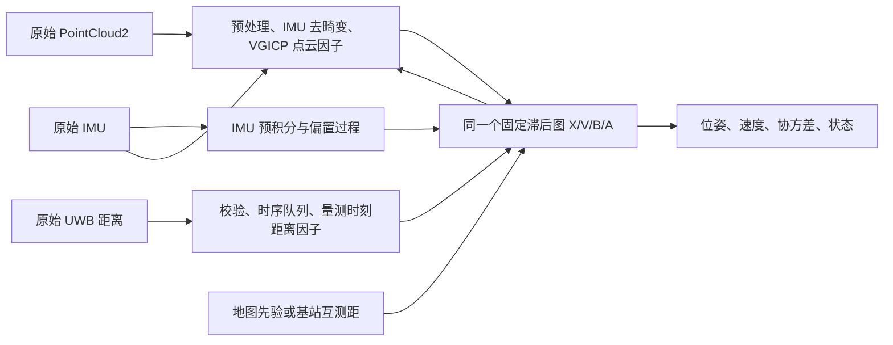

# LIUO Tunnel 开发 Handbook

创建日期：2026-10-21；阶段范围更新：2026-10-22（北京时间）。状态：阶段一已按 snapshot 范围验收，阶段二已在代表性范围交付，阶段三需求已记录、尚未实施；第二阶段限制见[交付报告](phase2_representative_results.md)。

**初始化与部署的最新依据：[隧道部署与初始化条件](spec/deployment_initialization_contract.md)。** 该用户确认合同覆盖早期入口启动、固定离地高度及基站高度已知的假设；本次文档更新不代表新增功能已实现。

**第三阶段以[任务需求](phase3_requirements.md)为主：** 未知基站联合估计 → 地图保存 → 独立复用，仅验证代表性有效性。原完整矩阵、固定精度门槛及rolling要求后移；[启动prompt](phase3_goal_prompt.md)提供持续Goal入口。

目标：从 IAP 迁移可独立构建、运行的 GLIM 风格里程计与传感器仿真，在同一个滑窗中紧耦合 **UWB 原始测距、LiDAR 点云匹配、IMU 预积分**，支持隧道轨道场景、未知基站标定和地图复用。所有项目代码、配置、消息、工具和文档都落在 `src/liuo_tunnel/`。

开发只分 **三个阶段**：独立迁移与仿真 → 紧耦合定位 → 自标定、复用与验收。接口和测试随所属阶段一起完成，不另设脚手架、日志、文档、测试等阶段。

## 1. 已确认要求与本方案的选择

| 项目 | 约定 |
|---|---|
| 代码来源 | 当前工作区 `src/iap` 的 `dev/iap_refactor` 分支，按需复制源码并修改，不依赖 IAP 包或其运行进程 |
| 源版本 | 本次检查的提交：`fbccae16802402d7300bb817d2627f86e6a495df`；实施时逐项记录实际来源与差异 |
| 估计器 | ROS 2 / C++，GTSAM + gtsam_points，GLIM 风格固定滞后平滑器；车辆保留完整 6DoF |
| UWB | 采用已完成天线延迟校正的双向测距 TWR 输入；机器人—基站、基站—基站都使用欧氏距离 |
| 最大通信距离 | **800 m**，作用于两种链路；这是仿真上限，不是对真实硬件覆盖能力的保证 |
| 基线测距噪声 | **零均值高斯，标准差 0.10 m，方差 0.01 m²**；不是最大误差 10 cm |
| 场景 | 隧道内地面机器人或无人机，完整 6DoF、任意内部位置启动；轨道运动学仅为首版仿真基线，不迁移无人机规划任务 |
| 最终范围 | 已知地图定位、带明确安装先验的未知基站联合标定、保存并复用地图；不能只交付已知真值基站的演示 |
| 实现顺序 | 先用已知地图隔离紧耦合接入问题，再放开基站；已知真值只允许存在于标明 oracle 的验证配置 |
| 不直接继承 | GNSS 接收机钟差、ECEF、星历、多普勒、ARAIM 航空完整性模型、主动规划、森林任务 |

上述频率、轨道尺寸、验收数字是本 handbook 提出的首版设计值，不是已有系统性能或用户已指定的硬件规格。正式实验前冻结配置；失败时保留结果，不能按结果悄悄降低门槛。

`src/demo` 是数学与失败案例参考，不是运行时依赖。其“一维后端、不进真机、不增加 IMU 因子”等规则只属于该 demo，不迁移为本项目限制。本项目自行消费原始 IMU，且不再额外消费含同一 IMU 信息的 LIO 位姿观测。

## 2. 源码核查与迁移清单

以下来源路径均相对于 `src/iap/`，以指定分支的实际代码为准。旧文档提到的 `sim/ego_planner_swarm_ws/src`、`tools/build_iap_sim.sh` 在本次检查的源码树中不存在，不能照抄为构建入口。仿真实际位于 `src/uav_simulator/`。

| 能力 | 来源 | Tunnel 中的处置 |
|---|---|---|
| ROS 主节点 | `apps/iap_rosnode.cpp` | 迁移为 `liuo_tunnel_node`；只注册 IMU、点云、UWB、状态输出 |
| 预处理与 IMU | `src/iap/preprocess/`、`src/iap/common/`、对应 `include/` | 复用时间处理、去畸变、协方差估计、预积分及初始化 |
| 实时滑窗 | `src/iap/odometry/odometry_estimation_imu.cpp`、`async_odometry_estimation.cpp` | 保留 X/V/B 与窗口管理，移除 GNSS 钟差及 GNSS shared-state 访问 |
| LiDAR 因子 | `odometry_estimation_cpu.cpp`、`odometry_estimation_gpu.cpp` | 保留直接点云匹配因子路径；CPU 为可移植参考，GPU 为性能路径 |
| 注入接口 | `include/iap/odometry/callbacks.hpp`、`src/iap/gnss/gnss_extension.cpp` | 借鉴 `on_smoother_update` 前入图与优化后诊断，不复制卫星模型 |
| 状态生命周期 | `util/key_lifecycle_monitor.*`、`relinearization_policy.*` | 复用 key 唯一所有者、生命周期诊断；改成车辆/基站符号，删除钟差分支 |
| CPU/GPU 证据 | `src/iap/odometry/gpu_evidence/`、相关测试 | 如 GPU 路径依赖其中实现，连同必要头文件、许可证、数值一致性测试一并迁移；不整包搬入 ARAIM |
| LiDAR 仿真 | `src/uav_simulator/local_sensing/{include,src}/...first_hit_lidar_renderer.*`、`pcl_render_node.cpp` | 复用体素第一交点渲染；改为轨道场景与项目消息，不直接链接 `local_sensing` 旧包 |
| 隧道环境 | `apps/demo11_corridor_map_publisher.cpp` | 保留走廊/墙面生成思路，新增轨道和长距离分块场景 |
| 仿真坐标桥 | `apps/demo4_lidar_body_bridge.cpp` | 借鉴时间匹配和坐标变换；仅存在于仿真侧，最终优先直接输出 LiDAR 坐标点云 |
| IMU 物理 | `src/uav_simulator/so3_quadrotor_simulator/src/quadrotor_simulator_so3.cpp` 中 `quadToIapImuMsg` | 复用比力定义与发布约定；车辆运动改为轨道轨迹，不复制无人机控制器 |
| 仿真启动 | `launch/_includes/simulation_environment.launch.py`、`launch/iap_sim.launch.py` | 复用启动组织、进程归属、场景目录和运行目录；删除 GNSS、EGO、森林规划节点 |
| 日志 | `util/run_log_manager.*`、`util/logging.*`、`util/timing_csv.hpp`、`launch/_includes/run_directory.py` | 迁移统一运行目录、spdlog、CSV、manifest、生命周期 |
| 分析与规则 | `tools/ana_log.py`、`tools/check_run_artifact_contract.py`、`test/test_run_log_manager*.cpp`、`test/test_ana_log_contract.py`、`AGENTS.md`、`docs/spec/run_artifact_contract.md` | 保留通用规则及测试，去掉 IAP 专属产品语义 |

**已发现的迁移注意事项：**

1. CPU 的 `use_scan_to_map=true` 旧路径先做配准，再加入位姿先验，不作为本项目默认或验收路径。使用 `use_scan_to_map=false` 的多帧原始 VGICP 因子。
2. 即使在 CPU 多帧路径，也额外存在对 IMU 预测位姿的软先验。迁移时移除这条每帧预测位姿先验：它不是独立传感器观测，可能重复约束运动并遮盖退化。初始规范先验和真实边缘化先验仍保留。
3. `gamma_lidar` 被算出或写进日志，不等于实际点云信息已经按方向降权。第一版保留原始因子、删除人为预测先验，记录 LiDAR 单独的信息谱；如需降权，必须用“开关前后实际因子 Hessian 的变化”证明它生效，不能只改日志。
4. `local_sensing/CMakeLists.txt` 直接查找 `iap__rosidl_typesupport_cpp` 与 `iap/msg/lidar_beam_evidence.hpp`。复制渲染源码后重写该依赖；不要把整个旧 CMake 原样搬来。
5. 当前第一交点接口是 `render(sensor_pose)` 的瞬时扫描。它不等于已有逐点运动畸变仿真；滚动扫描支持需要在迁移后的包装层补齐并测试。
6. IAP 的 `glim` 命名空间、无前缀 `.so`、旧 CSV 路径和 GNSS shared-state 容易留下隐式依赖。迁移后使用 `liuo_tunnel` 命名空间及带项目名前缀的库；来源字符串可以保留，运行引用不可以保留。

### 2.1 目录与独立性

```text
src/liuo_tunnel/                 # 独立项目根；根部不放 package.xml
├── AGENTS.md
├── README.md
├── LICENSE / THIRD_PARTY_NOTICES.md
├── docs/
│   ├── development_handbook.md
│   └── spec/run_artifact_contract.md
├── packages/
│   ├── liuo_tunnel_msgs/        # 共享原始观测接口，无估计器/仿真依赖
│   │   └── msg/UwbRange.msg
│   ├── liuo_tunnel/             # 生产里程计，含复制后的 GLIM/IAP 核心
│   │   ├── include/liuo_tunnel/{common,odometry,uwb,util}/
│   │   ├── src/{common,odometry,uwb,util}/
│   │   ├── apps/ launch/ config/ test/
│   │   └── CMakeLists.txt / package.xml
│   └── liuo_tunnel_sim/         # 轨道、环境、传感器与真值；生产包不依赖它
│       ├── src/ include/ config/scenarios/ launch/ test/
│       └── CMakeLists.txt / package.xml
├── tools/                      # 构建、回放、评估、产物契约检查
└── log/                        # Git 忽略；每次运行一个目录
```

仅将现有实际需要的模块保留下来，不为远期多机器人、规划、插件市场增加框架。三个 ROS 包用于隔离共享消息、生产估计器和含真值的仿真；不是三个新的算法层。

允许依赖 ROS 2 Jazzy、GTSAM、gtsam_points、Eigen、PCL、spdlog、TBB、Boost、可选 CUDA 等通用库。锁定实际测试版本、构建选项和 ABI；特别核对 GTSAM/gtsam_points/CUDA 的组合。禁止 `find_package(iap)`、`find_package(glim)`、调用 `iap_rosnode`、运行时读取 `../iap` 配置、链接源仓库或旧工作区的私有库。GTSAM_POINTS 是第三方库，不等于使用 IAP 仓库。

每份迁移代码保留许可证，并记录源提交、原路径及修改原因；不能仅替换文件头中的作者。根目录 `THIRD_PARTY_NOTICES.md` 收集实际复制内容的来源。最终用干净 underlay、仅扫描 `packages/` 的构建验证独立性，而不是临时删除或移动用户的 IAP 仓库。

## 3. 紧耦合估计器契约

### 3.1 唯一优化状态与数据流

车辆状态为 `X_i = T_WB ∈ SE(3)`、世界系速度 `V_i`、IMU 偏置 `B_i=(b_a,b_g)`。`B` 是 IMU 原点坐标系；LiDAR 和 tag 外参固定、已标定。基站为世界系 `A_j ∈ R³`，在需要表达地图不确定度时作为长期变量。第一版不加入 UWB 在线偏置状态或 demo 的里程计比例状态 k。



UWB 直接约束同一组车辆状态，进而通过 IMU 和点云因子共同影响姿态、速度与偏置。禁止先解算 UWB 位置再与 LIO 位姿融合，也禁止输入已有 `/lio/odom` 作为本图运动因子。

生产代码以 IAP 的 `OdometryEstimationCallbacks::on_smoother_update` 所在位置为接入参考：在一次 smoother update 前追加 UWB 因子、基站初值及时间戳，随后与该批 IMU/LiDAR 因子统一优化。ROS 回调只校验并入队；唯一估计线程修改图，优化后统一发布快照。初始化帧同样需要正确处理注入，不能只接后续帧回调。

点云匹配使用可变姿态间的原始 `IntegratedVGICPFactor` 或 GPU 等价因子。固定的历史目标点云是原框架的近似，必须记录其影响；活动窗口内点云按优化后的姿态使用，不把新的 UWB 修正只作用于发布结果而留下一份未修正的活动地图。

### 3.2 距离残差、外参与导数

沿用 IAP 的符号约定：**残差 = 测量 − 预测**。demo 中的符号不同，不能混抄。

令 tag 在 IMU 系的已标定杆臂为 `t_BU`，则：

```text
q_i = p_i + R_i t_BU
rho_ij = ||q_i - a_j||
r_ij = d_ij - rho_ij
r_jk = D_jk - ||a_j - a_k||          # 基站互测距
sigma_TA = sigma_AA = 0.10 m        # 基线实测距离噪声
```

在 GTSAM Pose3 右扰动、切向量 `[δθ, δv]` 下，令 `u=(q-a)/rho`，同步因子的解析导数为：

```text
dr/dX = [ uᵀ R [t_BU]× , -uᵀ R ]
dr/da = uᵀ
AA: dr/da_j = -u_jkᵀ, dr/da_k = +u_jkᵀ
```

因子实现必须用 `Pose3::retract` 中心差分核对，覆盖非单位旋转、非零杆臂和随机空间基站；不能只验证直线、零杆臂样例。对 rho≈0 拒绝该观测并记原因。单条距离的转动约束来自杆臂和其他因子的联合关系，不宣称单个 UWB 直接测量完整姿态。

基线高斯数据使用高斯核。NLOS 压力配置可增加已消融的鲁棒核，不能把模拟器的 NLOS 真值标签输入估计器。若后续加入常偏置，必须区分天线标定误差和随遮挡变化的偏置，并做可观性与独立消融。

### 3.3 异步量测与延迟

首版采用两帧间插值测距因子，避免将几毫秒到几十毫秒的异步量测硬贴到最新帧。设 `t_i <= t <= t_{i+1}`、`beta=(t-t_i)/(t_{i+1}-t_i)`：

```text
p(t) = (1-beta)p_i + beta p_{i+1}
R(t) = R_i Exp(beta Log(R_i⁻¹ R_{i+1}))
r(t) = d(t) - ||p(t) + R(t)t_BU - a_j||
keys = [X_i, X_{i+1}, A_j]           # 精确已知地图时 A_j 为常量
```

使用节点测量时间，不使用接收时间。插值每次线性化都依赖当前优化变量，不先算一个固定 tag 位置再当常量。端点时间直接使用同步因子，不重复插入。插值的全部导数都需数值核对。

设计包络：LiDAR 10 Hz，相邻状态间隔通常 0.1 s，首版轨道加速度上限 1 m/s²，线性平移插值最大偏差上界约 `a_max*dt²/8=1.25 mm`；转动和杆臂误差另行测试。这是模型近似，不是完全无误差的连续时间估计。测试 25 ms/50 ms 异步、变速、转弯，要求纯插值测距模型误差不超过 1 cm。超出已验证包络或状态跨度超过 0.15 s 的观测不冒充正常测距使用，报告 `TIME_BRACKET_GAP`；后续如需高速机动，再凭实测升级连续时间模型或量测时刻状态。

右端状态尚未到达时等待，目标等待预算 150 ms；窗口内乱序观测按测量时间插入，超过滞后窗口的观测丢弃并计数。没有足够 IMU 数据时，不伪造预积分；进入降级状态。检测 ROS 时钟倒退或 bag 重启，清空本次 session 的时序状态并开启新的估计会话，不让旧图接上新时间轴。

第一版滞后窗口建议 10 s；这不是直接保证基站已可观。消息队列、初始化缓存、关键帧数、点云存储都有明确容量和超限日志。

### 3.4 静态基站与固定滞后的生命周期

所有已加入的基站由 UWB 模块唯一拥有，每次 smoother update 刷新其保留时间戳，**没有 UWB 数据时也刷新**，防止固定基站随车辆旧状态一起意外边缘化。刷新不是新测量，不增加先验或过程因子；绝不依靠“省略时间戳一定会永久保留”的未经验证行为。

当前地图的全部基站保留（正式稀疏候选为 7 个），主动验证固定窗口内车辆节点有界、长期基站不消失。该方案的地图规模随基站数增长，不能宣称无限长线路常数内存。以后大地图若需分块，必须保留分块间联合信息，不能以独立对角先验替代而不说明近似。

每个量测身份只入图一次，包括 AA、bag 重放和消息重发。独立新测量可以有新因子；同一条 AA 数据不能在每次更新重复加入。边缘化已有观测后，不再将同一观测作为“新信息”补入图。

### 3.5 坐标系、地图模式与初始化

- 输出完整 `nav_msgs/Odometry`，默认根坐标 `odom`、子坐标 `base_link`；已知静态 `base_link -> imu_link/lidar_link/uwb_tag` 外参。估计状态位于 IMU 原点，发布 base_link 的位姿、速度与协方差需正确变换。
- 关掉额外全局回环后端作为首版默认；需要可视化全局点云时从已估计姿态生成，不另给车辆加一套与 UWB 冲突的定位结果。
- 自标定运行在本次初始局部坐标系，重力确定竖直方向，起点平移和初始 yaw 作为坐标规范；初始速度和 IMU 偏置保留诚实先验。不得用真值姿态初始化。
- 地图复用时将 `odom` 建立在已保存地图坐标系中，发布同一 `map_id`。起始位置由实际首段 UWB/IMU/LiDAR 估计；不再次强制起点为零。需要 `map` TF 的接口可以使用同坐标的静态 identity，不另引入一套校正滤波器。
- GTSAM 的局部旋转/平移协方差不能直接复制到 ROS 的 `[x,y,z,roll,pitch,yaw]` 顺序；必须按当前姿态、外参和消息坐标约定变换并测试。不可求得时报告无效状态，不能发全零协方差表示“绝对准确”。

三种地图配置具有不同含义：

| 模式 | 输入与约束 | 用途 |
|---|---|---|
| `surveyed_map` | 外部测得的位置及协方差；有不确定度则 A 入图、只加入一次地图先验 | 可部署的已知地图定位 |
| `self_calibrate` | 基站 ID、墙侧/有符号横向偏距、TA/AA、实际局部几何；高度初值不是测量先验，纵向坐标/高度/前后顺序待估 | 首次联合标定，最终必须验收 |
| `oracle_map` | 仿真真值坐标作为精确常量，单独标记 | 因子/时序对照；不算自标定能力 |

自标定从任意隧道内部位置开始，现场可保证上电静止一段时间，不保证入口特征段或标记发车区。用实际 IMU、点云和测距初始化；对候选基站累计至少 8 次测距和至少 20 m 估计运动基线作为首版候选策略，借鉴 demo 的平方测距线性解生成沿局部轴向的候选，再提升为 Point3 联合优化。这些数量不保证可观。未知前后分支使用实际运动、AA、局部几何和候选残差判别，不从 ID 或预设顺序偷解；不足则保持 `ANCHOR_PENDING`。地图复用从当前 UWB 与 LiDAR/IMU 联合估计地图内位姿，不重新强制起点为零。

**直线运动没有足够三维激励时，不能声称完整 3D 基站无先验可标定。** 用户确认可给墙侧与到局部中线的有符号横向偏距；基站高度未知，粗相对安装高度仅作优化初值，不能固定或自动赋予高斯先验。数值误差尚未提供，不沿用旧示例 σ=0.30 m 作为现场精度。允许用真实可获得的墙面、地面、顶板构成内部可行区域，但需处理其坐标关联和不确定性；不能读取模拟器精确截面、固定机器人离地高度或沿真值轨道运动。LiDAR 派生几何与原始点云的相关性必须处理，避免重复计数。Mid-360 的全向水平视场不保证看到洞口或消除轴线正反歧义；不设精确绝对航向先验。

延迟初始化只利用当前仍保留的窗口量测与状态，初值本身不作为独立测量先验；这些 UWB 因子首次入图后自然形成联合协方差。跨度不足时可配置更长启动窗口，但不允许用窗口外已边缘化的 LIO 解作为独立真值再构造先验。如果选择批量 bootstrap 后切入滑窗，则移交保留的车辆/基站**联合**边缘化先验并清楚退役原因子，不复制“基站独立先验 + 已用过的运动/测距”。

入图前检查固定规范后的局部秩、条件数与分支差异；设置有限最大初始化等待时间并输出可解释失败。安装先验支持的是有条件自标定，输出地图记录该前提。不要为让矩阵可逆给所有基站随手加极小方差。

### 3.6 地图保存与第二次运行

地图文件包含 `schema_version`、`map_id`、坐标规范、单位、基站 ID/均值、联合协方差或等价平方根信息、变量排序、安装先验来源、外参哈希、标定配置哈希、有效性和来源 run。通过边缘化车辆状态得到地图联合信息，不复用上次轨迹的 IMU 偏置；未来若引入 UWB 偏置状态，需同时保存相关项。

新运行只加入这份地图先验，不再次添加标定时已用的 AA 数据或 s0 强先验。新采集的 AA 是新数据，可以按其测量身份使用。保存/加载做原子写、有限数/对称性/正定性检查；失败地图不能伪装为可复用地图。第二次运行采用独立噪声、不同起点和速度，直接在地图坐标评价，禁止事后轨迹对齐。

## 4. UWB 消息与运行接口

### 4.1 `liuo_tunnel_msgs/msg/UwbRange.msg`

首版一个消息表示一次物理测距，避免批量消息只有一个时间戳而掩盖各链路异步。不传 UWB 解算位置，不把基站真值放在测距消息里。

```text
# header.stamp: 距离所对应的有效测量时刻，已转换到统一 ROS 时间轴
# header.frame_id: 空字符串；标量距离不属于某个向量表达坐标系
std_msgs/Header header

# 一个发布源启动会话中的序号；唯一身份为 producer/session/sequence
uint32 producer_id
uint64 session_id
uint64 sequence

uint8 NODE_TAG=0
uint8 NODE_ANCHOR=1
uint8 node_a_type
uint32 node_a_id
uint8 node_b_type
uint32 node_b_id

uint8 STATUS_OK=0
uint8 STATUS_TIMEOUT=1
uint8 STATUS_INVALID=2
uint8 status

float64 range_m
float64 variance_m2

uint8 LOS_UNKNOWN=0
uint8 LOS_REPORTED=1
uint8 NLOS_REPORTED=2
uint8 propagation_status
```

约束：

- `STATUS_OK` 要求距离有限且 >0、方差有限且 >0、端点不同、端点类型合法、时间有效。其余状态不生成因子；没有有效数值时使用 NaN，不能填 0 当作有效距离。
- tag ID 是物理天线 ID，基站 ID 是物理基站 ID，二者各自命名空间。注册表将 tag 绑定到机器人及已标定杆臂。首版仅支持一个机器人；tag–tag 消息明确拒绝为 `UNSUPPORTED_LINK`，不暗示已实现多机器人。
- 仿真基线的两种链路均填 `variance_m2=0.01`。`propagation_status` 是硬件实际报告的信息，未知时必须 UNKNOWN；模拟器真值标签只到评估侧。
- TWR 时间戳定义为设备/驱动标定的有效测量时刻，设备时钟偏移由驱动同步；不能使用 ROS 收包时间替代。若固件仅给交换起止时间，驱动用约定有效时刻并登记时间误差，不自动新增 GNSS 钟差状态。
- 两端设备重复上报同一次 TWR 时，由驱动统一为一个 measurement identity；handler 再做有界去重。AA 的正反端点排序用于链路统计，不代表同一链路的所有新测量都重复。
- 800 m 判定在仿真中根据**加噪前真实距离**进行；有效 799.99 m 测量加噪后可以大于 800 m。接收端不能用 `range_m>800` 硬裁掉尾部，制造截断高斯。

### 4.2 Topic 与配置

| Topic | 类型 | 约定 |
|---|---|---|
| `/sensors/lidar/points` | `sensor_msgs/PointCloud2` | LiDAR 系，x/y/z/intensity + 每点相对扫描起点秒数 `time` |
| `/sensors/imu` | `sensor_msgs/Imu` | IMU 系，比力 m/s²、角速度 rad/s；不使用模拟器的真值 orientation |
| `/sensors/uwb/range` | `UwbRange` | 原始 TA 与 AA；每条独立时间戳 |
| `/liuo/odom` | `nav_msgs/Odometry` | 优化时刻状态、速度和有效协方差；注明发布延迟 |
| `/liuo/diagnostics` | `diagnostic_msgs/DiagnosticArray` | INITIALIZING/TRACKING/DEGRADED/LOST、原因、最近观测时间、地图 ID |
| `/liuo/anchors` | `visualization_msgs/MarkerArray` | 估计基站、状态与不确定度，仅诊断用途 |
| `/sim/truth/odom` | `nav_msgs/Odometry` | 只供传感器生成和独立评估，估计器禁止订阅 |
| `/clock` | `rosgraph_msgs/Clock` | 仿真或回放二选一发布，不能同时发布 |

IMU/点云使用可配置 SensorDataQoS；UWB 默认 best-effort/volatile/keep-last 2048，允许按驱动匹配配置，不使用 transient-local 重灌旧测距。bag 播放需要匹配 QoS。每条消费/丢弃都有计数，不能把“没收到”和“被拒绝”合为一种情况。

配置至少分为：`config_sensors`（T_BL/T_BU 与时间约定）、`config_odometry`（图与窗口）、`config_uwb`（队列、地图模式和白化/鲁棒策略）、`config_logging`、仿真场景文件。估计器配置不得包含世界真值地图路径。共享 topic 名和外参通过快照绑定，而不是各模块各抄一份常量。

已知缺失项必须启动失败并给出配置键，例如未知 tag 外参、坐标系冲突、地图 ID/协方差无效。UWB 暂时断流属于运行降级，保留 LiDAR–IMU 传播并扩大不确定性；恢复后真实测距重新入图，不能重置到仿真真值或悄悄跳过失败段。

## 5. 轨道隧道仿真设计

### 5.1 最小主场景

`rail_tunnel_straight_v1`：长 2400 m、宽 6 m、高 5 m，双轨距 1.435 m；机器人沿轨道移动，IMU 高度约 1.2 m。轨道几何只驱动模拟器，不向估计器添加轨道位置、轮速或非完整约束。入口 0–50 m 设置不规则设备特征供初始化，其余为长直墙、地面、顶面与重复轨枕，避免全程人为布满唯一定位标志。

以上为现有基线测试世界，不是部署保证。后续按所属阶段验证入口以外启动、不同初始朝向和离地高度；不得要求实际机器人必须在入口设备段启动。实际 Mid-360 的扫描覆盖/时序需要单独验证，现有 snapshot 合成扫描不代表硬件已经适配。

车辆先静止 5 s 初始化，再以最大加速度 1 m/s² 加速到 5 m/s，经过约 600 m/1200 m/1800 m 时减速停留 5 s，再继续；最后在 2350 m 停车。采用连续位置/速度/加速度的轨迹，速度转折不能靠离散瞬移实现。另一复用运行从 150 m 出发，改变速度和随机种子。后续同一阶段加入 `rail_tunnel_curve_v1`（例如 R=500 m 的圆弧过渡），检验三维坐标和遮挡，而不再依赖 demo 的已知中心线距离模型。

实际部署硬约束：任意连续 1 km（含端点）最多 3 个 UWB 基站。2026-10-21 用户撤销此前增加基站数量的授权；正式候选为 7 个基站，纵向位置 0/400/800/1200/1600/2000/2400 m。墙侧与高度采用明确安装假设：v5 每四个循环 (y,z)=(2.8,4.6)、(-2.8,4.6)、(-2.8,0.4)、(2.8,0.4) m。S32 在固定纵向位置和既有非共面检查下筛选此高位优先候选；其乐观几何下界不代表实际验收通过。旧 v4 安装顺序与全部运行仍保留为历史证据，不得改写成 v5 结果。800 m 加噪前真实三维量程、LOS、σ=0.10 m 和验收门槛不变。必须自动检查任意 1 km 密度，禁止增站绕过约束。旧 13/49 基站结果仅为历史诊断，不能用于当前部署验收。该布局是模拟观测生成条件，估计器只读取外部地图，不得从 ID 推导坐标或约束车辆沿真值轨道。

可观测性评价需包括 LOS 梯度方向、固定规范后信息的弱方向、基站位置相关性，不能以“13 个基站多于未知数”代替。800 m 覆盖不意味着车辆必须每时刻看到所有基站，也不意味着横向精度和轴向一样好。

### 5.2 观测生成

| 流 | 基线设计值 | 必须实现的物理含义 |
|---|---|---|
| 时间与轨迹 | 固定模拟步长；单一 `/clock` | 事件按模拟时间调度，随机数不依赖 ROS 回调先后 |
| IMU | 200 Hz | `f_B=R_WBᵀ(a_W-g_W)+b_a+noise`；角速度来自姿态导数，独立偏置过程 |
| LiDAR | 10 Hz，512×40 波束，最大 40 m | 复用 first-hit 渲染，按传感器射线取首个交点，输出传感器坐标 |
| TA | 每个 tag 20 Hz 扫描轮次 | 对轮次内实际调度的可达基站生成各自测量时刻；不是一个时间戳下的虚假同时测量 |
| AA | 每条调度链路 1 Hz | 两端距离 ≤800 m 且可见时才生成；同一交换只上报一次 |
| UWB 噪声 | σ=0.10 m | TA/AA 均为独立零均值高斯；故障场景另加偏置、丢包或相关噪声 |

IMU 噪声、偏置随机游走及 LiDAR 噪声必须明确配置并冻结；可用首版每采样标准差 `sigma_acc=0.02 m/s²`、`sigma_gyro=0.001 rad/s`、连续偏置随机游走强度 `sigma_ba=0.001 m/s²/√s`、`sigma_bg=0.0001 rad/s/√s`、LiDAR 距离标准差 0.02 m。驱动噪声参数到 GTSAM 连续时间协方差的转换需要单独核对，不能将每采样方差直接当噪声密度。无噪声单元测试另设显式配置。

UWB 调度器设置总交换预算，例如 250 次/s，每十个时隙中九个 TA 优先、一个 AA 优先，各类内部按最老截止时间轮转；优先类无可用测量时另一类可借用；记录实际每链路刷新率、排队和缺测。这个值是理想化调度假设，真实设备若达不到必须改成实测配置重新验收。超过预算就延迟/缺测，不暗中生成无限并发距离。

距离用 `||p_W+R_W t_BU-a_W||` 或 `||a_j-a_k||` 计算，随后加 `N(0,0.1²)`。可达性必须同时满足 800 m 和场景 LOS；直隧道基线可基本无遮挡，弯道跨墙射线不能因为距离短就当 LOS。若考虑穿墙/NLOS 传播，应作为独立压力模型而非物理保证。

每个传感器、每条链路使用基于 `(seed, stream, endpoint IDs, sample index)` 的独立随机流。开关某条 AA 或估计器模式不能改变 IMU、LiDAR、其他 UWB 的噪声样本。世界真值和评估输出放在仿真专属配置/话题/文件中，不能复用为估计器输入。

长隧道体素场景按空间块生成和缓存。LiDAR 按 40 m 查询邻近块，UWB LOS 按实际线段查询世界块；不得把 LiDAR 的局部加载范围误当 800 m UWB 的世界边界。记录内存与渲染开销，避免每个节点复制一份稠密 2.4 km 点云。

### 5.3 点云时间与 IMU 的必过检查

第一阶段可先用瞬时扫描验证迁移，明确 `scan_model=snapshot` 且每点相对时间为 0；不能宣称已验证去畸变。后续全面验收（不是当前第二、三阶段的完成门槛）需增加 `scan_model=rolling`：在 100 ms 扫描期按波束时间查询真实传感器姿态，生成每点 `time`，扫描结束后发布，保留扫描起点 header。可扩展已有 renderer 为分束/分块渲染，复用第一交点算法；不要对每个波束重复渲染完整帧。

真值只用于产生该时刻实际传感器观测，不能将所有点提前用真值去畸变到同一时刻后再送给估计器。估计器自行使用 IMU 去畸变。仿真 IMU 的 orientation 标记不可用（`orientation_covariance[0]=-1`），防止把真实姿态作为额外观测。

检查静止时加速度计含正确重力比力、匀速时无平移加速度、转弯时有向心加速度，外参变更后点云和 UWB 杆臂变化一致。所有节点使用同一个模拟时间基准；基线无需历史 GNSS UTC 日期，也不启动 GNSS 仿真节点。

## 6. 日志、产物与开发规则

### 6.1 复用 IAP 的统一 run 契约

以 `dev/iap_refactor` 的 `docs/spec/run_artifact_contract.md` 为来源，复制通用合同到 Tunnel 并改名。不要继承 main 分支的硬编码绝对日志目录，也不要照搬森林规划的附录。

- 对外只提供 `LIUO_RUN_ROOT`；源码运行默认项目根 `log/`，安装运行默认 XDG state 下 `liuo_tunnel/log/`。这里的 `log/` 是显式运行根例外，不允许把文件散落到源码目录。
- 顶层 launch 或独立进程的 RunLogManager 是唯一 owner，原子分配 UTC run ID；通过内部 `LIUO_RUN_DIR` 传给所有子进程。
- 子进程采用同一个 run，不新建时间戳目录、不更新 latest。`ROS_LOG_DIR=<run>/runtime/ros`。
- 正式实验输出绑定提交、构建版本、依赖、参数和输入哈希；源 IAP 提交也记录。
- manifest 原子写入，区分 `active/completed/failed/interrupted` 与独立的验收 `not_evaluated/pass/fail/incomplete`。正常退出不等于验收通过。

```text
<LIUO_RUN_ROOT>/<run_id>/
├── runtime/                    # liuo_*.log、ros/
├── profiling/                  # timing.csv、资源曲线
├── export/
│   ├── odometry/               # 轨迹、ICP、因子计数、UWB 残差、地图
│   ├── simulation/             # 真值、噪声与可达性诊断
│   ├── capture/                # 显式启用的原始 bag/冻结输入
│   └── analysis/               # report.md、metrics.csv、图
└── metadata/
    ├── run_manifest.json
    ├── config/                 # 实际生效配置快照
    ├── processes/
    └── manifests/
```

每次实验最少保存：

| 文件 | 核心字段 |
|---|---|
| `trajectory.csv` | 测量时间、发布时间、位置/姿态/速度、协方差有效性、状态、map_id |
| `uwb.csv` | measurement identity、链路、测量/接收时间、原始距离/方差、关联 keys、预测距离、测前创新或优化后残差的明确类别、白化值、鲁棒权重、接纳/拒绝原因 |
| `graph.csv` | X/V/B/A 数量、各类有效因子数、新增/边缘化计数、重复/过期/缺 key、优化耗时、fallback/reset |
| `icp.csv` | 点数、匹配率、残差、LiDAR 独立信息谱/弱方向、实际启用的降权方式 |
| `timing.csv` | 渲染、接收排队、预处理、去畸变、因子生成、优化、端到端延迟、内存 |
| `metrics.csv` | 各场景与种子误差、可用率、失败、延迟、地图/间距误差、验收结果 |

残差日志逐观测异步/缓冲写，不能每条都开关文件阻塞估计线程。INFO 只写启动、初始化完成、模式转换和故障；重复诊断限频。大点云、逐因子矩阵和 bag 默认关闭，正式配对实验显式开启一份冻结输入并登记，不为每个对照重复生成一份不同输入。

保留 IAP 的路径逃逸检查、单 owner、原子 latest、并发目录分配、进程归属、活动 run 保护。自动保留策略只对终止的 ordinary development run 生效；formal/protected/active/无效 manifest/外部目录不可普通清理。只停止本次 run 创建的进程，不使用宽泛 `pkill`。

### 6.2 迁移后的 AGENTS 规则

第一阶段在项目根建立适用于本项目的 `AGENTS.md`，至少包括：

1. 只改 `src/liuo_tunnel`；IAP/demo 只读参考。用户已授权的源分支切换不等于允许改写源实现。
2. 修改前核对当前分支和工作树，保留用户已有修改；不擅自建分支/worktree、重写历史或操作用户文件。
3. 新增状态、因子、鲁棒策略或抽象必须指出解决哪个已复现问题；同一次消融只改变一个因素。
4. 原始 UWB/点云/IMU 在同图紧耦合；不重复消费相同测量，不把初值、预测位姿、数值阻尼伪装为独立观测。
5. 真值只在仿真与评估；oracle 配置显式隔离。不得用真值基站初始化自标定，不用轨道中心线锁死车辆。
6. 坐标、单位、时间、残差符号和协方差约定是接口合同；变化时更新合同、调用方与相关测试。
7. 先定位首次违反约定的位置，再修复；不靠反复重启、静默 fallback、无限增大噪声掩盖问题。
8. README 放构建/运行方法，handbook 放阶段与总设计，spec 放稳定合同，重要替代方案写 ADR。采用 refactor 分支的文档规则，不机械要求每次代码修改追加旧 IAP 的流水账。
9. 每个完成阶段记录实现文件、测试命令、run ID 和结果；不能以 RViz 好看、程序没崩或某个局部测试通过代替端到端验收。
10. 工程建成 Git 仓库后，相关检查通过的逻辑改动在当前分支单独提交，只提交任务文件；正式 live evidence 必须绑定干净已提交版本。
11. 复用 `.clang-format` 的 2 空格/180 列风格，保持最少足够模块；保存复制来源与许可证。
12. GPU live 前检查 `nvidia-smi`、`cuInit(0)` 和设备数量，不可用时标记 `GPU_NOT_READY`；CPU 可做其独立参考测试，但不能冒充 GPU 实时验收。

## 7. 仅三个开发阶段

### 阶段一：独立迁移，跑通轨道传感器与 LiDAR–IMU 基线

**交付结果：** 只构建 Tunnel 的三个包，可以启动同一 run 下的轨道环境、原始 LiDAR/IMU/UWB、完整 LiDAR–IMU 里程计和评估器；UWB 此时可以只发布和记录。

一起完成：复制最小核心与许可证、删除 GNSS/规划/钟差依赖、落实消息与日志合同、CPU 原始 VGICP 路径、轨道场景和传感器、规范化 launch。GPU 若选择启用则同样完成依赖迁移。避免先搬整仓再留下一串删除 TODO。

**退出条件：**

- 干净环境只扫描 `src/liuo_tunnel/packages`，无 IAP 包/私有库即可构建；运行进程、加载 `.so` 与配置路径可核查。
- IMU 比力、外参、消息时间与逐点字段测试通过；snapshot/rolling 明确区分，rolling 在最终验收前完成。
- 距离边界 799.9/800.0/800.1 m 使用真实三维距离构造测试；前两者可达、后者不可达。对至少 10,000 个独立 LOS 样本，噪声均值满足 `|mean|<3*0.1/sqrt(N)`，标准差在 `[0.095,0.105] m`；统计失败保留并检查，不能裁剪样本制造通过。
- 日志路径、共享 run、manifest、源哈希、失败退出、时间重置与 producer session 测试通过。
- 记录 LiDAR–IMU 在入口和退化段的实测表现；不要求人为把它弄崩。去掉所有 GNSS 因子和状态后仍能正常启动。

### 阶段二：代表性仿真中的原始 UWB–LiDAR–IMU 紧耦合验证

**2026-10-22 用户明确授权的目标调整**：本节覆盖此前第二阶段全精度、10 种子、完整故障矩阵和严格统计一致性退出要求；历史 FAIL 保留，不追溯改判。本阶段不以全面部署认证为目标，不进入未知基站自标定。

复用现有 GPU 原始 VGICP、IMU 与原始 TA/AA 的同一 X/V/B/A 图、相关地图先验、时序队列、固定滞后及运行保护，不重新开发系统。仅完成三项：

1. 初始化：用实际点云及已确认安装信息支持的内部几何，明确到已知地图的坐标关联与不确定性，验证错误分支筛选。固定种子、预声明少量内部起点和朝向；允许静止和已知外参，无固定高度、起点、航向。不得读取模拟器边界；剩余歧义报告 INITIALIZING/初始化未完成，不强选健康分支。
2. 正常全程：冻结一套配置，同一份原始输入 ON/OFF，报告轴向/横向/高度、姿态、速度误差、实时性、连续性和资源。在预声明退化段证明 UWB 改善漂移，且正常融合无未解释持续发散或灾难性跳变，不能以其他方向明显失控换取改善；仅胜过完全失效的 OFF 不足以证明有效。
3. 断流：复用代表性输入，只验证已有 5 s/20 s 断流；持续输出诚实状态与诊断。重新收到测距或计时器到期不认证恢复；允许保持降级/恢复未确认，明确限制。初始化歧义与运行中的姿态/偏置/速度漂移分开分析。

**完成条件：** 三项均有可复现证据；基本正确性、同图结构、实际实时运行、资源有界和状态诚实性仍须满足。复用未受修改影响的已通过测试，不重跑全套或启动多种子 campaign。交付冻结配置、命令、结果和限制；完成结论只能是“代表性仿真范围内系统完成且验证有效”。有效性以同输入对照、分段/分轴误差与轨迹演化、初始化及断流状态证据判断，不以单次运行PASS或任一固定精度数字替代。

**持续执行边界：** 单个实验或几何关联方案失败只结束该实验，不结束整个 Goal。应自主选择下一条有依据的路径，并推进不依赖额外现场条件的工作；不得反复请求已授权的算法设计/实现许可。只有目标实际达成才标 complete；真正无法继续时按当前 Goal 的阻塞规则报告具体依赖，不能把“仍未达到参考精度”或“一个方法失败”当作整体阻塞。

第 8 节 RMSE 0.30 m、轴向/姿态精度等保留为参考目标，不再是本阶段硬门槛。10 种子、大规模统计、完整故障矩阵、严格 NEES/覆盖率达标、全面精度优化与部署认证登记为后续验证。协方差仍需正确输出并披露局限，不任意放大噪声。完整无人机、真实 Mid-360 扫描与 rolling 均未验证。

评估器必须将上述超限放入 `accuracy_reference_exceedances`，不得仅因此让本阶段单次运行检查失败；不得设置“完整campaign未完成”的无条件失败项。单次报告明确 `stage_acceptance=NOT_ASSESSED`，阶段有效性仍需上述配对证据判定。已有历史报告保留原判据和原FAIL，不就地改写为PASS。数据完整性、非有限输出、图结构、现有实时性与资源检查继续生效。

每轮先登记具体假设、实验及支持/否定条件；同方向两次未获支持即停止调参。维持七站/400 m、任意连续 1 km 至多三站、800 m 真实三维距离、LOS、0.10 m 噪声；使用现有总超时/无进度保护，无无限重试。

### 阶段三：未知基站自标定与独立地图复用

**2026-10-22 范围修订：** 以[第三阶段任务需求](phase3_requirements.md)为准，接续已交付的第二阶段，不全面重构或先解决所有遗留精度问题。仅做三个连贯步骤：

1. 首轮在基站纵向位置、高度、前后顺序未知时，把候选基站和机器人状态放入原始紧耦合图，正确处理延迟初始化、规范、有限歧义及观测重复使用。
2. 保存/加载具有联合不确定度、必要安装参考、来源、弱方向和有效范围的地图；由首轮后验生成，不用已知地图替代，不把调查快照冒充有效地图。
3. 第二次以不同起点或朝向、独立传感器噪声复用该地图，完成代表性定位和有限对照；不重复加入首轮已吸收的测距/安装信息，也不重置到真值起点。

**完成条件：** 真正跑通首次自标定→地图导出→独立复用，证明地图能约束声明区段的漂移，融合自身无未解释持续失控或灾难性跳变，弱高度及未认证状态如实披露。首轮与次轮各固定一个噪声种子，保留次轮同输入融合/OFF及已知地图参照、首轮TA-only/TA+AA有限对照，AA收益不强求。地图信息移交、真值隔离、原始同图结构、实际实时运行及资源有界有证据。交付实现、地图身份、冻结配置、复现命令与阶段报告。

第8节位置/间距/姿态/初始化时长等旧数字为参考，不是本阶段硬门槛。十种子、完整故障矩阵、整条往返/弯道、rolling、真实Mid-360、完整无人机与部署认证后移；不要求先修完高度精度和断流恢复。必要依赖问题由实际证据驱动修复。单次实验失败不结束Goal，自主继续其他有依据的路径；不能用保存JSON、评估PASS或仅胜过失效OFF替代方案有效。

## 8. 验收与复现

### 8.1 验收矩阵和建议门槛

第二、三阶段按第7节及[第三阶段任务需求](phase3_requirements.md)的代表性验证范围执行。下列完整矩阵、精度数字、10种子与严格统计工作属于参考目标/后续全面验证，不覆盖修订后的阶段完成条件。

主评估使用在线实际发布的位置，与同一测量时刻的真值匹配，**不拿整段离线平滑结果冒充实时精度**。自标定首次运行按初始化坐标规范转换真值，转换仅来自已知测试坐标关系，不用全轨迹最佳拟合；复用运行直接使用地图坐标。

以下门槛是首版建议目标，正式实施前记录配置版本；不保证设计天然满足：

| 项目 | 名义验收目标 |
|---|---|
| 已知地图，直线及走停 | 位置 RMSE ≤0.30 m；轴向绝对误差 P95 ≤0.50 m、最大 ≤1.0 m |
| 自标定与复用 | bootstrap 后位置 RMSE ≤0.50 m；轴向 P95 ≤0.80 m、最大 ≤1.5 m；另报告全程含启动段结果 |
| 地图 | 相邻基站轴向间距 RMSE ≤0.20 m；全局累计坐标误差单独列出，不用局部间距替代 |
| 姿态 | 名义场景姿态误差 P95 ≤2°；完整 yaw/roll/pitch 分布另报 |
| 实时性 | 在登记硬件与配置上 1×运行；10 Hz 优化更新处理耗时 P95 <100 ms，状态测量时刻到发布时间延迟 P95 <250 ms；计入扫描收集与插值等待 |
| 连续性 | bootstrap 后有效里程计可用率 ≥99%，无 NaN/缺 key 崩溃，名义场景非预期重置/fallback=0 |
| 自标定启动 | 不保证入口特征段；在声明的隧道内启动测试中，开始运动后 30 s 内形成至少一个足够约束当前定位的有效局部基站集合；未达则初始化失败，不静默删启动段或挑选高度分支 |
| 固定滞后 | 车辆活动状态与配置窗口相符，离开窗口后旧车辆/点云释放；基站保留符合配置，完成整条 2.4 km 及返回测试后队列不持续增长 |

主场景固定 seeds 0–9，每个 seed 按同样输入配对，分别列每次结果、合并统计和所有失败；名义门槛按每次运行判定，不能只给均值掩盖失败。CPU/GPU 不必逐位一致，但必须比较优化结果、协方差与因子代价的合理容差；若只交付一个后端，报告明确该后端的通过范围。

另外做压力测试：弯道 LOS 限制、单基站失效、连续 UWB 中断、带时序相关的 NLOS 正偏、安装先验扰动、静止/反向、地图重载。压力工况分别报告误差、检测/恢复时间和状态是否诚实，不要求在完全无观测时仍达名义精度；不能将它们从失败清单隐去。基线的800 m、σ=0.10 m 始终保留，压力是另列条件。

NEES/协方差覆盖率作为可信度验收证据：考虑同轨迹相关性，按独立运行统计；区分地图共同误差与局部相对误差。鲁棒 Hessian 协方差只作局部近似，不宣布严格概率保证。不直接复用 demo 的统一 `[0.5,2]` 作为所有维度/场景的硬门槛，也不反向调 sigma 追求 NEES=1。

### 8.2 必须保留的最小对照

| 对照 | 要回答的问题 |
|---|---|
| LiDAR–IMU / 加原始 UWB | 紧耦合新增了什么实际约束，是否改善退化段 |
| oracle / surveyed / self-calibrated | 理想地图、实际地图不确定度、自标定各贡献多少误差 |
| TA / TA+AA | 固定基站之间的独立距离是否改善地图与轨迹 |
| 同步 / 异步及走停 | 接入是否依赖“时间正好对齐”或匀速假设 |
| 第一跑 / 地图复用 | 跨次坐标是否一致，地图不确定度是否诚实保留 |
| snapshot / rolling | 是否真正检验了 IMU 去畸变与运动时刻 |

### 8.3 计划中的统一命令

以下是**实施后要提供的接口**，当前不存在这些 ROS 包或脚本，不能将命令列出视为已运行。构建脚本需自动确定项目根、检查第三方依赖、只扫描本项目 packages；输出目录全部在本项目内。

```bash
cd /home/dev/code/ws_tunnel/src/liuo_tunnel
source /opt/ros/jazzy/setup.bash

# 可选 GPU 编译开关由 tools/build.sh 统一解释并记录
bash tools/build.sh --backend cpu
source install/setup.bash

# 一条顶层入口分配一个 run，启动场景与里程计
ros2 launch liuo_tunnel_sim tunnel_sim.launch.py \
  scenario:=rail_tunnel_straight_v1 seed:=0 anchor_mode:=self_calibrate

# 生产传感器入口：不启动仿真，不读取 truth
ros2 launch liuo_tunnel tunnel.launch.py config:=/absolute/path/to/deployment.yaml

# 配对实验显式冻结输入一次，评估结果落入相应 run
python3 tools/evaluate.py --run log/latest
python3 tools/check_run_artifact_contract.py --run log/latest
```

`tools/build.sh` 至少封装 `colcon --log-base ... build --base-paths packages --build-base ... --install-base ...`，不要使用包含 IAP 或硬件驱动整个工作区的递归扫描。构建日志也按 run 契约归档。`test` 同样指定本项目 build/install 路径，不能误测旧 IAP 二进制。

bag 回放使用独立 `tunnel_replay.launch.py`：只启动估计器及唯一 bag 时间源，沿用同一运行目录与评估接口，不和传感器仿真同时发布 `/clock`。部署时提供实际 LiDAR 点时间字段转换、IMU 单位、UWB 驱动桥与外参校验；只发布标准消息不等于硬件已经完成适配。

## 9. 开发时最容易误判的地方

- “接进了 GTSAM”不等于三传感器紧耦合：要看图里是否还保留原始点云匹配残差，以及 UWB 是否连接同一组状态。
- “把 GNSS extension 改名”不等于 UWB 完成：GNSS 伪距的钟差/ECEF模型不能迁移为普通 TWR 距离模型。
- “800 m 测距”不等于每隔 800 m 放一个基站就够：可见性、前后几何、刷新率和初始化都要评估。
- “地图均值正确”不等于地图可复用：联合不确定度、坐标规范、变量顺序和来源观测必须保存。
- “运行成功”不等于定位可信：需要在线误差、延迟、状态和失败证据，不能拿离线结果替代。
- “一维 demo 不一致性未解决”不意味着不能开始本项目；但它关于地图共同误差、k 泛化失败和覆盖条件的教训应保留，不能照抄漂亮数字。

## 10. 参考与核查入口

- [源 IAP 开发规则](../../iap/AGENTS.md) 与 [run 产物合同](../../iap/docs/spec/run_artifact_contract.md)：本文复用规则和日志设计的依据，以本次源提交为准。
- [源滑窗回调](../../iap/include/iap/odometry/callbacks.hpp)、[源 IMU 估计器](../../iap/src/iap/odometry/odometry_estimation_imu.cpp)、[源 CPU 点云因子路径](../../iap/src/iap/odometry/odometry_estimation_cpu.cpp)：实际接入与原始因子核查入口。
- [源仿真组织](../../iap/launch/_includes/simulation_environment.launch.py)、[源第一交点渲染接口](../../iap/src/uav_simulator/local_sensing/include/local_sensing/first_hit_lidar_renderer.hpp)。
- [原始 idea](../../../docs/idea.md)、[demo 最新诊断](../../demo/docs/consistency/report.md)：研究动机、地图不确定性和模型失配证据；不直接继承其中的绝对精度承诺。
- [GTSAM Pose3 官方文档](https://borglab.github.io/gtsam/pose3/)：Pose3 表示三维姿态与位置；实际因子扰动和协方差转换仍以锁定版本的源码与数值测试为准。
- [gtsam_points 官方仓库](https://github.com/koide3/gtsam_points)：点云因子与优化器依赖的源码入口；不以不断变化的上游 HEAD 代替版本锁定。

### 当前执行切片（用户授权，2026-10-22）

本轮仅完成几何关联与有限候选初始化的实现及固定seed少量内部起点验证；全程ON/OFF、断流行为留待初始化代表性证据明确之后安排，不在本轮启动。安装横向资料采用显式来源/误差/共同直线参考的模拟输入，不承诺现场已有同等精度或注册地面高度。有限候选实现及证据见phase2_acceptance.md N5–N7；历史几何调查保留并标明后续实现。第二阶段仍未完成。


2026-10-22 最新初始化核验：N9–N11已实际完成静止原始测距移交、等价数值中心化及分步有限候选求解，三个预声明内部起点的GPU短程回放均完成初始化、严格输入核对及运行检查，输出均DEGRADED。旧“仍需解决启动实时性”描述仅指历史版本。当前范围结论及未解决的高度后验局限见[代表性初始化结果](initialization_representative_results.md)文末；不宣称任意启动或第二阶段完成。已有全程运行暴露持续高度漂移及错误TRACKING，单独保留为失败，不用于否定或冒充本轮初始化证据。本轮不追加全程/断流实验。


### 2026-10-22 第二阶段交付状态

按第7节用户明确修订的范围，最终db1c1ad冻结实现已完成三个内部起点、同原始输入全程ON/OFF及既有5s/20s断流验证。结论仅为“代表性仿真范围内系统完成且验证有效”；详细逐项证据、启动/有效输出分母、冻结命令、历史失败及剩余限制见[交付报告](phase2_representative_results.md)。高度精度与后验统计仍有局限，长断流速度漂移/位置校正及未认证恢复保留，未进行第三阶段或全面部署认证。本节记录完成状态，不改写前文历史实验或扩大现场条件。
