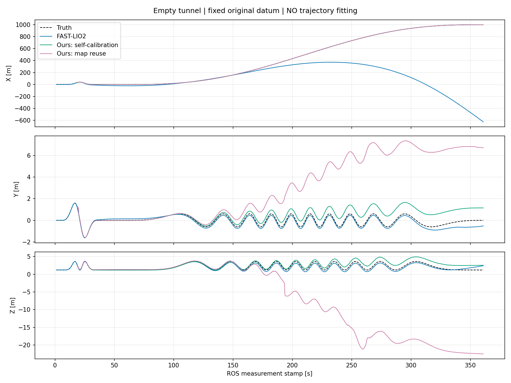
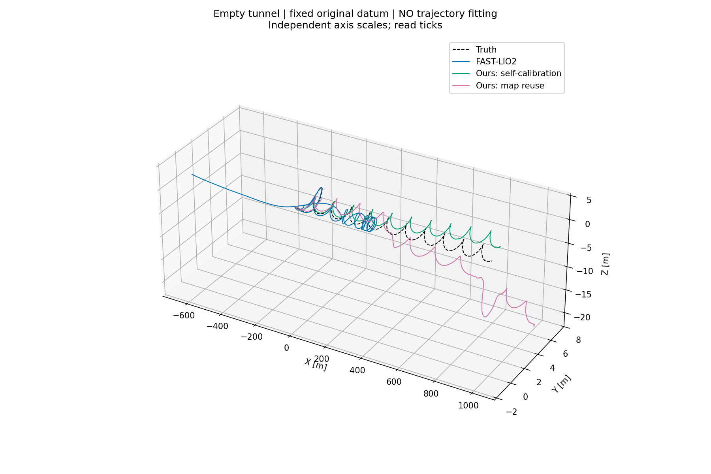
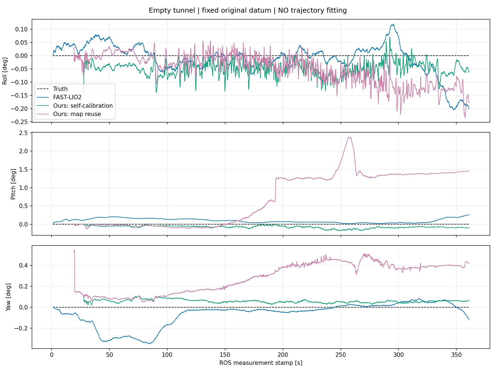
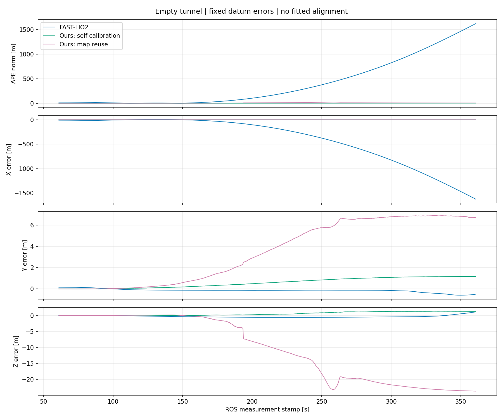

# 空隧道、入口启动：FAST-LIO 与本方法无图/有图对比

本报告是 2026-10-23 用户指定的新场景实验，旧场景结果不改写。只比较 FAST-LIO2、本方法无图和本方法有图；后两组使用原始 UWB 紧耦合，FAST-LIO 只用 LiDAR+IMU。本方法使用 GPU，FAST-LIO 使用原生 CPU。没有修改估计器参数以追求某种排名。

本次固定坐标 APE RMSE：FAST-LIO **613.528 m**，无图 **1.074 m**，有图 **14.956 m**。FAST-LIO 严重轴向漂移，有图横向/高度失控；无图虽较小但仍有失效状态及初始化可重复性问题，三者不能统称定位验收通过。

## 场景与输入

- `empty_tunnel_straight_v2`：长 2400 m、宽 6 m、高 5 m，仅两侧墙、地面、顶板。**钢轨、枕木、柜体全部移除**，UWB 柜体遮挡也同步移除。0.1 m 体素，开放入口，没有新增端面墙。入口处的表面终止边缘仍可能可见，不能宣称所有位置都严格轴向不可观。
- 所有新现场运行从 `(0,0,1.2)` m、yaw=0 启动，仅用于仿真与离线评估，不作为估计器先验；两个 launch 默认起点也已更新。
- 保持原来的 360 s 路线形式：前 60 s 局部三维标定机动，后 300 s 到 x=1000。**这不是恒高沿中心线直行**。因起点从 220 改为 0，后段轴向路程由 780 增为 1000 m，峰值轴向速度由 4.875 增为 6.25 m/s；所以与旧报告的变化不能全部归因于删去轨道特征。
- 40×512 射线、10 Hz snapshot LiDAR、200 Hz IMU、40 m LiDAR 量程、原噪声和外参不变；7 个 UWB 基站/400 m 间隔、800 m 真实三维量程、LOS、0.10 m 测距噪声不变。没有 rolling 验证。
- 唯一完整评测输入：[seed 1 原始输入](../log/20261023T034937Z_071)，72,000 条 IMU、3,600 帧点云、26,114 条 UWB。MCAP SHA-256：`40cdd3f6bd2391d93ea89636137bbb9df1f47f804914ef986c4bb10f788210f1`。三组各自运行身份中引用的原始文件哈希相同。此为输入文件/发布侧证明，不宣称独立接收侧逐消息录包。
- 有图组只使用独立 seed 0 的[最终地图](../log/20261023T033506Z_462/export/map/calibrated_map.json)，SHA-256 `73e3660b3e326de847680ded52bfa65cd8b2d5f144e4002519df70affb0d2443`，未使用评测 seed 1 建图。该地图只初始化 3 个基站，另 4 个未初始化；来源运行有 1,751 帧 LOST、1,483 帧 DEGRADED，位置 RMSE 约 3.82 m，**不是健康或真值地图**。

## APE：固定坐标约定，不拟合轨迹

主表不执行全程 SE(3) 配准，也不按估计器第一帧误差作校正。局部输出只通过预先确定的原始启动 datum 转到世界坐标：本次 yaw=0，平移 `(0,0,1.2)` m；有图组用**原始 seed 0 建图 datum**，不是用复用运行起点重新校正。该 datum 仅供离线评估，保留初始位置/姿态误差，不送入算法。

`e(t) = p_est_world(t) - p_truth(t)`，`APE(t)=||e(t)||`。主窗口为 ROS stamp 61–360.9 s，0.1 s 网格，最近输出时间容差 0.051 s；仅对真值作时间插值，不跨输出断档补轨迹。共同有效样本 **3000/3000**。不删除 LOST/DEGRADED 或大误差点。缺失结果为 N/A。

| 方法 | APE RMSE (m) | X RMSE (m) | Y RMSE (m) | Z RMSE (m) | APE P95 (m) | 最大 APE (m) | 姿态 RMSE (deg) |
|---|---:|---:|---:|---:|---:|---:|---:|
| FAST-LIO2（LiDAR+IMU） | 613.528 | 613.528 | 0.230 | 0.386 | 1409.829 | 1626.275 | 0.167 |
| 本方法无图（UWB 联合自标定） | 1.074 | 0.015 | 0.712 | 0.804 | 1.718 | 1.755 | 0.120 |
| 本方法有图（UWB 地图复用） | 14.956 | 0.134 | 4.510 | 14.259 | 24.445 | 24.624 | 1.119 |

| 方法 | 输出帧数 | 首末 stamp (s) | 主窗口覆盖率 | 完整运行状态计数 |
|---|---:|---|---:|---|
| FAST-LIO2（LiDAR+IMU） | 3596 | 1.4–360.9 | 100.0% | {'not_published': 3596} |
| 本方法无图（UWB 联合自标定） | 3332 | 27.8–360.9 | 100.0% | {'LOST': 29, 'DEGRADED': 3303} |
| 本方法有图（UWB 地图复用） | 3416 | 19.4–360.9 | 100.0% | {'DEGRADED': 3271, 'LOST': 145} |

FAST-LIO 本次未发布与本方法等价的健康状态，`not_published` 不表示 TRACKING。`completed` 是进程生命周期，不是定位有效性通过。原自动报告里的基础检查 PASS 也不覆盖精度或健康状态。

## 曲线：FAST-LIO、两种本方法与真值

以下四图均采用上述固定 datum，没有拟合轨迹。XYZ 为位置变化，RPY 为姿态变化；误差图独立列出。





三维图各轴显示比例独立，须结合刻度阅读，不是等比例空间图。



RPY 采用 `R=Rz(yaw) Ry(pitch) Rx(roll)`，单位度，角度换支展开；不平滑轨迹。真值机体朝向基本固定，横向/高度位置变化不等于机体转动。



原生 CSV 输出未经任何空间变换的图：[XYZ](figures/empty_pose_native_xyz.png)、[三维轨迹](figures/empty_pose_native_3d.png)、[RPY](figures/empty_pose_native_rpy.png)。这些输出各在自身坐标系，不直接把坐标差当误差。

另保留只关联一次首输出姿态的补充图：[XYZ](figures/empty_pose_first_pose_xyz.png)、[三维](figures/empty_pose_first_pose_3d.png)、[RPY](figures/empty_pose_first_pose_rpy.png)。它们会消除各自首帧误差，不用于上面的主表；对应指标和变换见 JSON。

## 失败、可重复性及解释边界

1. seed 1 现场无图运行 [20261023T034141Z_099](../log/20261023T034141Z_099/runtime/odometry_console.log) 在 60 s 初始化上限后以 `INITIALIZATION_AMBIGUOUS_TIMEOUT` 失败，零轨迹。随后对完整冻结输入的无图配对回放在 27.8 s 开始输出。两者算法配置没有调参，但启动结果不一致，**初始化可重复性尚未证明**；不能只保留回放成功。具体是输入交付时序、候选调度还是其他差异，本轮没有完成因果诊断。
2. 最初用 record_only 路径附带 LIO 采集输入，[20261023T034400Z_424](../log/20261023T034400Z_424/runtime/odometry_console.log) 在约 135 s 因不可解线性系统退出。该失败保留，未纳入三组排名。随后新增纯传感器 `--capture-only`，通过 8 s 冒烟验证后完成唯一完整录包，没有靠忽略估计器异常继续录制。
3. 独立建图本身已有明显失效；有图组也出现大幅横向/高度漂移，不能以“有地图”视为健康定位。无图组虽然完整回放，仍有 LOST/DEGRADED，不能单凭平均误差宣称系统可靠。
4. 这是一套冻结输入、一次配对回放结果，不是多种子统计或部署认证。未追加调参重跑，也不预设 FAST-LIO 必须发散。本轮未隔离地图误差、轴向几何退化、姿态/IMU 漂移等各自贡献，不作未经验证的归因。

## 运行与复现

- FAST-LIO2（LiDAR+IMU）：[运行目录](../log/20261023T040819Z_553)、[轨迹](../log/20261023T040819Z_553/export/odometry/trajectory.csv)。
- 本方法无图（UWB 联合自标定）：[运行目录](../log/20261023T035548Z_992)、[轨迹](../log/20261023T035548Z_992/export/odometry/trajectory.csv)。
- 本方法有图（UWB 地图复用）：[运行目录](../log/20261023T040208Z_950)、[轨迹](../log/20261023T040208Z_950/export/odometry/trajectory.csv)。

- [机器可读评估及输入哈希](empty_tunnel_results.json)、[首姿态绘图变换](empty_pose_plot_metadata.json)、[冻结实验协议与必要修订](empty_tunnel_comparison_protocol.md)。
- [场景构建](../log/empty-tunnel-build.txt)、[24 项物理/渲染检查](../log/empty-tunnel-scene-tests.txt)、[纯录制入口构建](../log/empty-tunnel-capture-build.txt)、[3 项固定 datum 检查](../log/empty-tunnel-fixed-datum-tests.txt)、[3 项 watchdog 检查](../log/empty-tunnel-watchdog-tests.txt)。这些检查不等于定位通过。
- 起初一次运行继承了项目外日志根，已主动中断并将本次产物移回项目：[中断记录](../log/20261023T033429Z_304)。后续显式指定 `LIUO_RUN_ROOT`。

```bash
cd /home/dev/code/ws_tunnel/src/liuo_tunnel
export LIUO_RUN_ROOT="$PWD/log"
# 独立首次地图，使用输出 run 中 export/map/calibrated_map.json
./tools/run.sh --config packages/liuo_tunnel/config/phase3_self_calibrate.json \
  --installation packages/liuo_tunnel/config/installation/straight_simulated.json \
  --duration 360 --seed 0 --calibration-route --sim-start 0 0 1.2 0 --formal --wall-timeout 600
# 与任何估计器生命周期独立的完整输入
./tools/run.sh --capture-only --config packages/liuo_tunnel/config/phase2_continuous_walls_off.json \
  --duration 360 --seed 1 --calibration-route --sim-start 0 0 1.2 0 --wall-timeout 600
# 重放本次冻结输入
./tools/run.sh --replay log/20261023T034937Z_071 \
  --config packages/liuo_tunnel/config/phase3_self_calibrate.json \
  --installation packages/liuo_tunnel/config/installation/straight_simulated.json --formal --wall-timeout 600
./tools/run.sh --replay log/20261023T034937Z_071 \
  --config packages/liuo_tunnel/config/phase3_reuse_map.json \
  --map log/20261023T033506Z_462/export/map/calibrated_map.json --formal --wall-timeout 600
bash tools/baselines/run.sh fastlio --source "$PWD/log/20261023T034937Z_071" --duration 360
# 仅重新评估/绘图：不会重新运行定位
python3 tools/baselines/evaluate_empty.py
python3 tools/baselines/plot_pose_comparison.py --runs tools/baselines/empty_runs.json --prefix empty_pose
```

重跑的结果可能因前述初始化可重复性问题不同，以上命令不是保证复现同一精度的承诺。运行器有总超时与无进度保护，只停止自身任务。未修改旧场景图表或把失败标记为阶段完成。

独立校核：直接从各 CSV 取窗口内 3,000 个输出，只在 Z 加固定初始 datum 1.2 m 后计算 RMSE，与主评估一致，见 [交叉检查](../log/empty-tunnel-evaluation-crosscheck.json)。

代码记录：场景与入口默认值 `21bcc67`，入口路线校验修正 `848541e`，固定 datum 评估 `e0263fd`，纯传感器采集及缺失结果处理 `6a6aeb3`。各 run manifest 保留实际运行源码及二进制身份；本轮未修改 FAST-LIO 或本方法估计器数学实现。
