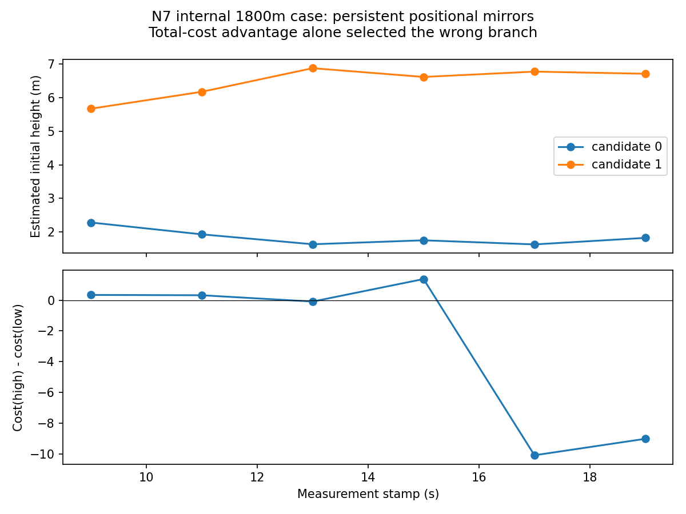

# 几何关联与有限多候选初始化：代表性结果

**阅读顺序：以下 N7/N8 是历史记录；当前实现及结论见文末 N11 核验。历史失败没有改判。**

2026-10-22。本轮遵循用户最新缩小的范围，只做初始化；未启动全程ON/OFF、断流或多种子。第二阶段未完成。本报告不把局部路径的限制说成整个算法不可行。

## 实现及合法信息

复用d3cd88e生产实现：专用静止原始点云拟合左右墙3D法向/中线偏距；该帧不再参加VGICP。地图A与带相关噪声的有符号安装偏距通过二维水平轴L连接，墙面观测通过X0连接L；地图先验仅一次。原始GPU VGICP、IMU、TA/AA仍在同一图。静止、已知外参可用；未使用起点、航向、固定高度、模拟器边界或真值轨道先验。

地图文件安装信息是**模拟安装测量**，不是现场承诺：共同直线参考、固定正方向，独立随机seed67130，公共σ0.02m、每站独立σ0.05m，完整7×7相关协方差；不由估计器从ID或map.y生成。仅适用于已声明的直隧道关联假设，弯道不能照搬。地图本身保留相关测绘不确定度。

三站原始静止测距的两个镜像初值×两种墙轴方向，形成四个候选。全部使用原始图评估，每2秒新数据复核。原有“总代价差5＋跨批稳定”被N7第三例否定。1f382d5增加保守认证限制：与赢家同向（现有0.1rad簇尺度）但位置仍分离（现有0.5m簇尺度）的候选不能仅凭总代价优势删除；报告INITIALIZING/POSITION_BRANCH_UNVERIFIED。两个尺度是有限搜索的盆地区分，不是导航精度门槛。

这不是新增独立判别测量，也不是全局唯一性证明。即使所有种子收敛，仍可能落入同一错误盆地；弱后验必须继续降级，不能以LM完成代替健康。N6入口旧结果保留，但它使用旧门控，不能冒充当前门控的通过证据。

## 预声明实验与实测

seed=0，20秒、1×、5秒静止启动、GPU、snapshot。世界轴向运动与机身朝向独立；三组仿真/评估端(x,y,z,yaw)为(200,0,1.2,0)、(1000,0.8,2,π/2)、(1800,-0.8,1.6,π)。参数只传仿真进程。七站/400m、800m真实三维量程、LOS和0.10m测距σ未变。

| 例子/版本 | run | 初始化与状态 | 轴/横/高RMSE m | 结果 |
|---|---|---|---|---|
| 200m/0°，7ca8976 | 20261022T033532Z_307 | stamp11收敛，100帧全部DEGRADED | .03393/.04651/.33634 | 合法盆地保留；实时FAIL |
| 1000m/90°，7ca8976 | 20261022T033559Z_463 | stamp11收敛，100帧全部DEGRADED | .03246/.05053/1.54647 | 高度有效性FAIL；实时FAIL |
| 1800m/180°，7ca8976 | 20261022T033636Z_105 | 错误高分支移交，2帧DEGRADED后LOST | .09363/.05395/5.24309（仅2帧） | 初始化认证FAIL；l0数值FAIL |
| 200m/0°，1f382d5 | 20261022T034003Z_902 | 严格同输入回放，stamp11收敛，100帧DEGRADED | 与原例接近，总RMSE .34125 | 门控保留合法收敛PASS；实时FAIL |
| 1800m/180°，1f382d5 | 20261022T034039Z_290 | 全程INITIALIZING，0里程计、0TRACKING | 不适用 | 拒绝错误认证PASS；定位初始化未完成 |

1000m例末帧地图z=-0.15379m（真值评估z=2m），不能称高度有效。1800m旧run已输出两帧错误高分支，并非仅“可能错误”；随后l0线性系统失败未修复，新门控避免移交并不等于修复该数值问题。第三例新run为同seed重新生成，不称严格配对；200m新run则raw内容/身份哈希均核对通过。

200m与1000m例姿态P95分别.1791°/.1110°；速度分量RMSE分别(.02010,.00421,.01335)/(.01764,.00173,.01023)m/s。实际可用基站数分别3/4/4。所有完整20秒输入均4000 IMU、200点云、4000时钟，UWB分别1275/1660/1660条。最大在线车辆状态101；没有增加队列或降低播放速率。

200m当前回放处理P95=51.4614ms，墙钟端到端P95=.476256s，**仍FAIL**。1000m原例对应54.9498ms/1.134262s。200m当前位置NEES3.9732、联合9D NEES22.9008、95%位置覆盖98%；1000m原例8.2810/25.2081/52%。单run相关帧统计，不宣称严格一致性通过，也没有反调噪声。无输出的第三例评估器明确FAIL；不得将生命周期completed或拒绝所有输出当作定位通过。

## 本轮新增证据与缺失关联

N7第三例stamp19，低/高候选初始z分别1.82516/6.70894m，总代价207978.236/207969.211；高分支反而低9.0245。stamp17也有同向优势，因而旧门控错误认证。新门控对同一失败模式保留歧义，组件回归使用这些实测数字，不依赖真值阈值。



安装方程为 `d_j = n_xyᵀ A_j,xy - c`，墙面横向方程为 `c - n_xyᵀ(p_xy + (R center_body)_xy)`。对机器人和局部地面/顶板共同竖直平移，其几何关联残差不变：**当前安装资料仍没有把局部地面/顶板的高度注册到基站地图**。实际墙面因子高度/沿轴自由度及坐标等变测试已通过。这个结论只针对几何内外判据，不宣称原始UWB无高度导数或整个三传感器系统不可观。

局部点云中的离地/顶板间隙可以可靠存在，但不能先随候选放到地图，再据此排除该候选。N7/N8现在提供了新的实际生产证据：合法低分支仍存在，错误高分支仍可有更低全图代价，当前20秒观测没有经验证的独立认证方法。

如果要利用“在顶板以下/地面以上”直接排除此例，最小补充是**当前可识别截面的一项带误差的地图注册地面或顶板高度/面**，或等价的已识别基站—地面相对高度及有界截面关联。候选间竖直相差约4.884m；综合局部几何、注册量及候选不确定度的可行区间需要足够窄以分开它们（理想对称情形半宽须小于约2.442m，实际还要扣除各项误差）。这不是要求机器人固定高度、真值起点或精确航向，也不把该理想上界当现场精度承诺。另一路是用更有信息的原始运动/测距和经验证的独立候选认证，尚未验证，不据本轮失败否定它。

因此本轮完成最小生产实现与代表性验证，200m有合法收敛证据，其他例子揭示高度弱约束和未排除镜像；**不能宣称全部代表性初始化有效，更不能启动部署验收或标记阶段完成**。这满足对缺失几何关联作具体推导和针对性实验证据的交付，不是旧全程误差的重复引用。本轮到此停止调参，不进入全程/断流。

## 复现、身份与文件

```bash
cd /home/dev/code/ws_tunnel/src/liuo_tunnel
./tools/build.sh
export LIUO_RUN_ROOT=/home/dev/code/ws_tunnel/src/liuo_tunnel/log
./tools/run.sh --replay log/20261022T033532Z_307 \
  --config log/20261022T034003Z_902/metadata/config/phase1.json \
  --map log/20261022T034003Z_902/metadata/config/map.json --wall-timeout 90
./tools/run.sh --duration 20 --seed 0 --sim-start 1800 -0.8 1.6 3.141592653589793 \
  --capture --config log/20261022T034003Z_902/metadata/config/phase1.json \
  --map log/20261022T034003Z_902/metadata/config/map.json --wall-timeout 90
```

历史配置使用run中的冻结快照，避免后续候选配置修改改变复现条件。上述命令预计返回运行检查FAIL，原因如表；不能隐藏非零退出。1000m原始输入保留，可按其run路径回放，但本轮未追加重跑。新起点仅验证融合配置；未验证该起点的OFF规范对齐评估。

冻结候选配置SHA256：`bf08b6a7acfa2c960f5bfaf46186fa9ef33092de6ffeca623b3ea033b3e0773e`。
安装地图SHA256：`68eb6929c3268a0087e390840f47091659f9e50d9eca5cb9b94af9ecffc118c5`。
200m原始MCAP SHA256：`fee017dcc0bf038166d8eb24ee1e5297b1ab76bd089be4d1b7a8a7f9be3177f0`。
每run的`metadata/manifests/input_identity.json`保存命令/二进制身份；回放`frozen_input.json`保存逐原始话题哈希。`profiling/bootstrap_branches.csv`记录全部候选，`dedicated_wall_observation.json`记录实际专用点云；`export/odometry/trajectory.csv`、`covariance.csv`及`export/analysis/report.json`保存输出/评估。原失败runtime/odometry_failure.json保留。聚合分量结果/分支哈希见`log/initialization_n7/summary.json`。

独立构建通过；16项初始化候选/因子测试、仿真内部启动运动/比力测试、非单位真值姿态协方差回归通过。日志`log/phase2-n7-{build,physics-tests,covariance-tests}.txt`与`log/phase2-n8-{build,tests}.txt`。未重跑不受影响的全套合同，未验证rolling/Mid-360实扫、完整无人机、全程持续定位、断流恢复或现场部署。

## 后续持续Goal进展：N9/N10（保留上文历史）

后续实现未停在几何关联反例：20c645a补回此前遗漏的合法静止原始TA/AA，9860ee4将安装轴改为相对地图数值中心的等价坐标表达，消除实际正定块被尺度检查拒绝的故障，不增先验、不改噪声、不换求解器。

1000m同输入run `20261022T034736Z_149`：156 TA+12 AA原始静止测距各一次入图；总RMSE从1.548降至.521m，末高度从-.154变为1.900m。1800m同输入run `20261022T035634Z_916`：镜像种子收敛，连续100帧、无l0异常，总RMSE .368m。两例均全部DEGRADED，实际输入哈希核对通过。原失败全部保留。当前仍有启动端到端延迟FAIL（1800m P95 .574s）和局部协方差局限；没有完成阶段，也未启动全程/断流。详细证据、修复推导和后续有界实时改进实验见phase2_acceptance.md N9/N10/N11。

当前候选配置已含静止测距移交，所以上文复现命令特意使用历史run配置快照。复现本段最新实现则使用项目当前phase2_joint_installation.json，原始输入仍为上述保留的冻结capture；不得将新结果覆写到旧run。

## 当前交付核验：N11 有限候选初始化

本次按用户“只聚焦几何关联与有限候选初始化”的范围收尾。实际代码已完成N9/N10/N11修复，不能继续把上文旧失败当作当前实现结论。复用已经完成且未受后续运行工具变更影响的三个GPU短程回放，不重复捕获、构建或扩展campaign。当前核查HEAD为2e8f424，初始工作树干净；生产初始化证据绑定3604bbf。

### 可观测关联与自由度

实际PointCloud2中的两侧墙给出机体坐标中的无向法向及横向中心；独占静止帧stamp2.9对应静止末位姿stamp3，不进入VGICP。已知地图的A变量、联合测绘协方差和有符号安装偏距通过共享二维参考L建立关联；安装误差有公共分量，不能作为独立机器人位置先验。数值中心origin只用于改善消元尺度，不增加物理信息。

模型为 `d_j=n·(A_j-origin)-c'` 与 `c'-n·(p+R center_body-origin)=0`，墙法向角按π周期比较。这能关联水平横向位置及无向轴线，**仍不提供沿轴坐标、地面/顶板地图高度或轴线正反方向**。这些剩余量由原始测距、IMU和运动期间点云在同图中约束；不能仅凭墙面宣布全局唯一。现场仍需确认安装资料的共同参考、正方向及误差；当前数值是明确标记的模拟安装测量，不是新增现场承诺。

候选为三个可用基站原始静止测距的双镜像×两种轴向，共四个；选择三元组依据几何面积，不按ID猜坐标。全部候选在同一快照原始图上求解，跨两批新观测检查。同向仍分离的候选保留POSITION_BRANCH_UNVERIFIED，不以总代价更低强选。失败或非有限候选不能认证。分步LM保留原求解语义及四候选，不丢弃求解期间原始观测；静止原始TA/AA各一次入图，初值摘要不作为额外测量。

### 固定seed=0、三个预声明起点的最新实测

全部20秒、GPU、snapshot、严格原始输入哈希核对通过；沿用N7预声明起点，未新增种子。

| 起点/朝向 | 最新run | 首次输出stamp / 帧数 | 轴/横/高RMSE m | 端到端P95 ms | 输出状态 |
|---|---|---|---|---|---|
| 200m / 0° | 20261022T040638Z_195 | 13.0 / 80 | .03260/.05545/.42601 | 68.55 | 全部DEGRADED |
| 1000m / 90° | 20261022T040737Z_906 | 14.5 / 65 | .07412/.06462/.28915 | 63.01 | 全部DEGRADED |
| 1800m / 180° | 20261022T040502Z_331 | 12.8 / 82 | .04021/.05473/.33315 | 65.22 | 全部DEGRADED |

1800m原错误高分支z0≈6.71m不再被移交。stamp9同向两个镜像种子收敛到z0=2.31908/2.32694m，stamp11收敛到1.99144951/1.99144952m；该批反向候选代价106674.119，同向87075.987。完成四候选比较后stamp12.8移交，无l0异常。真值初高1.6m仅用于此处评估，不进候选生成或门控。200m同向候选stamp11约1.09547m；1000m约1.24854m（真值2m），后者仍有明显初始高度误差，末输出z=2.01136m。不能把盆地收敛说成精确高度认证。

**本轮结束条件1在上述有限代表性范围内得到支持：** 已实现合法几何关联、有限候选、同图评估和歧义门控；原错误高位分支未移交，合法低位盆地保留，三例实际输出而非永久INITIALIZING。初始化门控/实时运行检查PASS；任意启动、完整全局分支覆盖及统计一致性未验证。尤其1000m位置NEES18.21、95%覆盖0%，说明局部后验过度自信仍存在，不能宣称健康定位或部署通过。三例状态均为DEGRADED，未因初始化完成虚报TRACKING。

源实现提交：20c645a（静止原始测距移交）、9860ee4（等价中心化）、3604bbf（有界分步候选求解）。复用18项候选/因子检查及分步/整批等价测试，日志为log/phase2-n10-centered-tests.txt和log/phase2-n11-step-tests.txt。未改算法，不重复已通过测试。

### 冻结输入复现

```bash
cd /home/dev/code/ws_tunnel/src/liuo_tunnel
./tools/build.sh
export LIUO_RUN_ROOT="$PWD/log"
./tools/run.sh --replay log/20261022T034039Z_290 \
  --config log/20261022T040502Z_331/metadata/config/phase1.json \
  --map log/20261022T040502Z_331/metadata/config/map.json --wall-timeout 90
```

200m、1000m分别替换输入为20261022T033532Z_307、20261022T033559Z_463；三例冻结配置/地图内容相同。构建当前代码可复现实验；精确原二进制身份见各run的metadata/manifests/input_identity.json。分支完整记录在profiling/bootstrap_branches.csv，独占点云记录在dedicated_wall_observation.json。当前汇总、分量误差及证据SHA256见[静态证据摘要](initialization_latest_evidence.json)。没有重写原run。

### 范围之外已发生运行的收尾

核查时此前500秒全程捕获20261022T041540Z_602已于04:24:08 UTC完成，无残留任务进程；不再启动OFF/断流或后续批次，全部证据保留。该运行轴/横/高RMSE .04525/1.07926/4.10828m，曾出现高度误差7m以上仍TRACKING，状态统计4765 TRACKING/104 DEGRADED/13 LOST。**持续定位有效性与状态诚实性FAIL**，即使其单次合同报告为PASS也不能改变此结论。这是后续运行问题，不用它替代本轮初始化验证。第二阶段和Goal保持未完成；下一阶段应先分析该持续漂移与健康认证，再安排正常全程配对。


最终冻结版本db1c1ad重新验证三个既有内部输入：200m/1000m/1800m分别为20261022T045159Z_885、20261022T051133Z_448、20261022T051204Z_138，均完成且全部DEGRADED，严格原始输入核对通过。完整最新证据与第二阶段范围结论见[交付报告](phase2_representative_results.md)；以上旧失败及N12问题原样保留，不能拿历史局限替代当前结果。
