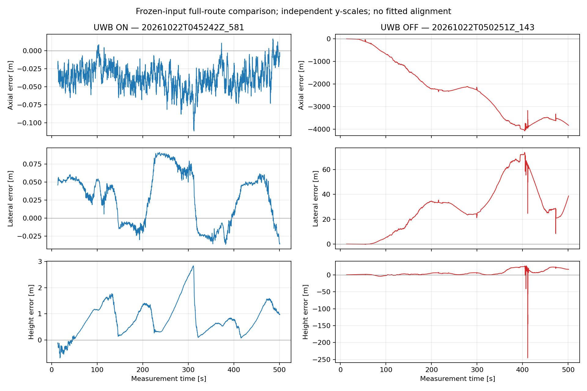
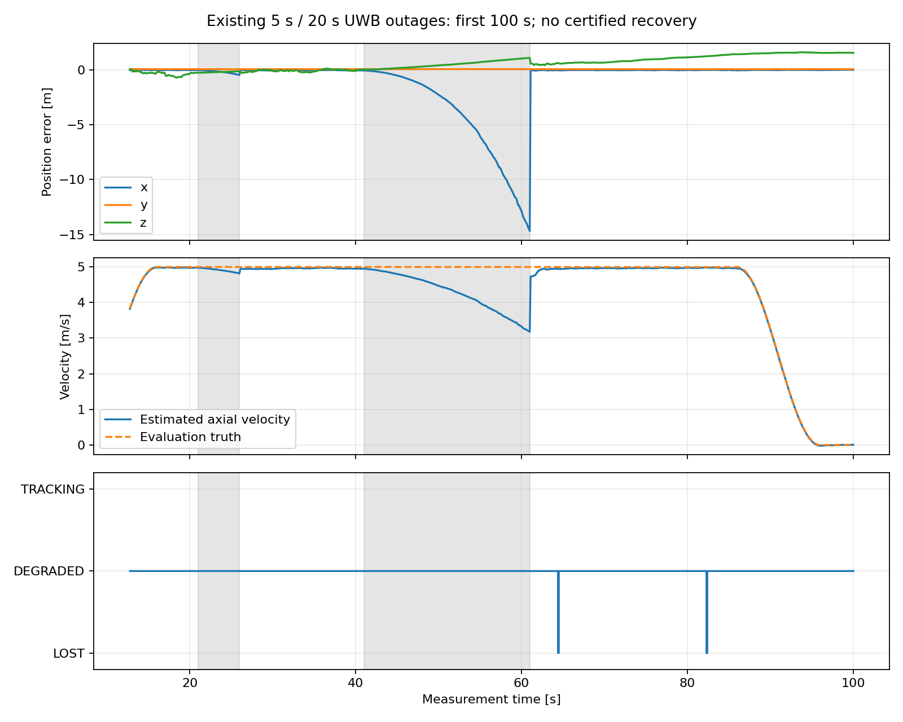

# 第二阶段代表性仿真交付

2026-10-22。按用户明确修订的第二阶段范围核查，结论限定为：**代表性仿真范围内系统完成且验证有效**。这不是全面可部署认证，不是高精度、任意启动或统计一致性通过。原始GPU VGICP、IMU、TA/AA在同一图；没有UWB+LIO松融合、真值位姿先验或未知基站自标定。

## 范围与判断依据

固定seed=0，三个预声明内部起点/朝向；一份500秒完整原始输入的ON/OFF，以及同输入既有5s/20s断流。正式路线为200→600→1200→1800→2350m，覆盖200–2350m，不冒称重新验证0–200m入口、整条往返或弯道。七站纵向0/400/800/1200/1600/2000/2400m，任意连续1km最多三站；800m真实三维量程、LOS、0.10m噪声不变。路线中有效LOS链路数3–4，通信覆盖长度可超过1km。

本结论不只依据OFF失效：ON全程轴向/横向误差分别不超过0.112/0.092m，高度最大2.834m、呈积累后纠偏而非原N12持续增长到7m以上；最大相邻输出变化xyz为0.5163/0.0110/0.2182m，轴向变化包含实际5m/s运动。位置、姿态、速度及资源均完整记录，无非预期reset/fallback/NaN。高度仍弱，不能用于宣称高精度3D定位；状态明确退化/未认证恢复。参考0.30m目标未达，未调噪声或另设更宽精度门槛。

侧墙因子本身不约束轴向/高度；轴向约束来自原始测距与运动图，已有原始UWB扰动影响共享X/V/B和点云线性化的GPU测试可复用。ON还使用合法安装关联，OFF为纯LIO、没有地图/安装因子，因此这是系统ON/OFF，不将所有横向改善单独归因于UWB。模式只改配置uwb.mode，实际点云分配会因是否使用专用墙观测而不同；不能声称处理后的每个点或因子完全相同。

## 逐项核查

| 要求 | 当前结果 | 直接证据与边界 |
|---|---|---|
| 原始三传感器同图紧耦合、GPU | PASS | 各run的graph.csv、GPU preflight、input_identity；同图/导数既有测试；无CPU冒充GPU |
| 实测几何关联、有限候选及诚实初始化 | PASS（声明三例） | 四个原始测距镜像×无向轴候选的有限比较；未区分同向分支保留INITIALIZING；三例最终实际输出 |
| 同输入正常全程ON/OFF | PASS（配对与代表性有效性） | 同原始话题哈希、同二进制、同LIO设置；4876个共同时刻；融合自身表现与全轨迹图如下 |
| 5s/20s断流状态行为 | PASS（行为合同） | 投递核对PASS、持续输出；恢复计时器与新量测均不独自认证恢复；精度/速度问题未掩盖 |
| 实时性、资源有界、连续性 | PASS（本硬件/路线） | GPU 1×；ON处理35.40ms、端到端41.45ms P95；窗口101；初始化后有效输出99.84% |
| 协方差正确输出与限制披露 | PASS（输出合同）；统计一致性FAIL/后移 | 原联合局部协方差不改；ON位置NEES44.48、95%覆盖6.11%，不得当成校准的全局置信度 |
| 原0.30m精度、20s断流名义速度保持 | FAIL（保留，非本阶段完成门槛） | ON RMSE1.034m；长断流速度误差约−1.80m/s、轴向漂移约14.45m |
| 10种子、完整故障矩阵、任意启动、完整无人机、真实Mid-360、rolling、部署认证 | 未验证/后移 | 未启动campaign，不用snapshot冒充rolling |

## 初始化：来源、关联及剩余自由度

实际PointCloud2提取侧墙法向/中心；安装记录的共同直线参考、墙侧正方向、联合误差连接已知地图A与二维参考L。安装资料为明确标记的模拟测量：seed67130，公共σ0.02m、独立σ0.05m，完整7×7协方差；不是现场精度承诺。地图保留相关测绘不确定度，先验一次。没有注册地图地面/顶板，也没有固定机器人高度、位置或航向。

墙几何只建立横向及无向轴关联；高度、里程、方向剩余分支由原始测距/IMU/点云随运动比较。三站测距双镜像×两种轴向=四候选；两批数据比较和同向分离保护仅是有限搜索门控，不证明全局唯一或任意启动成功。静止段原始TA/AA逐条一次入图，种子摘要不额外当观测。专用静止点云不进入VGICP；持续墙观测每十帧保留原始索引每四点之一，其余点才进VGICP，避免同点重复计数。mrad/中心化只是数值坐标变换，阈值相应换算，不增加信息。

| 起点(x,y,z,yaw) | 最终版本run | 观测到首次输出的时间 | 输出 | RMSE / 端到端P95 |
|---|---|---|---|---|
| (200,0,1.2,0) | 20261022T045159Z_885 | 12.2s | 78帧DEGRADED | .3736m / 68.98ms |
| (1000,.8,2,π/2) | 20261022T051133Z_448 | 13.5s | 65帧DEGRADED | .3064m / 60.96ms |
| (1800,−.8,1.6,π) | 20261022T051204Z_138 | 11.8s | 82帧DEGRADED | .3394m / 57.79ms |

三例均严格原包回放，起点/朝向只在模拟与评估端。1800m旧高位镜像没有再次移交，合法盆地保留。全部在20s初始化预算内；初始化期间不输出虚假里程计，不把永久INITIALIZING当通过。正式全程ON的启动完成stamp13.4（首观测stamp1，历时12.4s），工作预算导致首次发布时刻可有少量差异，不宣称逐位确定性。

## 正常全程：误差、连续性与资源

ON：`log/20261022T045242Z_581`；OFF：`log/20261022T050251Z_143`。共同stamp13.4–500.9，共4876帧。ON使用地图坐标；OFF仅在评估端以首个真值位置/yaw建立固定规范，不做全轨迹最佳拟合、不反馈估计器。

| 指标 | ON | OFF |
|---|---:|---:|
| 轴/横/高RMSE，m | .04070 / .04601 / 1.03249 | 2535.744 / 34.479 / 10.914 |
| 位置RMSE，m | 1.03431 | 2536.00167 |
| 轴向P95 / max，m | .06425 / .11116 | 3827.513 / 4070.382 |
| 姿态误差P95，度 | .61205 | 4.84280 |
| 速度xyz RMSE，m/s | .02727 / .00498 / .03205 | 11.19570 / .42120 / .45515 |
| 处理 / 端到端P95，ms | 35.40 / 41.45 | 33.18 / 39.08 |
| 进程RSS采样峰值，KiB | 352096 | 311664 |
| 设备已用显存采样峰值，bytes | 1295056896 | 1261830144 |

显存是设备已用量采样，包含其他设备使用者，不冒称全部归本进程。ON窗口X/V/B各101，原始输入IMU/clock各100000、点云5000、UWB38847；无队列持续增长。

预声明退化区段x=300–2300m的4450个共同时刻，ON轴/横/高RMSE .04151/.04682/1.03480m；OFF为2509.220/35.483/10.502m。200–600、600–1200、1200–1800、1800–2350各段均保留在JSON，不挑区段。OFF明显失效，不能单凭它更差证明有效；ON自身的有界轨迹、各方向表现、诊断与资源才是结论的另一必要依据。



ON初始化后4876个预期时刻全部有输出、最大间隔0.1s；其中4868 DEGRADED、8 LOST，有效输出4868/4876=99.84%。包含启动期则5000个输入时刻中仅4876帧有里程计（97.52%），不能隐藏启动等待。8次LOST为postfit残差阈值越界，不自动等同于真实轨迹完全丢失；但其后没有独立恢复认证，不能仅因下批残差变小宣布健康。首个失效stamp64.4锁存至session结束。状态计数与起点时序独立保留。

## 断流：保持诚实，不宣称漂移已修复

run `log/20261022T051246Z_145`，同源500秒包，既有outages_only.json。相对输入开始20–25/40–60s，对应消息stamp21–26/41–61。1785条UWB按声明丢弃，实际投递及pressure_audit合同PASS；没有NLOS/额外故障扩展。

| 工况 | 窗口最大轴向误差 | 窗口末轴向速度误差 | 恢复后的在线结论 |
|---|---:|---:|---|
| 5s断流 | .467m | −.177m/s | 恢复未认证，无TRACKING |
| 20s断流 | 14.449m | −1.803m/s | 恢复未认证，无TRACKING |

恢复首秒最大位置误差约14.73m，最大相邻轴向位置校正15.12m；**不宣称平滑或无扰恢复**。后续轴向位置被测距拉回，不等于系统可认证恢复。不能直接把这种校正当成连续控制参考；本阶段不实现控制/规划。速度塌陷与运行姿态/偏置漂移仍存在，与初始化分支问题分开登记。

全程4882帧，4874 DEGRADED、8 LOST；初始化后有效率99.84%，最大间隔0.1s；全程零TRACKING。处理/端到端P95 35.19/41.44ms，位置RMSE1.647m，位置NEES47.04、95%覆盖4.04%。这些局部统计未达标，没有放大噪声制造通过。



`uwb_optimistic_position_trace`是当批原始TA共同世界平移雅可比在固定姿态/轨迹/基站下的乐观局部信息指标，不是实际定位协方差、NIS或全局分支证书。即使这一乐观指标也弱，就不让小联合后验独自宣告健康；通过它同样不能证明无多解。恢复失败锁存仅session重置清除，目前没有自动恢复认证能力。

## 冻结身份与复现

生产实现/所有最终run绑定 `db1c1ad`，三包独立构建、GPU运行。ON配置SHA256 `03fec708780b375f096c594f60a3feebaf7af37b881bf1b95740bc53c4a05683`；OFF `6034f5c08adf5e0264b8aba7c2ecb5a00da6751bc35fb3cbdf5c6e2391cb785d`；安装地图 `68eb6929c3268a0087e390840f47091659f9e50d9eca5cb9b94af9ecffc118c5`。

代表性完整输入 `log/20261022T041540Z_602/export/capture/raw/raw_0.mcap`，SHA256 `ada1393c661fbd6a5aacfb5f29cd302236fedaf399602c22da2a600791d2340e`。短例输入依次为20261022T033532Z_307、20261022T033559Z_463、20261022T034039Z_290。所有源码/二进制身份、每话题输入哈希、配置快照及失败原因在各run的metadata/runtime中。

```bash
cd /home/dev/code/ws_tunnel/src/liuo_tunnel
./tools/build.sh
export LIUO_RUN_ROOT="$PWD/log"
# 正常ON；记录命令输出的新run路径。
./tools/run.sh --replay log/20261022T041540Z_602 \
  --config packages/liuo_tunnel/config/phase2_continuous_walls.json \
  --map packages/liuo_tunnel/config/maps/surveyed_map_installation.json \
  --formal --wall-timeout 900
# 严格同输入OFF，仅mode不同；保留同一个已构建二进制。
./tools/run.sh --replay log/20261022T041540Z_602 \
  --config packages/liuo_tunnel/config/phase2_continuous_walls_off.json \
  --map packages/liuo_tunnel/config/maps/surveyed_map_installation.json \
  --formal --wall-timeout 900
# 现有双断流；不重新生成传感器输入。
./tools/run.sh --replay log/20261022T041540Z_602 \
  --config packages/liuo_tunnel/config/phase2_continuous_walls.json \
  --map packages/liuo_tunnel/config/maps/surveyed_map_installation.json \
  --delivery-profile packages/liuo_tunnel/config/delivery/outages_only.json \
  --formal --wall-timeout 900
# 对本次已交付的run核查；重新运行时替换路径。
python3 tools/compare_runs.py log/20261022T045242Z_581 log/20261022T050251Z_143 --strict-estimator-settings
python3 tools/pressure_audit.py log/20261022T051246Z_145
```

新捕获入口仍可用相同ON配置/地图加 `--duration 500 --seed 0 --sim-start 200 0 1.2 0 --capture --formal --wall-timeout 900`，但重新生成不是原包严格配对。本报告复现以保留的原包为准。运行器保留默认30秒无进度保护、900秒总墙钟上限，无自动无限重试。

## 测试、失败与迁移记录

相关提交：20c645a静止原始测距移交，9860ee4等价中心化，3604bbf分步候选，50d76f7独占持续墙观测，4d97ba3角度单位及阈值等价变换，db1c1ad正常失效锁存和弱几何诊断。迁移来源IAP fbccae16802402d7300bb817d2627f86e6a495df及公共依赖版本/许可证见THIRD_PARTY_NOTICES.md；不修改或运行依赖IAP。没有新分支/worktree。

复用未改动的同图、导数、边缘化、消息/时序、部署密度等已有证据；本轮相关9项墙面/点归属测试、3项尺度回归、12项状态测试和共同世界平移雅可比回归通过。日志log/phase2-n13-*.txt及phase2-n14-{status-tests,geometry-tests,build-fixed}.txt。状态修复前实测64.4s回归明确失败，保留phase2-n14-status-red.txt。测试类型拼写构建失败保留phase2-n14-build.txt，修复后独立构建通过。

全部旧失败原样保留。N13首短包20261022T043423Z_738出现实际正定团被GTSAM尺度检查拒绝，修复没有新先验/自动QR fallback。N14首OFF尝试20261022T050121Z_605在首条clock发布超250ms退出、无传感器/里程计；根因未确立，一次完全不改参数/代码的受控复跑完成，不能称启动可靠性全面验证。未删除该失败或将其当OFF算法对照。

完整数值、分段结果、身份和哈希见[证据摘要](phase2_representative_evidence.json)；历史逐轮记录见[phase2_acceptance.md](phase2_acceptance.md)。单次run仍为stage_acceptance=NOT_ASSESSED，本报告才按用户修订范围作综合判断，不回改原始报告。

后续：严格统计一致性与高度精度优化、独立恢复认证/连续校正接口、10种子/完整矩阵、弯道及复杂运动、真实Mid-360/rolling、完整无人机与现场部署。第三阶段未知基站自标定仍未实现；现有可复用接口为原始UwbRange、X/V/B/A联合图与相关地图输入、带来源/联合误差的安装记录、显式候选/状态/协方差输出。不得把已知地图实验当作首次已知基站高度或顺序的承诺。

最终完整性核查：六个成功run同一二进制、全部所列产物SHA256匹配、无估计器真值订阅、无输入合同违例。融合联合9D协方差全部有限/对称/正定，最小特征值约4.57e−8，最大不对称1.11e−16；这只证明输出数值合同，不证明统计校准。核查记录log/phase2-n14-completion-audit.json及证据JSON，所有旧报告保持原样。
