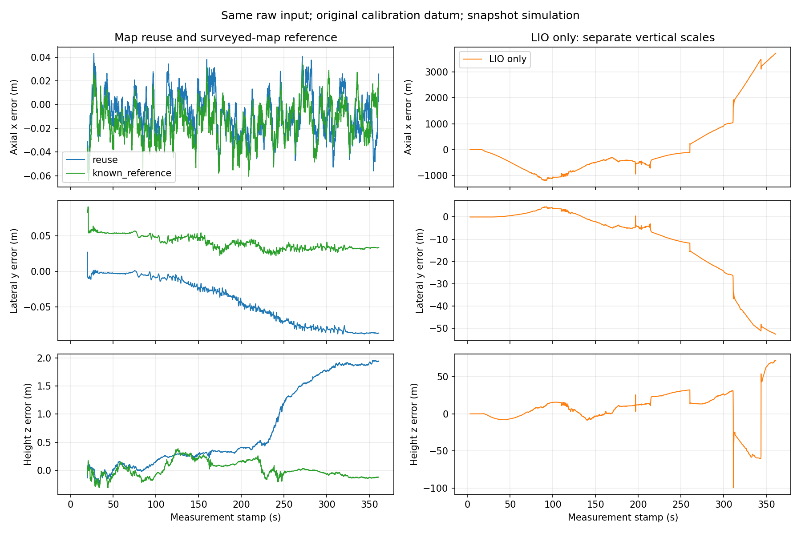

# 第三阶段实施与代表性证据

状态：代表性范围交付完成；当前结论与复现见下节。2026-10-22。
主需求为 phase3_requirements.md；第二阶段结果与失败保持原样。

## 当前交付结论（2026-10-22）

**代表性仿真中首次自标定及独立地图复用有效。** 此结论仅覆盖下面冻结的直隧道、两条360秒snapshot输入和已验证轨迹，不是全面可部署、精确三维地图、任意启动或统计一致性认证。原0.30/0.50m等参考精度未全部达到，没有修改噪声或放宽为另一套精度门槛。

首轮seed0从(200,0,1.2,0)启动，次轮seed1从(220,.2,1.6,π/2)启动；这些坐标只在仿真/评估端。前60秒局部闭合激励，随后300秒平滑行进至x≈1000m，含横向/高度变化。首次实际在线轨迹约覆盖200–1000m，次轮220–1000m；不宣称覆盖2.4km全隧道或该范围内任意体积/起点。原七站/400m、任意连续1km最多三站、800m真实三维量程、LOS及σ=.10m均保持。

### 按目标逐项核查

| 要求 | 结果及实际证据 |
|---|---|
| 首次未知基站同图估计 | PASS：仅加载无坐标installation文件；原始GPU VGICP/IMU/TA/AA与X/V/B/A/L同图，未读取surveyed/oracle坐标或真值位姿 |
| 延迟初始化及跨窗口信息 | PASS（声明实例）：站3在190.4秒确认，193条TA及190条历史AA一次移交；候选或轨迹结果不作为独立位姿先验；站4分支未决，5/6未初始化 |
| 地图导出与相关信息 | PASS：四个Point3＋共享L，共14维联合高斯边缘协方差；车辆被联合边缘化，保留A–A/A–L交叉项；声明局部单峰近似，未认证统计一致性 |
| 独立复用 | PASS（声明路线）：指定首轮地图字节完全一致地加载；不同起点/朝向及独立噪声；实际初始化并连续定位，无二次起点对齐 |
| 旧信息不重复 | PASS：首轮安装因子始终1；复用联合地图先验始终1、surveyed先验0、旧安装观测因子0；新会话原始观测是新数据 |
| 同输入ON/OFF及已知地图参照 | PASS：同原始话题哈希/数量、同二进制和LIO设置；复用/OFF严格配对；已知地图参照明确使用不同地图先验/启动设置，不称三者仅模式不同 |
| 首轮TA-only/TA+AA | PASS（对照执行）：同原包/二进制，配置仅use_aa不同；AA关闭后接受/摘要均0；结果不强求AA优于所有指标 |
| 地图往返/损坏/泄漏拒绝 | PASS：联合代价与信息往返、非SPD/多解/外参冲突/仿真命令来源拒绝；安装接口拒绝坐标和未经授权先验 |
| 实时、连续、有界、状态诚实 | PASS（本硬件/路线）：1×GPU、窗口101，完整输出/资源见下表；无TRACKING；失效后恢复未认证保持降级 |
| 高度精度与严格统计一致性 | FAIL/后移：高度误差和局部过度自信明确保留，不属于本阶段硬完成门槛 |
| 任意启动、完整无人机、弯道/全隧道、rolling、真实Mid-360、自动恢复、部署认证 | 未验证；不以snapshot或本次局部规范代替 |

### 冻结运行与数字

正式数字均绑定二进制SHA256 `85974a6cef93b3207957930992e04f10850e3724495d9b1044dbaa318c6ef8bb`（生产算法226f3a5）。源码/配置/依赖/原始输入及产物SHA256在[完整证据JSON](phase3_representative_evidence.json)及各run manifest中；运行器均使用480秒墙钟总上限和既有无进度保护，无无限重试。

| 用途 | run（均在log/） | 轴/横/高RMSE m | 首次输出stamp | 输出状态 |
|---|---|---|---|---|
| 首轮TA+AA与导出 | 20261022T160635Z_994 | .02305/.05474/1.17993 | 52.5 | 3082 DEGRADED，3 LOST |
| 独立地图复用 | 20261022T162059Z_880 | .01910/.05285/1.03406 | 19.8 | 3410 DEGRADED，2 LOST |
| 同输入已知地图参照 | 20261022T162714Z_380 | .02172/.04157/.13990 | 20.0 | 3408 DEGRADED，2 LOST |
| 同输入LIO-only | 20261022T161447Z_132 | 配对见下文；明显失效 | 3.1 | 仅基线，不作融合有效性唯一证据 |
| 首轮TA-only | 20261022T163326Z_401 | .02522/.07177/1.42391 | 44.7 | 3160 DEGRADED，3 LOST |

复用/OFF共同3412帧，轴/横/高RMSE分别(.01910,.05285,1.03406)m与(1284.729,20.220,25.270)m。三方共同3410帧的完整数值也保留于JSON；不得混用OFF全部3579帧统计。既有场景退化区与本路线交集x=300–1000m，完整曲线和200–400/400–800/800–1000分段都保留，未挑选最佳区间。

有效性不只依赖OFF更差：复用自身最大轴/横误差.05594/.08798m，最大高度误差1.95673m；扣除真实运动后的最大相邻分轴误差变化.01502/.03476/.06813m。高度在后半程增长并在约2m附近趋稳，已知地图参照高度最大.38850m、RMSE.13990m明显更好。**这支持地图高度弱约束是主要限制，不支持精确高度/净空认证；不能把原始图里没有健康标签当作精度问题已解决。** 复用姿态P95 .18571°，速度xyz RMSE .01629/.00384/.00714m/s；首轮速度RMSE .01797/.00407/.01234m/s。参照的完整姿态/速度与分段指标见JSON。



首轮在线3085/3600输入帧，初始化等待51.5s；初始化后全部预期时刻有输出，其中3082帧非LOST。复用3412/3600帧，初始化等待18.8s；初始化后3410/3412非LOST，最大发布间隔.1s。启动期间无伪造里程计，不隐藏等待分母。首轮处理/端到端P95=35.00/42.11ms，复用34.11/39.90ms，已知参照34.95/40.58ms。RSS采样峰值首轮648088KiB、复用338540KiB；车辆窗口最多101，复用IMU/cloud/UWB队列峰值2/0/1。显存设备采样峰值首轮2049507328bytes、复用1798373376bytes，包含设备其他使用者，不全部归本进程。

### 地图内容、范围与高度限制

指定地图为 `log/20261022T160635Z_994/export/map/calibrated_map.json`，SHA256 `6ffc91bf57fe1a5aaf0e380f7b79e694ddf7a380229597d07359f6443fa8afe9`，map ID为`20261022T160635Z_994_session_1`。复用输入副本的字节哈希完全一致，没有按第二次结果挑选其他首轮地图。

校准四站的分轴地图RMSE .00799/.10092/1.96758m。站0/1/2/3高度误差分别−.243/.174/1.324/3.694m；对应局部高度标准差约.394/.168/.569/1.084m，明显不能当作经过校准的全球置信度。相邻已初始化基站距离误差约.00301/−.00351/.01343m，估计纵向顺序为0→1→2→3；该顺序由估计坐标得到，不是从ID或400m间隔输入。站4已收到TA但有限分支未确认、减速后基线不足；5/6未获得可初始化的TA几何。它们保持not_initialized，不虚构坐标。

地图仍为PROVISIONAL_INITIALIZED、deployment_validated=false，包含完整A/L联合协方差、变量顺序/单位/坐标规范、来源身份及安装资料已吸收标记。单个JSON的estimated_vehicle_bounds只指其最后保留车辆窗口，并非全路线有效区。新增**只供评估的**`export/map/representative_validation.json`以地图SHA绑定首轮/复用轨迹的观测范围和限制；它不作为估计器先验，也不把包围盒当任意可行体积认证。实际已验证条件是两条冻结轨迹及其共同直隧道安装参考，不能推广到整条2.4km、任意空间起点或飞行净空。

首轮位置NEES均值7.64、95%覆盖61.62%；复用8.14、58.50%，严格统计一致性未通过/后移。五个run的输出联合9D协方差逐样本有限、对称、正定，仅证明数值输出合同，不证明统计覆盖。失效记录不被新数据或计时器单独清除；本阶段没有独立自动恢复认证。

### AA有限对照与生命周期

TA+AA/TA-only同一首轮360秒输入、同二进制，配置去掉use_aa后逐值一致。TA+AA接受1080条AA，测量身份全部唯一、图累计数一致；TA-only禁用2160条原始AA，AA接受与摘要因子均0。TA+AA新站3在190.4秒入图，TA-only在240.1秒入图；首轮启动等待反而为51.5s/43.7s。地图高度RMSE 1.96758/2.00122m、车辆高度RMSE1.17993/1.42391m：本例AA提前扩图、精度变化有限，不宣称普遍收益或统计提升。

关键修复是未知端点AA不随车辆窗口淘汰：AA没有车辆键，候选使用精确高斯摘要，正式提交仍按原始身份一次吸收。TA只能使用仍有状态的窗口；不将旧LIO轨迹作为新独立观测。未知AA原始缓存仍有6000条硬上限，满则明确失败；本例待定记录峰值982。长期不可初始化会触及此上限，长时部署需进一步验证/改进，不能声称无限运行资源已认证。

### 可复制命令

```bash
cd /home/dev/code/ws_tunnel/src/liuo_tunnel
./tools/build.sh
export LIUO_RUN_ROOT="$PWD/log"
# 首轮：只加载无坐标安装记录。地图自动输出到打印run路径/export/map/calibrated_map.json。
./tools/run.sh --replay log/20261022T154821Z_851 \
  --config packages/liuo_tunnel/config/phase3_self_calibrate.json \
  --installation packages/liuo_tunnel/config/installation/straight_simulated.json \
  --formal --wall-timeout 480
# 独立次轮：下方使用本报告实际首轮地图；复现新首轮时替换此路径。
./tools/run.sh --replay log/20261022T161447Z_132 \
  --config packages/liuo_tunnel/config/phase3_reuse_map.json \
  --map log/20261022T160635Z_994/export/map/calibrated_map.json \
  --formal --wall-timeout 480
# 同输入OFF与已知地图参照。
./tools/run.sh --replay log/20261022T161447Z_132 \
  --config packages/liuo_tunnel/config/phase2_continuous_walls_off.json \
  --formal --wall-timeout 480
./tools/run.sh --replay log/20261022T161447Z_132 \
  --config packages/liuo_tunnel/config/phase3_known_map_reference.json \
  --map packages/liuo_tunnel/config/maps/surveyed_map_installation.json \
  --formal --wall-timeout 480
# 首轮有限AA消融。
./tools/run.sh --replay log/20261022T154821Z_851 \
  --config packages/liuo_tunnel/config/phase3_self_calibrate_ta_only.json \
  --installation packages/liuo_tunnel/config/installation/straight_simulated.json \
  --formal --wall-timeout 480
python3 tools/compare_runs.py log/20261022T162059Z_880 log/20261022T161447Z_132 --strict-estimator-settings
```

需要重新生成输入时，分别使用`--duration 360 --seed 0 --sim-start 200 0 1.2 0 --calibration-route --capture`和`--duration 360 --seed 1 --sim-start 220 .2 1.6 1.5707963267948966 --calibration-route --capture`，配OFF配置及`--formal --wall-timeout 480`。重生成不冒充原包严格配对。首轮原包72000 IMU/clock、3600点云、26614 UWB；次轮72000 IMU/clock、3600点云、26685 UWB。来源run须保留，离线评估从首轮声明规范建立固定世界变换，不使用第二起点或全轨迹最佳拟合。

### 验证、提交与保留失败

关键源码提交：2525d18（联合地图导出）、f5a8cae（安全来源与固定首轮评估规范）、50f9c77（延迟新站/相关安装子集替换）、0ab9b82（避免常数背景成本提前停止）、226f3a5（保留静态未知AA）。来源IAP fbccae16802402d7300bb817d2627f86e6a495df及第三方版本/许可证见THIRD_PARTY_NOTICES.md；不修改或运行依赖IAP。

复用已通过且未受影响的无坐标安装/候选、Schur联合边缘化、地图代价/信息往返、固定评估规范、轨迹导数和运行保护测试；新增/相关检查日志为`phase3-delayed-installation-tests.txt`、`phase3-extension-absolute-tests.txt`、`phase3-static-aa-retention-tests.txt`、`phase3-final-map-interface-tests.txt`。五个run的产物哈希、数值协方差、原始接受身份、实际先验数量和地图副本完整性见`log/phase3-completion-integrity-audit.json`及证据JSON。汇总脚本位于`log/phase3_final_evidence.py`；不把聚合器退出码当作有效性证明。

最终小修正将首轮轨迹map_id与导出地图ID统一：原实现初始化后仍写PENDING_SELF_CALIBRATION，历史源run保持原值，以其export地图/来源身份为准；复用run原本已正确引用该地图ID。修正仅日志标签，独立三包构建通过（phase3-final-map-label-build.txt），不改估计图/数值，不将旧run伪称新二进制运行，也不重复未受影响的全路线。

所有旧失败继续保留。包括启动参数解析失败、扩图未决、候选数值/边缘化试验和20261022T154040Z_643的60秒初始化超时；后者一次不改配置的受控复跑成功，说明启动时序仍敏感，不认证普遍启动可靠性。下文是按时间保留的开发记录，其中“尚未实现/未完成”仅描述当时状态，不覆盖本节冻结结论。


## 历史开发记录

## 起始核查与当前实现

实际起始 HEAD d8dc0fd，master，工作树干净；相对指定基线7d9a792的新增提交仅为第三阶段需求记录，未回退。未发现活动项目运行进程；磁盘可用约22GiB。生产基线仍为db1c1ad。

P3-1假设：只将既有模拟安装测量及完整相关误差导出为独立文件，可消除首轮读取已知地图坐标的接口依赖。成功条件是独立解析器保留记录及协方差，拒绝混入坐标/顺序/间距/高度先验；这不证明运行端已经隔离。

新增 config/installation/straight_simulated.json 为既有 surveyed_map_installation.json 中 installation 对象的逐值复制。复制在开发端完成，不是首次估计器运行时读取地图再过滤。共同参考、符号、seed67130及相关噪声不变；不是新增现场承诺。记录排列仅指定协方差行列，不能代表纵向顺序。

新增 InstallationInput 严格白名单解析；不接受坐标、排序或高度先验。当前节点尚未接入，不能宣称已有首轮无坐标运行。三项C++针对性测试通过，日志 log/phase3-installation-input-tests.txt；独立编译执行，不冒充完整ROS构建。

## 下一实现假设及验证边界

P3-2：在保留原始GPU/IMU因子的有界启动图中，通过实际运动位置的平方测距差生成未知基站初值，再在同一原始联合图比较有限候选，可以避免复制LIO后验。初值不得加入额外位姿或基站先验。墙面给出横向参考的两个符号关联；高度镜像必须保留并用观测比较，未区分不导出有效单峰地图。

先验证局部闭环再扩展路线。局部首轮候选实验预声明seed0、启动(200,0,1.2,0)，独立复用seed1、启动(220,0.5,1.6,pi/2)，仿真/评估端使用，估计器不可读取。具体运动激励与时长需在生产运行前登记；未运行不作有效性结论。评估固定采用首轮规范到世界的同一变换，不按次轮起点再对齐。

成功需原始图实际产生可复用联合地图并独立初始化；否定条件包括未决分支、因子重复、数值秩不足或持续失控。任何单次失败只更新该假设，不改写阶段目标。

尚待：生产模式接入、有限未知基站候选、有界缓存与联合移交、地图导出加载及信息一致性、GPU局部闭环、代表性路线、同输入次轮ON/OFF和已知地图参照、首轮TA/TA+AA对照。阶段保持未完成。

### P3-2a：未知基站初值生成（尚未接入在线图）

已实现 unknown_anchor_candidates.hpp：输入只有当前图估计的tag位置、对应原始距离、一个有符号安装关联假设；没有基站ID/世界坐标/顺序/400m参数。将候选限制在安装横向初值平面，消去平方距离的公共常数，由中心化距离差解平面内分量。秩一运动沿零空间与原始球方程相交，保留两个镜像；秩二仅生成一个线性初值，不认证全局唯一或健康。安装量在这里仅用于初值，完整相关安装误差仍必须进入随后原始联合图。

至少8条/20m估计基线沿用handbook的初始候选策略，不是可观性或阶段门槛；每次最多512条，超过容量显式返回，不能静默截断后冒充完整似然。静止不足、无交点、非法数据均不凭空生成可靠坐标。该函数不输出先验或协方差。

四项C++测试通过：直线时保留高度双镜像且均满足原测距；实际垂直激励产生正确初值；静止/超容量拒绝；平移/yaw规范变换等变。日志 log/phase3-unknown-anchor-seeds-tests.txt。这些是合成几何单元证据，不能代替实际噪声、GPU联合图或地图复用验证。

接入风险已查明：现有append_ranges在取出消息后立即按KnownMap构因子；未知基站必须先保留消息身份及对应X插值键，候选准备后才一次性构因子。不能用初始化缓存重复push消息绕过去重，也不能让对应X在信息移交前退出。下一步在现有有界启动图内完成这条路径，随后才做局部生产运行。

### P3-2b：生产入口与原始信息保留

新增self_calibrate模式和phase3_self_calibrate.json，运行器使用独立--installation参数，禁止同时传--map；节点再次拒绝非空map_file，不调用KnownMap::load。仅使用InstallationInput的ID校验消息身份，map.means保持空；没有由ID生成位置。移除首轮initial_position_guess配置，当前启动沿用静止重力姿态/原点规范。

原始TA通过现有RangeQueue验证和去重后，连同测量身份、精确插值键及beta保留；AA也保留原始测量。启动原始GPU/IMU因子及X/V/B在bootstrap图内保留，不进入smoother边缘化，不将预测/优化轨迹转为新独立测量。保留动作日志为PENDING_CALIBRATION，不算接受融合或拒绝。重置/退出记录待定测量去向。上限12000条、400帧/40s，届时明确失败而非无限等待。

这一步尚未把候选联合求解接入，运行状态会持续INITIALIZING并最终超时，不能当作实现完毕或正式有效性证据。尚未启动该不完整路径的正式仿真。下一步需要从此原始图生成候选、加入A/L和原始TA/AA、比较地图分支，再完成一次联合移交；不能复用现有只比较X0的分支认证，因为首次坐标规范使所有X0相同。

旧评估器遇到phase3 schema显式报PHASE3_EVALUATION_PENDING，防止静默按phase1或已知地图规范评估；待固定首轮规范和地图生命周期检查接入后再启用第三阶段评估。这是未完成功能的显式拒绝，不是验收豁免。

独立干净underlay三包构建PASS（59.6s），日志log/phase3-self-calibration-entry-build.txt；集成构建得到的安装输入3项、未知候选4项测试通过。run/evaluate Python语法及git diff --check通过。旧第二阶段运行证据未改写，第三阶段仍未完成。

### P3-2c 预声明首次生产诊断

本轮接入联合候选求解，先复用20s、seed0、(200,0,1.2,0)的原始输入log/20261022T033532Z_307，不新捕获，不启动全程。原始运动为既有5s静止后轴向加速；本次测试判据是实际形成A/L/车辆同图候选、原始消息一次入图且分支日志完整。直线激励可能保留镜像，本次若不收敛不算整体阻塞，也不认证有效地图。

初始化保留两种安装符号关联及每站高度镜像，最多32个组合，不通过截断不同分支制造唯一性。最多512条的抽样仅生成初值，所有保留TA仍逐条入联合图；AA使用原有精确统计。已观测子集使用原安装相关协方差的相应主子矩阵一次入图。未初始化端点的AA显式记录AA_ANCHOR_PENDING；后续新TA基站的延迟扩展尚未实现，明确失败而非悄悄忽略，因此当前仅用于初始局部闭环。

候选依然串行GPU、每回调30ms软工作预算；比较基站地图分支而非固定规范X0。跨两批地图位置稳定才允许移交，任一候选求解失败不等于排除。地图有效性尚未认证时即使车辆后验小也不输出TRACKING。模型仍需实际运行验证，不能以构建或数学初值测试代替。

P3-2c实际结果：生产提交84c8b22，独立三包构建PASS（log/phase3-joint-candidates-build-final.txt）。GPU正式短回放run `20261022T124902Z_610`，启动时工作树干净。原始4000 IMU、200 cloud、1275 UWB、4000 clock的内容哈希逐话题与冻结输入完全一致。

stamp15.2形成联合候选，20.9输入结束时完成4个候选，仍INITIALIZING、0里程计/0TRACKING。实际候选日志profiling/calibration_branches.csv，原始数据身份和接入过程保留在uwb.csv。前几个错误侧向关联候选的估计高度可达−26m，不能宣称地图有效；这些是未完成全体比较的候选，不是发布的定位。单迭代工作约50–55ms也超过30ms软预算，尚未通过实际实时性验证。输入结束由运行器正常收尾自身进程，不是丢弃失败候选后通过。

运行退出1，评估明确PHASE3_EVALUATION_PENDING；当前失败并非旧精度门槛触发。短输入只证实无坐标联合候选路径确实执行，不足以证明可用地图。本轮没有追加盲目重跑；下一步应解决局部运动激励与候选求解耗时，预声明足够的有界局部输入，再完成全体分支比较。首轮直线近共面运动的多解仍要真实处理，不能用扩大初始化时间替代几何判别。

### P3-3 局部三维激励假设（运行前声明）

P3-2c的20s轴向输入只完成部分候选，不能判定镜像；候选高度异常也可能来自带噪初值。本轮不改变噪声/基站或增加先验，新增仅仿真端的闭合轨迹以区分实际运动几何的影响。seed0，起点(200,0,1.2,0)，5s静止；接着30s内，令u为0到1的五次平滑时间，theta=2pi*u，位移为[20(1-cos theta), .6 sin theta, .6(1-cos 2theta)]m；结束后原地静止。轴向200–240m、横向±.6m、高度1.2–2.4m。姿态固定，原始IMU由解析加速度生成，点云和TA使用同一运动。只代表局部三维运动，不宣称完整无人机验证。起点和轨迹仅送模拟/评估进程。

首个局部输入预定60s、GPU1×、总墙钟120s，完整捕获以便后续严格配对；不是多种子campaign。启动候选总时限从40到60s、车辆缓存从400到600帧，原始测距上限12000不变。依据是实测16候选串行两批工作量，而非以等待时间作为认证；镜像判据、失败候选保留和实际实时性要求不变。成功条件是全体候选实际比较并完成联合移交；若仍歧义或耗时超标则保留FAIL，改进初值/计算路径，不再次沿单纯加时方向调参。

P3-3首次run `20261022T125453Z_661`（7daf117，干净工作树）在30s被NO_PROGRESS_TIMEOUT停止；当时snapshot17s的候选已完成7个，bootstrap_work仍推进，0里程计。确认是看门狗仅观察输出文件、未识别实际完成候选的进度，不是求解器挂死。失败包与日志保留，不称完整60s输入。

针对性修复：仅自标定的calibration_branches.csv（每个候选实际完成或失败才写）增加为估计器进度依据；传感器/clock或一般优化迭代日志不算进度。候选停止、初始化60s上限和墙钟120s仍能终止自身任务。三项watchdog测试含新回归先红后绿，log/phase3-watchdog-{red,green}.txt。拟按完全相同轨迹/噪声设置重新完整捕获一次，不冒称与被截断包严格同输入配对。

P3-3受控复跑run `20261022T125649Z_694`（309e688）确认看门狗修复：snapshot17s的16候选全部完成，stamp38.5进入BRANCH_AWAITING_NEW_DATA，未输出里程计或TRACKING。新数据第二批snapshot38.6累计约9724因子；单次工作变为约300–380ms，在stamp39.82明确失败cloud_queue_limit exceeded，运行器只收尾自身任务。保留原包、完整候选/工作日志与odometry_failure.json；此包同样是失败截断捕获，不能标成完整60s输入或成功地图。

结论：仅增加启动等待不能解决随着原始启动图增长而出现的计算超时。该方向停止；不扩大cloud_queue_limit、不降低1×回放速度、不丢弃未知分支。下一假设是按候选保留各自联合线性化信息、边缘化窗口外车辆，避免第二批再次对全历史原始图求解；必须一次性退役吸收的原因子并测试联合信息一致性，不能拆成独立地图先验或重用LIO轨迹。几何解尚未跨批稳定认证，不能将第一批代价优势称为地图有效。

### P3-4 候选联合边缘化假设

对每个候选在其自己的线性化点，将10s窗口外车辆（候选比较阶段保留规范X0）消去；保留的A/L及车辆联合信息用LinearContainerFactor表达。仅替换触及旧状态的原因子，未触及的原始非线性因素继续保留。所有候选保持独立；源图保留为有界启动资料，不与压缩图叠加入求解器。最终移交再消去旧X0并重建实际AA索引。GPU因子使用同一批量线性化hook，无QR/对角线fallback。

这属于固定线性化近似，可能影响强非线性或初值很差的分支，不能把小局部残差当作全局证明。单元测试验证保留A/L交叉信息、Schur增广矩阵（含常数项）、条件最小代价一致、删除键与源图不变；测试PASS，log/phase3-joint-marginal-tests.txt。首次构建因测试缺少Point3头文件失败，保留log/phase3-joint-marginal-build.txt，修正后独立构建PASS。

实际实验判据：相同原始输入下第二批工作时间和队列不再持续增长，全部分支可完成比较，且不丢弃旧信息。仍须实际运行证明，当前不能声称已解决实时性。

为了得到可复用完整输入，先以现有phase2_continuous_walls_off.json捕获已声明seed0/60s局部运动；原始观测生成独立于估计模式，捕获运行的LIO轨迹不当作首次标定真值或有效性证据。此前两个失败截断包全部保留。随后仅回放这一份新完整包，避免每次自标定失败都重新捕获。

P3-4实际证据：已成功捕获完整60s局部原始输入`20261022T130541Z_662`（LIO-only用于采集，不作为标定成功证据），可用于后续严格回放。8592863的自标定回放`20261022T130656Z_996`仍在stamp41.885触发cloud_queue_limit exceeded。首批压缩从2387因子退役748个，剩1640个、308变量，操作约17–21ms；然而LM外层一次推进含多次阻尼尝试，单次回调可超过100ms，输入积压。不能将联合边缘化单元PASS冒充端到端实时PASS。

P3-5假设：按单次LM内层尝试让出执行权，保留上一次线性化、阻尼、误差和原外层收敛条件，可避免连续多次阻尼尝试堵塞传感器回调。依据本机gtsam_points源码0a3c1b16a7e256721525f1fcb09588e033f85e63（现有第三方来源），仅self_calibrate启用，phase2原外层步进不变。判据为内外迭代次数、最终解和误差与原求解一致，每次advance最多一次tryLambda；随后必须回放同一完整输入检验实际积压，不能只靠单元测试。

实现期间构建失败日志phase3-trial-scheduling-build*.txt保留（内部状态头、VectorValues接口、上游inline日志方法未导出）。在构建失败时误执行的旧测试产物单独标为phase3-trial-scheduling-stale-test-not-evidence.txt，不作本次通过证据。没有改第三方安装文件；可选日志输出采用同等本地实现。

P3-5回放`20261022T131455Z_401`（43bb265）完整消费同一60s输入、逐话题哈希一致，无cloud_queue_limit异常；仍0输出，结束时14候选完成，工作记录最大107.04ms。单次尝试调度解决了本次积压，但没有证明初始化有效。早期压缩候选出现百米级高度，说明在很差初值上固定线性化不宜当作已验证地图近似。

P3-6新增源码证据：bootstrap阶段return前没有执行正常滑窗末尾的关键帧清理，匹配循环会连接所有历史keyframe，即使配置max_keyframes=1。到60s原始启动图约22192因子，违反预期的每帧匹配上限。这不同于原始测距/状态必须保留：保留车辆供延迟测距不意味着每个历史关键帧都应重复匹配。

修复按connection_window和max_keyframes限制每次实际VGICP连接，继续保留原始状态/测距；正常phase2已清理的帧集合行为不变。另撤回首次未求解初值上的边缘化，只有该候选已在完整非线性图求解后，后续批次才使用自己的联合线性化点。两项分别恢复匹配数量约定和近似使用前提，不改传感器噪声/基站/分支预算。下一回放仍用同一个完整包，观察初始图规模、候选完成与实际分支，不能以缩小图本身当作有效性PASS。

P3-6同输入回放`20261022T132013Z_342`（12cf251）完整60s、输入哈希一致、无队列异常。末尾源图5719因子，相比此前22192显著减少，且完成snapshot17/27.2/34.6/41/49等多批16候选比较。性能问题已取得实际进展，但0里程计/0TRACKING，地图仍未稳定认证。

snapshot17最低代价分支的A0/A1/A2高度约−9.13/15.96/35.40m，snapshot49约−3.04/8.97/17.47m；安装符号赢家中途变化。每批使用新增原始数据，不能比较总成本绝对大小来称改善。不存在已验证的可复用地图，仍不执行导出有效标志。下一步分析弱方向/后验及原始测距贡献，区分40m局部路线的信息不足、候选初值与固定线性化误差；不继续加时或扩大队列，不依据旧全程精度失败宣告算法不可行。

### P3-7 原始测距几何的离线诊断与新实验声明

新增轻量tools/analyze_calibration_ranges.py，仅离线读取生成端truth和原始测距，固定准确轨迹/水平参考作乐观诊断。它不导出地图或估计器输入，不使用true_range字段作观测；测距仍使用实际range/variance。安装误差保留相关协方差；对TA-only/TA+AA、两种符号、有限高度初值求解。这不是正式首轮TA/TA+AA生产对照，也不是现场可获得的先验。

原始完整输入20261022T130541Z_662：TA+AA两种符号最低代价1773.4965/1768.7092，差4.7873；即使准确轨迹，高度条件标准差约1.03/.94/2.94m。17s前缀符号差仅.706，高度条件标准差约2.4/1.8/5.5m。正式联合图的不确定性还包括运动和水平参考，不能比这个条件上限更乐观地宣称唯一。详见log/phase3-perfect-trajectory-range-{diagnostic,early}.json及txt。原40m轴向、±.6m横向、1.2m升降的短局部激励不足以认证分支，不能用不断调整代价门槛解决。

下一实验预声明：仍seed0、起点(200,0,1.2,0)、60s输入、5s静止/30s闭合运动/静止结束；轴向位移保持20(1-cos theta)，横向改1.6 sin theta，升降改1.2(1-cos 2theta)，范围x200–240/y±1.6/z1.2–3.6m，轨迹身份closed_local_3d_30s_wide_v2。解析速度/加速度及IMU比力同步更新。基站、真实量程、噪声不变，不读取边界作为先验；该运动仅仿真端，不是新增现场无人机机动能力承诺。旧v1原包和源码提交保持可追溯。先捕获一份完整输入作离线条件诊断，再同包生产回放，不启动多种子。

P3-7完整输入`20261022T132941Z_415`已捕获。条件TA+AA符号代价差约39.58（1807.7305/1768.1533），高度条件标准差约.677/.563/1.732m，支持更强局部激励的信息改善。生产同包回放`20261022T133117Z_950`依然0输出/0TRACKING；候选高度进入米级附近，但未认证稳定。不能据离线完美轨迹诊断宣称生产系统有效。

P3-8假设：各候选分别固定线性化后，其压缩目标并非同一非线性似然，直接比较总代价可能引入分支偏差。当前关键帧数量错误已修复，重新用有界完整原始启动图比较候选是可检验的新路径，不再沿增加等待/队列方向迭代。bootstrap_joint_marginalization改为显式实验开关，默认关闭；最终一次联合滑窗移交的边缘化仍保留。启动仍限60s/600帧，传感器/因子权重/分支门槛不变。仅self_calibrate应用新增匹配连接上限，第二阶段原启动匹配行为恢复保留，避免将新模式验证外推到历史第二阶段。

本次对照继续使用同一强激励原包，判据为候选在同一原始图中的代价/位置稳定与实时资源；若完整图仍不能实时执行，保持失败，不静默改回候选近似并宣称同图可比。

P3-8回放`20261022T133801Z_786`（dfaf552）未初始化、无队列溢出。共同原始图snapshot35.5的最佳候选高度约2.20/4.53/.81m（首轮局部坐标），明显不同于早期弱输入分支；仍不能据此认证地图。下一批snapshot49.3到输入结束仅完成11候选。保留完整证据，不再以不同边缘化近似代价作默认比较。

P3-9调度假设：目前只在每个点云回调推进候选，剩余帧间空闲没有用于既有求解器。允许在无待处理点云时推进至多一次原LM阻尼尝试，沿用同一冻结图、数值状态和终止条件；下一正常图更新负责记录完成候选及信息移交，不在空闲路径增加观测或发里程计。异常保留到原候选失败处理，不丢弃失败候选。60s/600帧、候选数、噪声、分支门槛均不变。按同一强激励包验证处理是否赶得上，不能以更多迭代本身认证成功。

P3-9回放`20261022T134545Z_298`（b993536）无队列异常，后续批次更早执行，但仍0输出；最后snapshot48.9在输入结束完成14候选，分支仍未认证。该调度修复保留，不沿继续延长时限调参。

P3-10信息使用缺口：自标定配置从初始接入时关闭了已有continuous_installation_walls，仅一帧墙观测关联L。该实际独占帧角度方差6.7255e-6（标准差2.59mrad），600m处对应约1.55m横向参考不确定度。生产候选通过改变L方向和锚点横向坐标补偿分支，不能将离线完美水平参考的诊断直接外推。

启用现有独占持续墙面观测，并允许bootstrap期间每十帧将其接入同一个L；生成A/L之前原始因子暂存，进入求解前才统一建立L变量。自标定数值原点为零，已知地图保留原中心化。每四个原始点保留一个用于该帧墙面，其余才进入VGICP，源点不双重使用；初始专用静止帧仍不匹配。安装偏距联合似然仍仅一次，新增的是实际新点云的测量，不是重复安装先验。新实验使用同一强激励原包，记录实际点集/因子变化；期望持续观测约束L方向并减少符号补偿，若未支持则保留失败并重新分析，而不扩大数据矩阵。

P3-10实际结果：同包GPU回放`20261022T135238Z_793`（81e3e89）在stamp48.5完成候选认证并实际联合移交到固定滞后图，持续125帧里程计直到60.9，全部DEGRADED/UWB_POSITION_GEOMETRY_WEAK、零TRACKING。原始输入哈希一致，观测合同无违例。首次观测stamp1到输出等待47.5s；不能隐藏这段初始化等待。

输入在35s运动结束，此后实际回到首轮原点并静止；按预声明固定变换(世界起点200,0,1.2/yaw0，仅评估端)而非事后对齐，已发布静止尾段xyz RMSE=.00891/.01342/.03247m，速度xyz RMSE=.00366/.00449/.00120m/s，输出最大间隔.1s。该误差仅指125帧尾段，不冒称运动全程精度已验证。发布时延P95=.074s，首次移交最大.240s；首帧处理118.96ms（smoother100.79ms），队列1，未溢出，仍需在代表性运动路线报告启动瞬态与连续实时性。

这提供了首次未知基站初始化的真实生产证据，不是完整阶段PASS。地图仍有高度/几何弱方向，尚未导出/独立复用，也未完成生产TA-only对照和次轮ON/OFF。下一步骤为导出A/L联合后验及身份、检查局部地图/启动轨迹，再用真实生成地图进行独立运行；不得用已知地图替代导出结果。

### 联合地图导出假设与验证（本轮预声明）

继续复用60秒seed0原始输入20261022T132941Z_415，不新增路线/种子。目标：在实际未知基站bootstrap移交后，从固定滞后Bayes树提取A及共享L的完整联合边缘协方差，输出一个有来源的局部高斯地图。输出只包含地图/安装参考，不保存车辆位姿或偏置作为复用先验；未初始化站逐项记录。当前范围标为PROVISIONAL_INITIALIZED，未证明独立复用有效、未认证部署。

验证假设：保存/加载完整联合先验保持当前局部高斯模型的代价与Hessian（含A/L交叉项）；含未决分支、损坏协方差或外参身份不符的地图必须拒绝。实际原包GPU回放应保持初始化输出，同时产生由真实图计算的有限SPD联合协方差。若实际导出失败，记录失败，不增加对角线或退回独立基站先验。估计器导出的空间范围仅描述当前保留车辆状态，不冒充全路线或地图有效区。

导出实测：生产2525d18，run `20261022T140915Z_798`。实际生成`export/map/calibrated_map.json`（stamp60），3个已初始化站0/1/2，3–6明确NOT_JOINTLY_INITIALIZED。11×11协方差最小/最大特征值约7.632e-6/3.921，A/L交叉块范数0.6969，没有对角化。三个基站高度标准差约0.820/0.805/1.759m，仍弱。此轮首次输出stamp59.9，仅11帧DEGRADED到60.9；比既有48.5首次输出明显晚，不能称稳定启动时长或足够的运动轨迹有效性证据。导出发生在实际bootstrap之后，不将单次文件生成当地图可用证明。运行最终因PHASE3_EVALUATION_PENDING明确FAIL，旧评估判据没有被绕过。

下一针对性实验预声明：冻结该实际导出地图，独立seed1，起点(220,0.2,1.6,π/2)，60秒相同闭合局部3D动作（运动仅模拟端），地图坐标评估继续采用首轮世界(200,0,1.2)、yaw0固定关系。它只检验独立加载/新会话初始化的最小闭环；之后仍需代表性路线与同输入对照。reuse_map模式以一个完整A/L先验加入旧后验，不加载首轮车辆偏置、位置或旧安装因子；本次原始墙面/TA/AA是新观测。若未完成初始化或出现失控，保留失败，不通过重设地图原点掩盖误差。使用120秒总超时和现有无进度检测。

首次独立复用run `20261022T141224Z_012`（f22af99）失败：stamp9–21.1持续SEED_SPHERES_DO_NOT_INTERSECT，随后INITIALIZATION_AMBIGUOUS_TIMEOUT，零输出。地图已成功读取，但不等于定位成功；保留中断原包和全部日志。实际3个站39次静止测距均值约219.8516299/180.1966572/580.1463911m，与带误差地图均值的精确三球交z²=-19.31053m²。完整数字在log/phase3-reuse-nonintersection.json。没有使用真值来判定该几何不相交。

下一具体假设：候选生成把不确定地图均值的精确三球交当成必要前提，阻止了合法的原始图联合求解。实际数据组件回归已RED（期望有限搜索候选，现为0）。仅reuse_map显式允许负判别量的数值延拓：radical平面两侧各取sqrt(abs(z²))的初值，仍形成双侧×两个轴向的四候选；这是由输入推导的搜索尺度，不是物理解、测量截断、噪声膨胀或新增高度先验。明确记录NONINTERSECTING_MIRROR_PROPOSALS_NOT_SOLUTIONS，默认旧已知地图路径不变。成功条件分开：组件能进入有限候选求解；实际运行仍须通过原始图/跨批/同向分离门控才可移交，组件通过不代替独立复用有效性。若仍失败，不沿此方向调搜索尺度。

输入冻结安排：首次复用失败导致捕获在21秒中断，不能将其称为完整60秒输入。后续使用相同预声明seed1/起点/动作，以既有LIO-only配置独立捕获完整输入，再严格回放复用及已知地图参照；OFF自身可能漂移，捕获成功不证明定位有效。这是同一代表性场景的完整输入建立，不增加seed或改变物理条件。

### 首次独立复用闭环结果（仍非阶段完成）

生产5754f3f，完整独立输入/OFF `20261022T141659Z_884`，复用 `20261022T141810Z_619`。输入固定seed1、起点220/.2/1.6、yawπ/2；与首轮seed0/200/0/1.2/yaw0不同。加载的确实是首轮run20261022T140915Z_798导出的A/L联合地图，无外部已知坐标替代。

复用stamp15.4–60.9连续456帧、最大间隔0.1s；轴/横/高RMSE .09187/.02407/.34851m，最大绝对误差.33685/.24020/.79188m；速度分轴RMSE .03991/.01058/.00646m/s，姿态P95 .22913°。365 DEGRADED、91 LOST（残差一致性），零TRACKING；恢复未认证保持锁存。最大相邻位置变化.68524/.19565/.12937m，包含运动。固定变换仅为首轮世界原点(200,0,1.2)、yaw0，无第二起点对齐。该结果支持短程独立初始化与实际运动输出，不能冒充完整代表性路线、可靠健康或全局统计一致性。

原始话题hash和counts与冻结源逐项一致（12000 IMU/clock、600点云、3822 UWB），observer violations为空。既有OFF明显失效；其完整输出RMSE326.54m不作为有效性的唯一证据。共同时间区间分轴比较由`python3 log/phase3-local-pair-metrics.py`生成，结果`log/phase3-local-pair-metrics.json`；脚本只评估，不输入估计器。OFF仅用自身初始规范以公平显示相对LIO基线，复用严格用首轮规范。

同输入已知地图参照`20261022T141927Z_364`未通过：原默认精确三球交仍SEED_SPHERES_DO_NOT_INTERSECT、stamp21.005超时、零输出。没有以该失败参照证明自标定更好。下一步应在单独第三阶段参照配置显式启用与reuse相同的数值候选策略，不改第二阶段默认配置，再完成地图误差/定位误差分离。已知地图模式不获得真实起点/姿态。

当前仍缺：第三阶段固定规范与生命周期评估器（因此复用run最终明确PHASE3_EVALUATION_PENDING失败）、实际因子计数核对旧先验仅一次、首轮TA-only同输入对照、扩展代表性路线及新基站延迟入图、最终冻结交付。Goal保持active，未宣称阶段完成。已有失败与中断输入全部保留。

### 可比参照与信息生命周期（预声明）

本轮假设：已知地图参照的失败同样来自精确球交初值限制，显式启用与reuse相同的数值候选策略后应能进行原始图比较；不修改地图、噪声、外参、输入和分支认证门槛。单独phase3_known_map_reference.json只新增开关，第二阶段默认配置不变。严格回放seed1既有完整输入；无论是否完成初始化，都保留参照结果，不因其失败宣称校准地图更好。

graph.csv将map_priors由“有A就推断为1”改为实际动态类型计数，并记录joint_map_priors/installation_observation_factors；reuse会在实际图中检查恰好一个联合后验、零surveyed先验及零旧安装观测因子，违例明确失败。该检查不改变后验或旧信息权重。后续复用运行需实际验证此不变量，历史列的推断值不冒充实际检查。

边界修复：旧导出虽然未将仿真元数据用于残差，但其source_identity复制了完整input_identity（含source_scenario/命令），不满足严格输入隔离。新运行器在估计器启动前生成map_source_identity白名单，仅含源码、配置/二进制、冻结原始输入与安装文件哈希；估计器仅读取该文件。新加载器拒绝旧式来源schema及额外来源字段。旧地图保留为历史证据，需从同原包重新生成，不通过离线改JSON伪装新图导出。

评估实现复用既有运行/输入/资源/协方差检查，增加原首轮固定规范与真实A/L生命周期检查；第一/第二轮均不做轨迹拟合，缺首轮证据明确失败。指标仍为参考，单run PASS不认证系统有效。8项帧变换/旧评估政策与原始图测试通过，包含第二起点故意设为不同位置、旋转/速度往返及缺来源拒绝；地图往返/禁止仿真命令来源测试通过。三包干净underlay构建通过。旧未实现评估的失败日志不改判。

已知地图参照f5a8cae/run20261022T142658Z_232：数值候选已进入求解，但stamp15.1同向高度分支约6.776/1.290m，尚未合并；第四候选在20秒截止前未完成，明确超时失败。它否定“只解决精确球交即可完成参照初始化”，不否定有限搜索主线。下一个独立假设是完整3D动作及有限候选批次尚未在既有20秒预算内完成：仅此第三阶段参照显式使用60秒启动总上限（与首轮自标定相同，运行器120秒总超时不变）。仍保留所有分支、原门控和错误状态；60秒也不分离则停止此方向，不继续延长或调尺度。该启动预算不同必须随对照结果披露，不能宣称同启动时长条件。

补齐AA有限对照：phase3_self_calibrate_ta_only.json只关闭use_aa；经过原始队列验证的AA记录为AA_ABLATION_DISABLED，不进入待标定缓存或任何AA摘要/因子。TA、安装协方差、VGICP/IMU和全部噪声不变，不把关闭AA记为传感器故障。对同一首轮60秒原包运行；要求输入哈希一致、ACCEPT_AA和AA摘要计数为零，地图/轨迹收益或退步均接受，不追求AA必须改善。

安全来源重导出run20261022T142901Z_033（f5a8cae）：实际bootstrap首次stamp52，90帧输出至60.9；新评估运行合同PASS、原始输入核对PASS、车辆窗口101、处理P95 62.12ms、端到端P95 .08869s。仅静态尾段位置RMSE .03572m，不能冒充运动精度。新来源只有声明的7个安全字段，不包含场景或命令。地图高度估计仍存在明显变动（例如站2 z≈1.625m，上一图约−1.647m），不能以尾段机器人误差小证明地图高度准确；继续独立复用验证新图，不选择更有利旧图。统计一致性仍不通过，阶段未完成。

新图独立复用run20261022T143253Z_403（847c306）已完成，实际图每帧joint_map_priors=1、installation_observation_factors=0，输入哈希一致、运行合同PASS。453帧连续输出，首次stamp15.7；轴/横/高RMSE .11239/.07967/.41070m，速度RMSE .05087/.01345/.00815m/s，端到端P95 .08902s。**451帧LOST、2帧DEGRADED**：轨迹仍有界不等于健康定位，不能据运行PASS宣布阶段有效。与旧图复用相比残差一致性明显更差，需结合已知地图参照区分地图与运动误差；不放松状态阈值。

离线地图误差指标现已加入评估：从本次仿真布局匹配的oracle fixture取得评估真值，只在评估进程中使用；按原首轮固定规范转换均值，无拟合。新图分轴基站RMSE .01926/.51368/1.78570m，相邻已初始化站三维间距误差约+.01504/−.00101m。小间距误差不能掩盖高度/横向地图误差。报告逐站误差、A/L联合标准差、交叉块范数、未初始化站及估计纵向顺序。评估器源码SHA256随新报告记录；历史报告不覆写。

60秒参照run20261022T143543Z_898被运行器30秒无里程计保护中止。实际bootstrap_branches在completion_stamp27仍有完成候选，非死锁；旧运行器只把self_calibrate的calibration_branches视为进度，遗漏已知地图有限候选。修复仅让启用有限候选的fuse/reuse同样使用实际完成候选CSV作为进度，不使用clock/普通日志/迭代日志。总120秒和算法60秒预算不变，无输出且无完成候选仍30秒失败。保留此失败，不算完整60秒算法验证，也不延长超时重试。

参照run20261022T143850Z_032在修正进度检测后揭示真正资源失败：stamp30.305 cloud_queue_limit exceeded；工作CSV每轮约140–340ms。其同向两分支到snapshot24.7已接近z0=1.333/1.319，但剩余分支尚未全部完成，故不能移交。没有放大队列或降速。源码定位为已知地图启动期间保留所有状态时仍重复连接历史关键帧，未遵守配置max_keyframes的每次匹配上限；另有LM外迭代多次阻尼试算可能阻塞。新第三阶段参照显式启用已在self_calibrate验证的bounded_bootstrap_work：限制匹配数、单次原始LM阻尼试算、空传感器间隙推进既有候选。reuse使用相同路径；旧第二阶段默认配置保持原行为。此为计算工作量假设，不改候选/量测噪声/认证阈值；需实际运行确认资源修复，既有单步/整批数值等价回归复用。

资源修复后的已知地图参照run20261022T144700Z_511（83acdc2）完成：stamp20.6–60.9连续404帧、全部DEGRADED；轴/横/高RMSE .02121/.05529/.15376m，速度RMSE .01346/.00199/.00509m/s，处理P95 69.51ms、端到端P95 .07599s，输入核对与运行合同PASS。未再触发队列溢出。其实际首次输出历时19.6秒，配置60秒预算未被用满；原失败不是通过延长预算或提高队列制造通过。

TA-only run20261022T144450Z_347（83acdc2）完整输入哈希/计数一致，184条AA_ABLATION_DISABLED、176条未初始化端点AA_ANCHOR_PENDING、零ACCEPT_AA。它最终stamp60.6完成初始化，只有4帧DEGRADED；不称运动定位验证通过。运行评估因没有地图文件失败：定期导出只在count%10==0发生，恰好错过晚初始化。修复为每个session首次初始化后立即导出，其后保留10帧周期；不改变估计器、候选或门控，不人为延长输入。必须重验导出，旧失败保留。AA作用只能结合有限单输入对照描述，不能从单次等待时长推出普遍收益。

现有三方共同stamp20.6–60.9的严格输入核对通过，分轴RMSE：校准地图复用.05842/.06428/.32212m，OFF390.73/.47112/6.13496m，已知地图.02121/.05529/.15376m。脚本compare_runs已支持首轮固定规范、地图身份及分轴速度；`log/phase3-current-map-reference-comparison.json`保存结果。**controlled_estimator_comparison=false**：二进制/启动工作实现及融合配置不同；当前只是同输入的诊断参照，不能冒充最终冻结的mode-only配对。新的有界复用路径及最终配置仍需验证。

AA同二进制/同输入配对（4d224f6）已完成：TA-only `20261022T145117Z_147`，TA+AA `20261022T145334Z_197`。逐配置去掉use_aa后完全相同、odometry SHA相同、原始话题hash/counts相同。TA-only首次stamp52.8，82帧DEGRADED、AA接受0/摘要0；TA+AA首次stamp58.6，24帧DEGRADED、AA接受120/摘要2。两者导出及运行检查PASS，但都是静态尾段输出，启动等待不稳定，不证明运动或普遍初始化时长。地图分轴RMSE分别(.02229,1.01209,1.68425)m与(.01858,.51035,1.11511)m：本例AA减小了地图误差，但没有缩短初始化等待，也不保证所有场景均有收益。没有改量程、布局或噪声。完整配对及每站/间距/弱方向在`log/phase3-aa-paired-comparison.json`，没有从多次运行中挑最佳地图替代指定基线。

### 当前局部闭环核验与下一缺口

使用配对TA+AA基线实际地图的独立复用`20261022T145603Z_242`（4d224f6）完成：首次stamp13.4，至60.9连续476帧、全部DEGRADED。轴/横/高RMSE .02143/.03550/.15939m，速度RMSE .01399/.00331/.00561m/s，处理P95 67.41ms、端到端P95 .07385s；输入哈希一致。实际联合地图先验每帧1、旧安装观测因子每帧0。它不再复现旧图/旧启动实现下451帧LOST的表现，但地图与启动匹配实现均有变化，不能把全部改善单独归因于某一项。没有修改状态门槛或随意放大协方差。

当前局部主链证据：首轮原包20261022T132941Z_415 → TA+AA首轮20261022T145334Z_197及实际export/map/calibrated_map.json → 独立seed1原包20261022T141659Z_884 → 复用20261022T145603Z_242。首轮/复用同二进制，source provenance安全字段、固定首轮评估规范、原始输入身份及A/L生命周期均有实际检查。TA-only是20261022T145117Z_147；可比已知地图参照是20261022T144700Z_511。OFF现有完整输入捕获可作为同输入诊断，但其二进制版本不同，最终冻结对照必须披露或补齐，不能宣称已完成严格mode-only最终验收。

**仍未完成第三阶段：** 上述是40m级局部闭环，首轮实际输出仍只有静态尾段。下一主线必须扩展代表性运动路线并处理新基站延迟入图；不能在遇到新TA时继续以NEW_ANCHOR_REQUIRES_DELAYED_JOINT_EXTENSION退出，也不能默默删除这些基站后宣称整线建图。新增站的安装相关信息需与已有A/L保持联合，旧安装观测只更新/移交一次，窗口外LIO不能成为独立位置先验。之后进行最终冻结的独立复用/同输入OFF/已知地图参照及范围有效性核验。高度/后验局限、滚动扫描和实机未验证保持披露；本轮没有标Goal complete。

### 代表性路线与新站延迟入图（修改前声明与实现）

上一轮完成局部验证，本轮不再把40m闭环作为终点。预声明第一轮seed0/start=(200,0,1.2,0)，第二轮seed1/start=(220,.2,1.6,π/2)。前60秒沿用已验证闭合局部动作；随后用300秒quintic轴向位移到x=1000，叠加沿里程周期100m的横向0.6m和高度0–2.4m激励，速度/加速度由同一解析式产生。第一轮轴向最高5m/s，第二轮稍低；坐标、路径、边界仅模拟/评估端可见。保留七站/400m、800m真三维量程/LOS/σ.10。先捕获200秒前缀，验证首个新TA出现及延迟图更新；通过后再运行360秒代表性路线，不展开seed矩阵。

新站延迟实现：身份仅从合法安装记录验证，原始队列继续校验/去重。尚无坐标的TA/AA记录ANCHOR_PENDING，队列硬上限6000，仅保留当前lag内且仍有相关X状态的量测；过期逐条记录，不拿旧LIO输出作独立观测。最近半个lag的当前图tag轨迹只生成有限双高度初值，至少8样本/20m基线；两个候选克隆同一当前原始GPU/IMU/TA/AA及已有边缘因子图，以单次LM试算推进。图快照过期则丢弃候选求解，不提交过期因子。两个高度仍分离时不强选；需两个新数据批次的同一盆地稳定后才入图。

提交时只插入新A初值和仍有效的原始TA/新AA，候选车辆状态/协方差不作为观测。旧InstallationOffsetFactor必须恰好一个且覆盖原A集合，随后删除它并加入包含新A的完整相关安装因子；保留原安装联合误差，不重复旧行。新的AA静态摘要使用真实原始样本，只加入一次并绑定实际factor index。每帧断言自标定安装因子恰好一个，地图成员变动立即导出新联合后验。未知站/分支未解不阻止已初始化地图继续定位，但最终范围必须明确，不宣称所有七站已标定。

首次构建的私有keys接口和空factor槽类型错误保留log/phase3-delayed-anchor-build.txt；修正后独立构建通过。4项InstallationInput测试（含异方差相关子集乱序、替换、重复信息拒绝）及代表性轨迹前60秒不变/有限差分p-v-a/速度上限检查通过，日志phase3-delayed-installation-tests.txt、phase3-calibration-route-tests.txt。这些组件证据不等于实际新站入图成功。

首次200秒捕获20261022T152322Z_296在ROS参数解析阶段失败：calibration_route参数前缺少-p，未产生可用路线输入。根因在运行器命令构造，非轨迹或估计器发散；补齐参数标记后重试同一预声明路线，保留失败日志。下一验证仍是首个新站实际出现和延迟入图，不改变物理条件。

### 200秒扩图前缀：首次实测与停止条件假设

捕获20261022T153028Z_490完整40000 IMU/clock、2000点云、13353 UWB；OFF严重漂移，仅用于完整输入及诊断。自标定回放20261022T153405Z_271输入核对PASS，首输出51.3，1493 DEGRADED/4 LOST；xyz RMSE .02148/.01984/.17083m，端到端P95 .04302s。出现实际残差超限后保持恢复未认证。新站3从原始队列进入待定；14批双候选、13次分支未合并、1次等待新数据，最终未入图。安装因子仍一个，地图仍0/1/2；运行合同PASS不等于扩图通过。

下一假设：旧图总成本约80–100万，relativeErrorTol=1e-5对总成本检查可能过早停止新A优化。针对性非线性回归在相同最优解上增加900000常数成本（零Jacobian），证实旧相对停止留下大于.01的状态误差，而只用原绝对停止和原30次上限得到相同最优解。日志phase3-extension-convergence-{build,test}.txt。据此仅延迟扩图求解禁用相对总成本停止；不改噪声、观测、分支或窗口门槛，不改既有启动路径。新增迭代次数记录。用同200秒输入验证是否减小残留分支差异并完成新站入图；若仍分离则转查几何/窗口，不无限调参。

停止条件修复后的首次回放20261022T154040Z_643在新站出现前启动超时（60秒），无输出。前期完整候选图批次随调度时刻改变，末批尚未完成；保留启动时序敏感性，不能当成扩图修复失败或忽略该失败。一次原配置/原二进制受控复跑20261022T154245Z_275在52.4秒初始化，进入新站区段。新站候选现需7–17次迭代，同批镜像多次合并，但跨批高度仍明显变化，200秒仍未入图。未放宽.5m分支/稳定门槛；绝对停止修复有组件依据，但不等于扩图有效。

第二假设转向窗口几何，而非继续调停止阈值。离线用精确车辆轨迹、精确旧A及独立.05m横向约束计算新A的乐观信息矩阵（原始TA/可用AA的range Jacobian/variance累加），只诊断、不反馈估计器。175.6/185.6/195.6/199.6秒前5秒窗口的条件高度标准差分别13.50/10.11/14.72/8.80m；实际联合不确定度更大，说明远距离短窗口本身很弱。见log/phase3-extension-geometry-diagnostic.json。它不是全局多解证书，也不是新噪声设定。

下一针对性实验沿已声明的360秒路线到x1000继续接近新站，固定种子/起点/传感器条件不变；不宣称200秒扩图已经通过。先捕获完整原始输入，之后同包测试是否随实际几何改善完成新站确认及联合安装因子替换；若仍不能确认，将处理跨窗口信息保留而非扩大门槛或在多个种子中挑成功。启动时序敏感性仍需在最终冻结证据中披露和核验。

### 完整360秒与静态AA生命周期缺口

完整输入20261022T154821Z_851包含72000 IMU/clock、3600点云、26614 UWB；自标定20261022T155436Z_230在55.7秒开始连续输出至360.9，3050 DEGRADED/3 LOST，xyz RMSE .02346/.05647/1.17062m，速度RMSE .01855/.00415/.01200m/s，端到端P95 .04619s。46批新站候选，26次等待新数据、20次未决分支，0次新增A。最终仅0/1/2，3/4虽有TA也未确认；不得称扩图通过。后段减速使5秒基线不足20m，停止生成新批次，不以多跑时间掩盖它。

针对性离线信息诊断脚本log/phase3_extension_information.py及phase3-extension-information-{spans,full-aa}.json保留。全真轨迹/旧A仅用于乐观条件信息，绝不反馈估计器；扩大TA跨度确实改善高度信息，但仍弱。核查发现另一实际生命周期错误：未知站AA被按车辆lag淘汰，首次prepare_calibration的未知端点AA被记录后丢弃。静态AA不含车辆键，应保留而非依赖车辆滑窗。保留历史AA后的5秒TA条件高度标准差在200/230/250/280/310秒约2.93/3.38/2.24/2.87/.945m（原约8.76/9.01/6.65/9.75/3.65m）。这些不是实际后验或新精度门槛。

修复假设：恢复合法历史AA信息可改善跨批新站一致性，无需首先扩大主窗口。未知AA原始记录保留在现有硬上限6000的队列中；TA仍按车辆lag过期，AA不决定候选快照的最早车辆时间。候选用现有精确GaussianRangeSummary（含scatter常数）压缩当前静态AA；生产提交时仍逐条ACCEPT_AA并更新唯一统计因子，保证身份/计数可核对，不把候选摘要再当额外观测。保留失败和资源上限，队列满明确失败。下一回放用同360秒输入，只验证此修复，不改噪声、地图条件、分支门槛或60秒启动上限。

静态AA修复226f3a5三包独立构建及2项摘要/替换测试通过。完整同输入回放20261022T160635Z_994在52.5秒初始化，190.4秒新站3实际入图：193条有效窗口TA＋190条从启动以来保留的AA，安装因子恰好替换一次。四站联合地图即时导出，AA接受身份全部唯一、最终图累计数与原始接受日志一致。完整结果3082 DEGRADED/3 LOST，xyz RMSE .02305/.05474/1.17993m，速度RMSE .01797/.00407/.01234m/s，端到端P95 .04211s；输入内容核对及运行合同PASS。

地图0/1/2/3的高度误差分别−.243/.174/1.324/3.694m；分轴地图RMSE .00799/.10092/1.96758m，相邻距离误差约.00301/−.00351/.01343m。站4仍有分离候选、5/6未初始化，全部保留标记，不称七站全部成功。新增站坐标被原始图约束并能导出，不代表其高度准确；局部单峰协方差仍未统计认证。完整证据与身份见log/phase3-static-aa-retention-evidence.json。此前0新增A的失败不改判。

下一独立完整输入使用已声明seed1/start=(220,.2,1.6,π/2)、同360秒路线，捕获OFF仅用于保存完整原始输入及配对基线。拟复用的地图固定为20261022T160635Z_994/export/map/calibrated_map.json，不从多个地图中按次轮结果挑选最佳。复用沿用首轮评估规范，不按次轮起点重新对齐；随后同输入已知地图参照，进一步区分地图高度误差和定位失效。当前没有宣称阶段完成。
